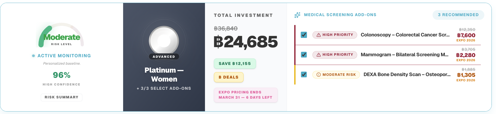
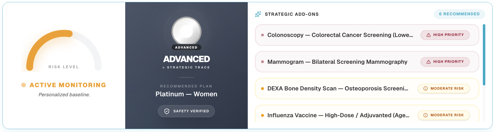
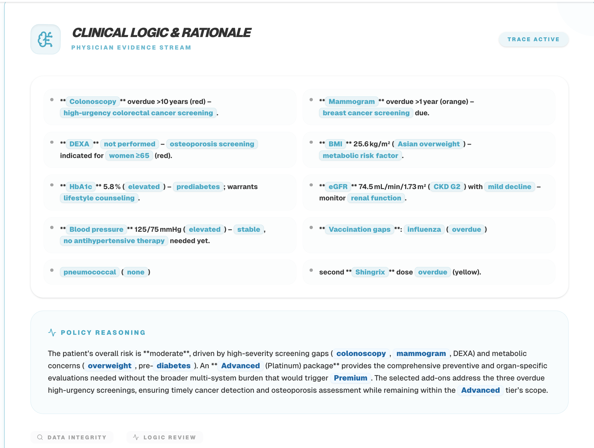
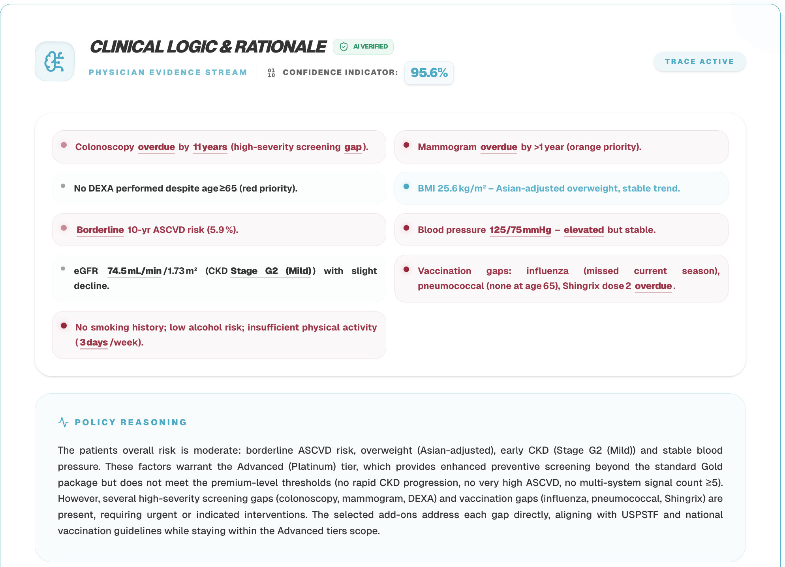
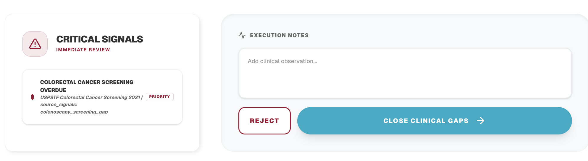
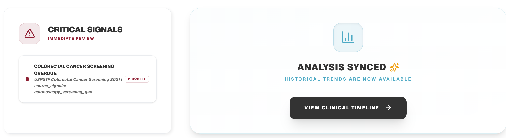
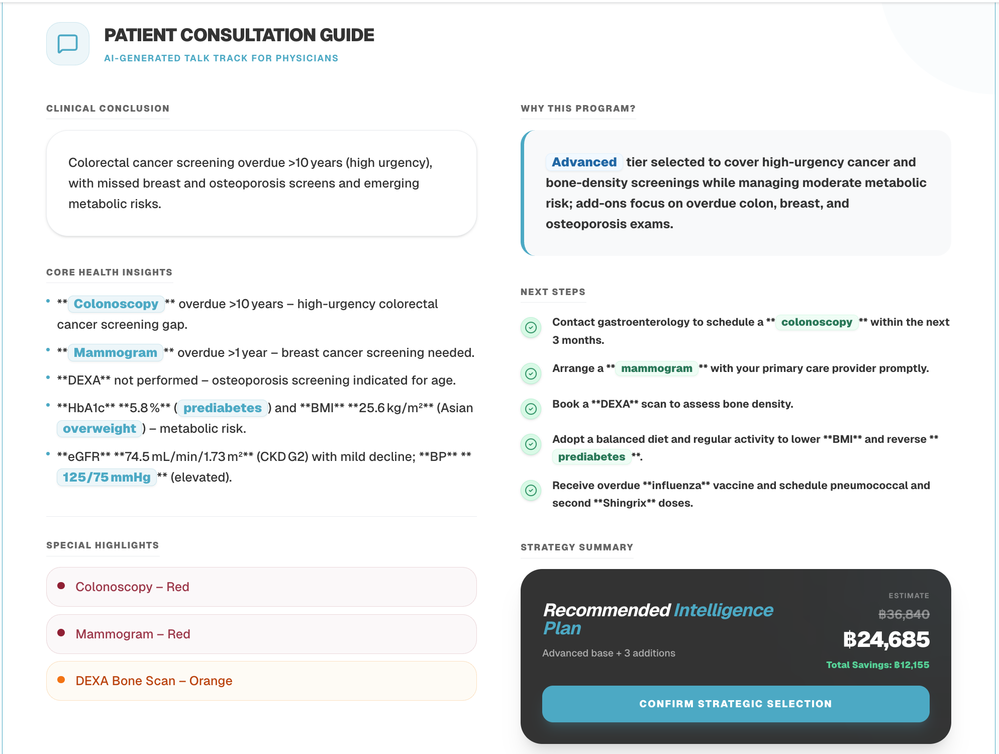
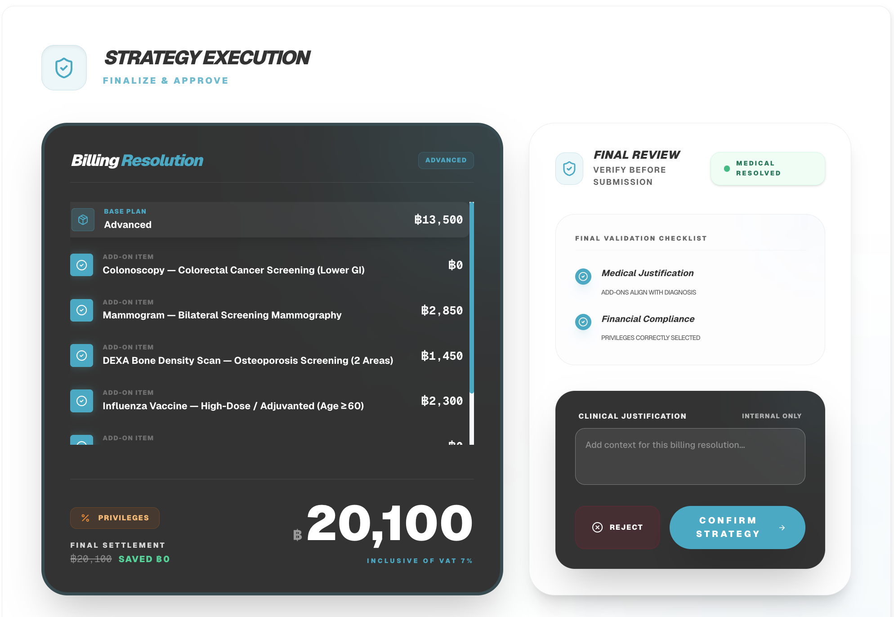

V4 UI is superior to V6 UI. Please investigate and migrate over.

I really hate the "Analysis Synced" pop-up in the lower-right corner. Please remove it.

The Summary cards:
V6: 
V4: 
I like the risk-o-meter in V6, so keep that. But for the rest, I like the simplicity of V4 UI.
I want to cherry pick the risk-o-meter from V6, and the strategic tier & plan card and the add-ons from V4. Do rename it from "Strategic Add-ons" to "Medical Screening Add-ons"

The Clinical Logics card:
V6: 
V4: 
I like how V4 has the "Transparency Metric" Toast & "Confidence Indicator" number

The Signal section:
V6: 
V4: 
The UI from V4 is simply superior here. The clinical timeline placement is on point. Please migrate over.

Patient Consultation:
V6: 
V4: Mostly same as V6, except that it removes the strategy execution from the section to be its own section. I like this better.

Strategy Execution:
V6: None
V4: 
I like this section. Clearly, V4 concentrate the pricing, promotion, and call-to-action into this one section. Please add it to V6.