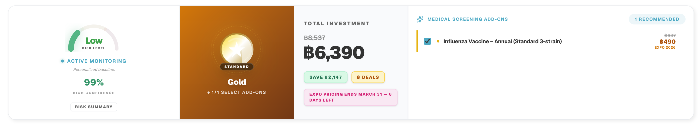
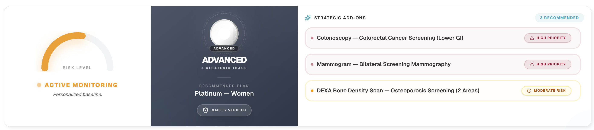
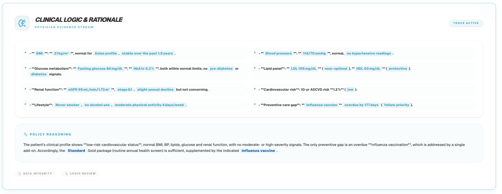
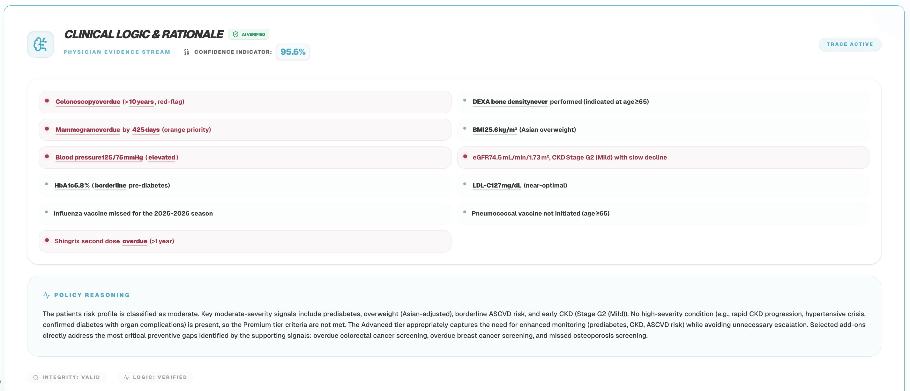
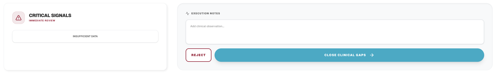
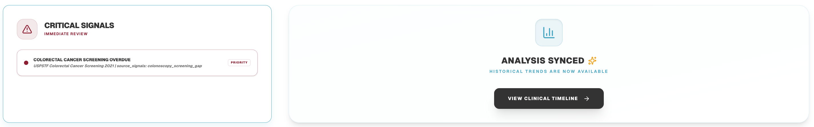
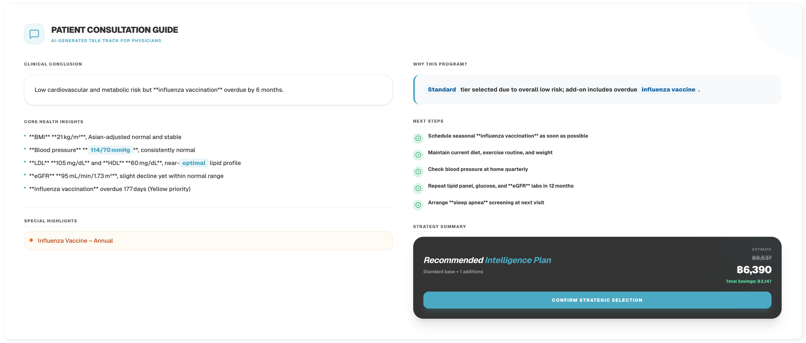
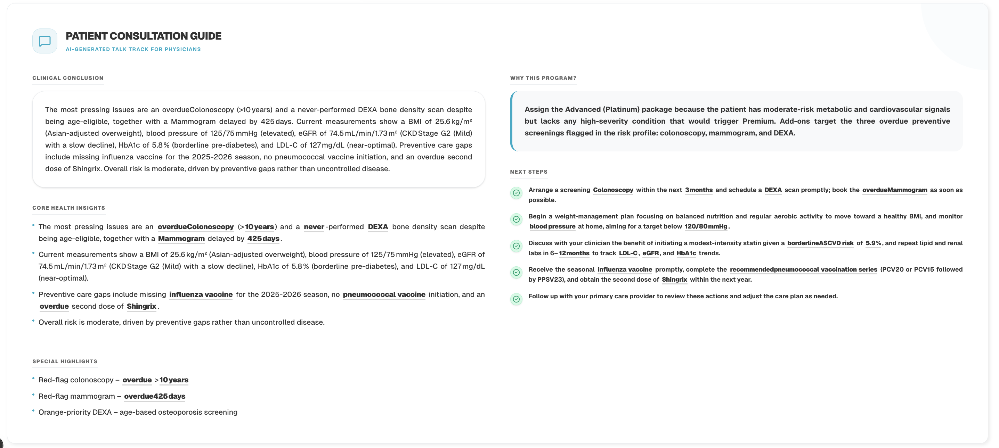

V4 UI is superior to V6 UI. Please investigate and migrate over.

The Summary cards:
V6: 
V4: 

The Clinical Logics card:
V6: 
V4: 

The Signal section:
V6: 
V4: 

Patient Consultation:
V6: 
V4: 