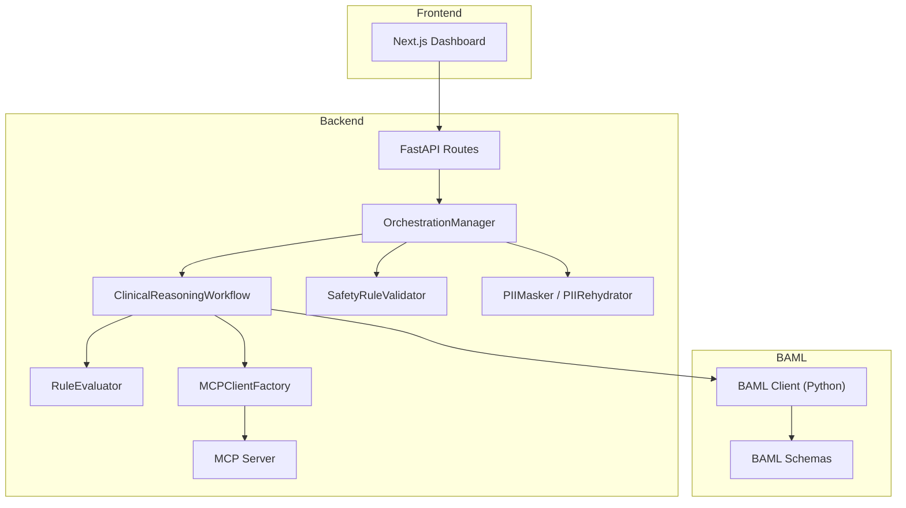
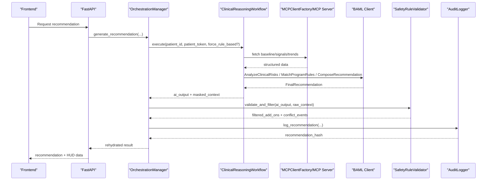
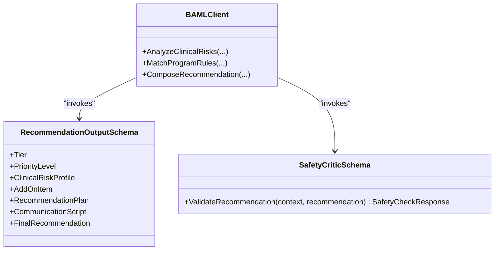
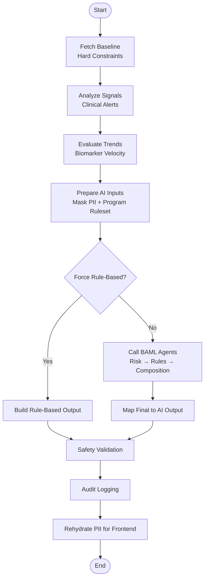
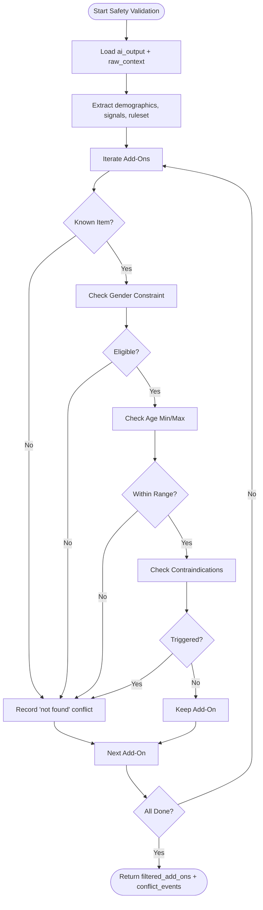
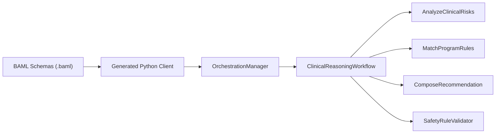
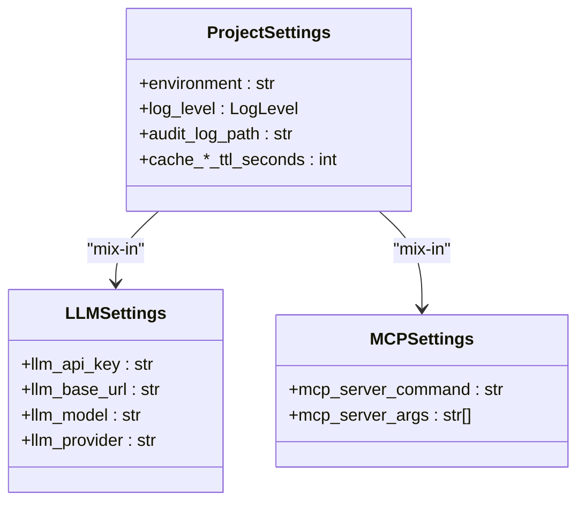
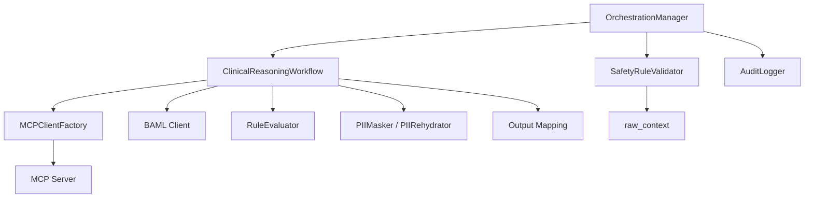

# AI Processing System

<cite>
**Referenced Files in This Document**
- [README.md](file://README.md)
- [backend/src/services/orchestrator.py](file://backend/src/services/orchestrator.py)
- [backend/src/services/workflows/clinical.py](file://backend/src/services/workflows/clinical.py)
- [backend/src/services/safety.py](file://backend/src/services/safety.py)
- [backend/src/services/rules.py](file://backend/src/services/rules.py)
- [backend/src/services/privacy.py](file://backend/src/services/privacy.py)
- [backend/src/services/mcp_client.py](file://backend/src/services/mcp_client.py)
- [backend/src/mcp_server/server.py](file://backend/src/mcp_server/server.py)
- [backend/src/mcp_server/tools/program_ruleset.py](file://backend/src/mcp_server/tools/program_ruleset.py)
- [shared/settings.py](file://shared/settings.py)
- [baml_client/__init__.py](file://baml_client/__init__.py)
- [baml_client/config.py](file://baml_client/config.py)
- [baml_src/clients.baml](file://baml_src/clients.baml)
- [baml_src/clinical/recommendation_output.baml](file://baml_src/clinical/recommendation_output.baml)
- [baml_src/clinical/safety_critic.baml](file://baml_src/clinical/safety_critic.baml)
</cite>

## Table of Contents
1. [Introduction](#introduction)
2. [Project Structure](#project-structure)
3. [Core Components](#core-components)
4. [Architecture Overview](#architecture-overview)
5. [Detailed Component Analysis](#detailed-component-analysis)
6. [Dependency Analysis](#dependency-analysis)
7. [Performance Considerations](#performance-considerations)
8. [Troubleshooting Guide](#troubleshooting-guide)
9. [Conclusion](#conclusion)
10. [Appendices](#appendices)

## Introduction
This document explains the AI processing system powering Navavej ROC’s Recommendation & Orchestration Center. It covers the BAML (Boundary ML) integration, including client configuration and prompt templates, the 5-phase clinical reasoning loop, the deterministic safety validation system, and the orchestration layer that coordinates AI and rule-based fallbacks. It also documents configuration options for LLM providers, performance optimization strategies, error handling, and graceful degradation when AI processing fails.

## Project Structure
The system is organized into:
- Backend orchestration and services (FastAPI, MCP, privacy, safety, rules)
- BAML schemas and auto-generated Python client
- MCP server with tools for clinical data retrieval
- Shared settings and environment configuration
- Frontend dashboard for visualization and governance

**Diagram sources**
- [backend/src/services/orchestrator.py:17-124](file://backend/src/services/orchestrator.py#L17-L124)
- [backend/src/services/workflows/clinical.py:17-257](file://backend/src/services/workflows/clinical.py#L17-L257)
- [backend/src/services/safety.py:3-89](file://backend/src/services/safety.py#L3-L89)
- [backend/src/services/rules.py:10-90](file://backend/src/services/rules.py#L10-L90)
- [backend/src/services/privacy.py:22-94](file://backend/src/services/privacy.py#L22-L94)
- [backend/src/services/mcp_client.py:14-36](file://backend/src/services/mcp_client.py#L14-L36)
- [backend/src/mcp_server/server.py:1-23](file://backend/src/mcp_server/server.py#L1-L23)
- [baml_client/__init__.py:15-60](file://baml_client/__init__.py#L15-L60)
- [baml_src/clinical/recommendation_output.baml:1-161](file://baml_src/clinical/recommendation_output.baml#L1-L161)

**Section sources**
- [README.md:76-95](file://README.md#L76-L95)
- [backend/src/services/orchestrator.py:17-124](file://backend/src/services/orchestrator.py#L17-L124)
- [backend/src/services/workflows/clinical.py:17-257](file://backend/src/services/workflows/clinical.py#L17-L257)

## Core Components
- OrchestrationManager: Coordinates workflow execution, safety validation, and audit logging; handles fallback to rule-based mode when AI fails.
- ClinicalReasoningWorkflow: Implements the 5-phase reasoning loop, integrates MCP tools, masks PII, calls BAML agents, and maps outputs to AI recommendation format.
- SafetyRuleValidator: Post-AI deterministic safety checks to filter add-ons based on gender/age constraints and contraindications.
- RuleEvaluator: Deterministic engine that selects a preliminary tier and signals matched according to configured rules.
- PIIMasker and PIIRehydrator: Pseudonymization of sensitive data before AI processing and restoration for frontend display.
- MCPClientFactory and MCP Server: Provides structured tooling for retrieving hard constraints, clinical signals, trends, and program rulesets.
- BAML Client and Schemas: Auto-generated Python client and prompt templates for 3-agent reasoning pipeline and safety critic.

**Section sources**
- [backend/src/services/orchestrator.py:17-124](file://backend/src/services/orchestrator.py#L17-L124)
- [backend/src/services/workflows/clinical.py:17-257](file://backend/src/services/workflows/clinical.py#L17-L257)
- [backend/src/services/safety.py:3-89](file://backend/src/services/safety.py#L3-L89)
- [backend/src/services/rules.py:10-90](file://backend/src/services/rules.py#L10-L90)
- [backend/src/services/privacy.py:22-94](file://backend/src/services/privacy.py#L22-L94)
- [backend/src/services/mcp_client.py:14-36](file://backend/src/services/mcp_client.py#L14-L36)
- [backend/src/mcp_server/server.py:1-23](file://backend/src/mcp_server/server.py#L1-L23)
- [baml_client/__init__.py:15-60](file://baml_client/__init__.py#L15-L60)
- [baml_src/clinical/recommendation_output.baml:1-161](file://baml_src/clinical/recommendation_output.baml#L1-L161)

## Architecture Overview
The system integrates three pillars:
- BAML 3-agent reasoning: risk analysis → policy matching → communication composition
- MCP tooling: structured retrieval of hard constraints, signals, trends, and program rulesets
- Deterministic safety and rules: post-processing filters and fallback logic

**Diagram sources**
- [backend/src/services/orchestrator.py:31-124](file://backend/src/services/orchestrator.py#L31-L124)
- [backend/src/services/workflows/clinical.py:33-153](file://backend/src/services/workflows/clinical.py#L33-L153)
- [backend/src/services/safety.py:6-58](file://backend/src/services/safety.py#L6-L58)
- [backend/src/mcp_server/server.py:11-22](file://backend/src/mcp_server/server.py#L11-L22)
- [baml_src/clinical/recommendation_output.baml:29-160](file://baml_src/clinical/recommendation_output.baml#L29-L160)

## Detailed Component Analysis

### BAML Integration and Prompt Templates
- Client configuration: The BAML client is configured via a generic OpenAI-compatible provider to support local or cloud LLMs. Environment variables define base URL, API key, and model name.
- Agents:
  - AnalyzeClinicalRisks: synthesizes risk profile, tier suggestion, and supporting signal IDs from masked inputs.
  - MatchProgramRules: maps risk profile to a final tier and selected add-ons using the program ruleset.
  - ComposeRecommendation: produces a communication script for the final recommendation.
- Safety critic: Validates AI recommendations against raw context and recommendation content to detect contradictions and omissions.

**Diagram sources**
- [baml_src/clients.baml:5-12](file://baml_src/clients.baml#L5-L12)
- [baml_src/clinical/recommendation_output.baml:1-161](file://baml_src/clinical/recommendation_output.baml#L1-L161)
- [baml_src/clinical/safety_critic.baml:3-23](file://baml_src/clinical/safety_critic.baml#L3-L23)

**Section sources**
- [baml_src/clients.baml:1-13](file://baml_src/clients.baml#L1-L13)
- [baml_src/clinical/recommendation_output.baml:29-160](file://baml_src/clinical/recommendation_output.baml#L29-L160)
- [baml_src/clinical/safety_critic.baml:3-23](file://baml_src/clinical/safety_critic.baml#L3-L23)
- [baml_client/__init__.py:15-60](file://baml_client/__init__.py#L15-L60)
- [baml_client/config.py:27-102](file://baml_client/config.py#L27-L102)

### 5-Phase Clinical Reasoning Loop
The workflow executes a deterministic sequence of data gathering, masking, AI reasoning, and output mapping, with robust fallback to rule-based logic.

**Diagram sources**
- [backend/src/services/workflows/clinical.py:33-153](file://backend/src/services/workflows/clinical.py#L33-L153)
- [backend/src/services/safety.py:6-58](file://backend/src/services/safety.py#L6-L58)
- [backend/src/services/privacy.py:44-57](file://backend/src/services/privacy.py#L44-L57)

**Section sources**
- [backend/src/services/workflows/clinical.py:67-153](file://backend/src/services/workflows/clinical.py#L67-L153)

### Safety Validation System
The safety validator performs deterministic checks after AI generation:
- Filters add-ons based on gender/age constraints and active contraindication signals.
- Produces conflict events for removed items to inform auditing and transparency.
- Ensures recommendations meet institutional safety criteria before exposure.

**Diagram sources**
- [backend/src/services/safety.py:6-89](file://backend/src/services/safety.py#L6-L89)

**Section sources**
- [backend/src/services/safety.py:6-89](file://backend/src/services/safety.py#L6-L89)

### Relationship Between BAML Schemas, Generated Client, and Orchestration
- BAML schemas define typed prompts and agent functions; the generated Python client exposes synchronous entrypoints for invoking these agents.
- The orchestration layer composes MCP-provided context with BAML agent outputs and applies deterministic post-processing.
- The client configuration supports OpenAI-compatible providers and environment-driven settings.

**Diagram sources**
- [baml_src/clinical/recommendation_output.baml:29-160](file://baml_src/clinical/recommendation_output.baml#L29-L160)
- [baml_client/__init__.py:42-44](file://baml_client/__init__.py#L42-L44)
- [backend/src/services/orchestrator.py:31-124](file://backend/src/services/orchestrator.py#L31-L124)
- [backend/src/services/workflows/clinical.py:124-145](file://backend/src/services/workflows/clinical.py#L124-L145)

**Section sources**
- [baml_client/__init__.py:15-60](file://baml_client/__init__.py#L15-L60)
- [baml_client/config.py:27-102](file://baml_client/config.py#L27-L102)
- [baml_src/clients.baml:5-12](file://baml_src/clients.baml#L5-L12)
- [backend/src/services/workflows/clinical.py:124-145](file://backend/src/services/workflows/clinical.py#L124-L145)

### Practical Examples: AI Reasoning Traces and Decision-Making
- Risk Analyzer: Summarizes primary risks, severity, tier suggestion, and supporting signal IDs.
- Policy Resolver: Selects add-ons with priorities and rationales aligned to the ruleset and risk profile.
- Communicator: Produces a concise health summary, rationale, highlights, and next steps.
- Fallback: When AI fails, the system builds a rule-based output indicating the applied rule and matched signals, marking review as required.

These behaviors are implemented in the workflow’s mapping and fallback logic.

**Section sources**
- [backend/src/services/workflows/clinical.py:160-246](file://backend/src/services/workflows/clinical.py#L160-L246)

### Configuration Options for LLM Providers and Model Parameters
- Provider configuration: The BAML client uses an OpenAI-compatible provider with environment variables for base URL, API key, and model.
- Project settings: Centralized settings include LLM provider, base URL, model, MCP server command/args, audit log path, and caching TTLs.

**Diagram sources**
- [shared/settings.py:29-67](file://shared/settings.py#L29-L67)

**Section sources**
- [baml_src/clients.baml:5-12](file://baml_src/clients.baml#L5-L12)
- [shared/settings.py:29-67](file://shared/settings.py#L29-L67)

## Dependency Analysis
Key dependencies and interactions:
- OrchestrationManager depends on Workflow, SafetyRuleValidator, AuditLogger, and MCPClientFactory.
- Workflow depends on MCP tools, BAML client, RuleEvaluator, and privacy helpers.
- MCPClientFactory spawns the MCP server process and manages session lifecycle.
- SafetyRuleValidator depends on raw context and ruleset metadata.
- BAML client depends on BAML schemas and environment configuration.

**Diagram sources**
- [backend/src/services/orchestrator.py:17-124](file://backend/src/services/orchestrator.py#L17-L124)
- [backend/src/services/workflows/clinical.py:17-257](file://backend/src/services/workflows/clinical.py#L17-L257)
- [backend/src/services/mcp_client.py:14-36](file://backend/src/services/mcp_client.py#L14-L36)
- [backend/src/mcp_server/server.py:1-23](file://backend/src/mcp_server/server.py#L1-L23)
- [backend/src/services/safety.py:6-58](file://backend/src/services/safety.py#L6-L58)

**Section sources**
- [backend/src/services/orchestrator.py:17-124](file://backend/src/services/orchestrator.py#L17-L124)
- [backend/src/services/workflows/clinical.py:17-257](file://backend/src/services/workflows/clinical.py#L17-L257)
- [backend/src/services/mcp_client.py:14-36](file://backend/src/services/mcp_client.py#L14-L36)
- [backend/src/mcp_server/server.py:1-23](file://backend/src/mcp_server/server.py#L1-L23)
- [backend/src/services/safety.py:6-58](file://backend/src/services/safety.py#L6-L58)

## Performance Considerations
- Caching: Project settings expose cache TTLs for registry, ruleset, signal store, and recommendations to reduce repeated MCP calls and improve latency.
- Asynchronous MCP: Session lifecycle is managed asynchronously to avoid blocking and enable streaming-like behavior.
- Minimal AI payload: PII masking reduces token usage and improves throughput.
- Fail-fast with fallback: When AI fails, deterministic rule-based output ensures continuity and predictable performance.

[No sources needed since this section provides general guidance]

## Troubleshooting Guide
Common failure modes and remedies:
- Empty MCP tool responses: The workflow raises a data integrity error when tool content is missing; verify MCP server health and tool registration.
- AI chain failures: The workflow catches exceptions and falls back to rule-based output; inspect logs for the exception and review rule configuration.
- Safety validator removes add-ons: Conflicts are logged with event types and reasons; adjust rules or patient demographics accordingly.
- Privacy leakage: Ensure masking is applied before sending to LLM; rehydration occurs only in the orchestration layer for frontend display.

**Section sources**
- [backend/src/services/workflows/clinical.py:248-257](file://backend/src/services/workflows/clinical.py#L248-L257)
- [backend/src/services/workflows/clinical.py:146-152](file://backend/src/services/workflows/clinical.py#L146-L152)
- [backend/src/services/safety.py:25-58](file://backend/src/services/safety.py#L25-L58)
- [backend/src/services/privacy.py:44-57](file://backend/src/services/privacy.py#L44-L57)

## Conclusion
Navavej ROC’s AI processing system combines structured BAML prompts with deterministic safety and rule-based fallbacks. The 5-phase reasoning loop integrates MCP tooling, privacy-preserving masking, and robust auditing. With configurable LLM providers and strong error handling, the system balances explainability, safety, and performance.

[No sources needed since this section summarizes without analyzing specific files]

## Appendices

### Appendix A: MCP Tool Contracts
- get_program_ruleset: Returns tier rules, add-on library, package resolution map, and resolved package for the patient.
- Other tools (get_hard_constraints, get_clinical_signals, get_biomarker_trends, get_patient_event_timeline) supply structured inputs to the workflow.

**Section sources**
- [backend/src/mcp_server/tools/program_ruleset.py:20-115](file://backend/src/mcp_server/tools/program_ruleset.py#L20-L115)
- [backend/src/mcp_server/server.py:14-19](file://backend/src/mcp_server/server.py#L14-L19)

### Appendix B: Audit Trail and Governance
- The audit logger records recommendation hashes, safety conflicts, and request metadata for immutable governance.
- The frontend receives rehydrated outputs with security metadata for transparency and traceability.

**Section sources**
- [backend/src/services/orchestrator.py:85-124](file://backend/src/services/orchestrator.py#L85-L124)
- [backend/src/services/privacy.py:60-94](file://backend/src/services/privacy.py#L60-L94)