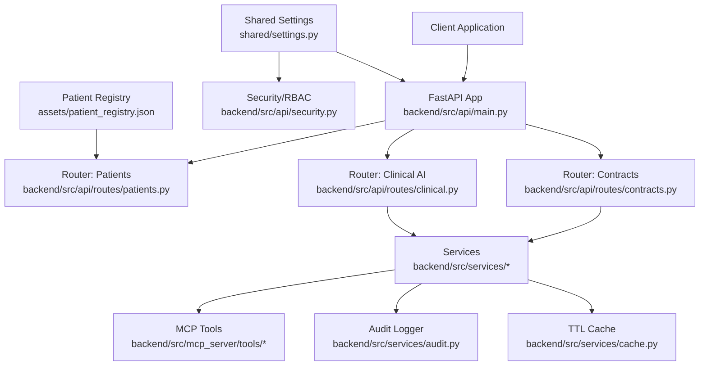
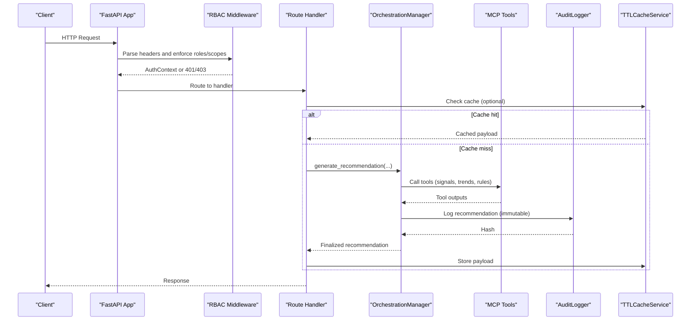
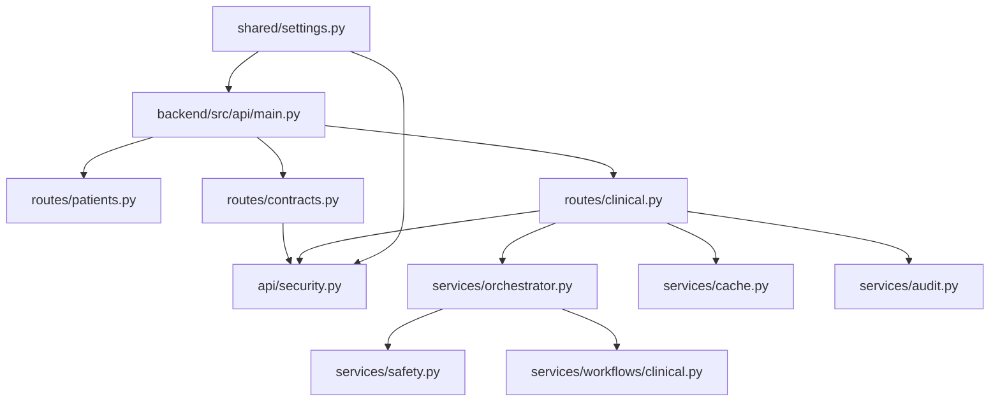

# Backend API Documentation

<cite>
**Referenced Files in This Document**
- [main.py](file://backend/src/api/main.py)
- [clinical.py](file://backend/src/api/routes/clinical.py)
- [patients.py](file://backend/src/api/routes/patients.py)
- [contracts.py](file://backend/src/api/routes/contracts.py)
- [security.py](file://backend/src/api/security.py)
- [settings.py](file://shared/settings.py)
- [orchestrator.py](file://backend/src/services/orchestrator.py)
- [cache.py](file://backend/src/services/cache.py)
- [audit.py](file://backend/src/services/audit.py)
- [workflows/clinical.py](file://backend/src/services/workflows/clinical.py)
- [safety.py](file://backend/src/services/safety.py)
- [patient_registry.json](file://assets/patient_registry.json)
- [test_api.py](file://scripts/test_api.py)
</cite>

## Table of Contents
1. [Introduction](#introduction)
2. [Project Structure](#project-structure)
3. [Core Components](#core-components)
4. [Architecture Overview](#architecture-overview)
5. [Detailed Component Analysis](#detailed-component-analysis)
6. [Dependency Analysis](#dependency-analysis)
7. [Performance Considerations](#performance-considerations)
8. [Troubleshooting Guide](#troubleshooting-guide)
9. [Conclusion](#conclusion)
10. [Appendices](#appendices)

## Introduction
This document describes the Navavej ROC backend API, covering both legacy clinical endpoints under /api/v1/clinical/ and the new contract-oriented endpoints under /api/. It explains HTTP methods, URL patterns, request/response schemas, authentication, authorization, security model, caching, audit logging, and operational guidance for API consumers.

## Project Structure
The API is implemented with FastAPI and organized by feature routes:
- Legacy clinical endpoints: /api/v1/clinical/*
- Contract-oriented endpoints: /api/*
- Patient management endpoints: /api/v1/patients/*
- Security middleware and RBAC: /backend/src/api/security.py
- Orchestrator and services: /backend/src/services/*
- Shared settings: /shared/settings.py
- Assets (patient registry): /assets/patient_registry.json

**Diagram sources**
- [main.py:29-32](file://backend/src/api/main.py#L29-L32)
- [patients.py:11-11](file://backend/src/api/routes/patients.py#L11-L11)
- [clinical.py:12-13](file://backend/src/api/routes/clinical.py#L12-L13)
- [contracts.py:22-23](file://backend/src/api/routes/contracts.py#L22-L23)
- [security.py:9-14](file://backend/src/api/security.py#L9-L14)
- [settings.py:45-69](file://shared/settings.py#L45-L69)
- [audit.py:14-24](file://backend/src/services/audit.py#L14-L24)
- [cache.py:13-45](file://backend/src/services/cache.py#L13-L45)
- [patient_registry.json:1-117](file://assets/patient_registry.json#L1-L117)

**Section sources**
- [main.py:29-38](file://backend/src/api/main.py#L29-L38)

## Core Components
- Authentication and RBAC: Implemented via headers X-Auth-User-Id, X-Auth-Role, X-Auth-Scopes and role/scopes gating.
- Authorization: Per-endpoint access control using require_access with allowed roles and required scopes.
- Caching: TTL-based cache for patient registry and recommendations.
- Audit logging: Immutable audit trail with SHA-256 chaining for clinical decisions.
- Orchestration: End-to-end workflow coordinating MCP tools, AI reasoning, safety validation, and PII rehydration.

**Section sources**
- [security.py:26-57](file://backend/src/api/security.py#L26-L57)
- [settings.py:53-66](file://shared/settings.py#L53-L66)
- [cache.py:13-45](file://backend/src/services/cache.py#L13-L45)
- [audit.py:14-121](file://backend/src/services/audit.py#L14-L121)
- [orchestrator.py:17-124](file://backend/src/services/orchestrator.py#L17-L124)

## Architecture Overview
The API exposes two major surface areas:
- Legacy clinical endpoints: recommendation generation, decision recording, and audit retrieval.
- Contract-oriented endpoints: recommendation, timeline, biomarker trends, screening gaps, monitoring snapshot, audit logs, anomaly alerts, RBAC, mapping codes, and master programs.

**Diagram sources**
- [main.py:29-32](file://backend/src/api/main.py#L29-L32)
- [security.py:26-57](file://backend/src/api/security.py#L26-L57)
- [contracts.py:584-660](file://backend/src/api/routes/contracts.py#L584-L660)
- [orchestrator.py:31-124](file://backend/src/services/orchestrator.py#L31-L124)
- [audit.py:55-121](file://backend/src/services/audit.py#L55-L121)
- [cache.py:18-33](file://backend/src/services/cache.py#L18-L33)

## Detailed Component Analysis

### Legacy Clinical Endpoints (/api/v1/clinical/)
- Base URL: /api/v1/clinical
- Authentication: Requires role membership and required scopes configured in settings.

Endpoints:
- POST /recommend
  - Purpose: Trigger AI reasoning for a specific patient.
  - Authentication: require_access with recommendation roles/scopes.
  - Request body:
    - patient_id: string (required)
  - Response: Contract-oriented recommendation payload (see /api/recommend response schema).
  - Errors: 404 if patient not found or token missing; 500 on orchestration failure.
  - Notes: PII rehydration adds patient_name to the result.

- POST /approve
  - Purpose: Record physician’s approval/rejection decision.
  - Authentication: require_access with recommendation roles/scopes.
  - Request body:
    - patient_id: string (required)
    - recommendation_hash: string (required)
    - decision: "Approve" or "Reject" (required)
    - physician_id: string (optional, defaults present)
    - notes: string (optional)
  - Response: { status, decision_hash, patient_id, decision }.
  - Errors: 500 on logging failure.

- GET /audit
  - Purpose: Retrieve all clinical decision logs.
  - Authentication: require_access with recommendation roles/scopes.
  - Response: List of audit entries.
  - Errors: 500 on read failure.

Validation and error handling:
- Missing patient or token yields 404.
- Exceptions during orchestration yield 500.

**Section sources**
- [clinical.py:19-48](file://backend/src/api/routes/clinical.py#L19-L48)
- [clinical.py:50-73](file://backend/src/api/routes/clinical.py#L50-L73)
- [clinical.py:74-81](file://backend/src/api/routes/clinical.py#L74-L81)
- [orchestrator.py:126-150](file://backend/src/services/orchestrator.py#L126-L150)
- [audit.py:163-172](file://backend/src/services/audit.py#L163-L172)

### Contract-Oriented Endpoints (/api/)
- Base URL: /api
- Authentication: Header-based RBAC enforced per endpoint.

Endpoints:
- POST /recommend
  - Purpose: Generate a recommendation for a patient identified by patient_token.
  - Authentication: require_access with recommendation roles/scopes.
  - Request body:
    - patient_token: string (required)
    - force_rule_based: boolean (optional, default false)
  - Response schema (RecommendResponse):
    - ai_recommended_tier: string
    - tier_deviation_justification: string or null
    - add_ons: array of objects with item_code, item_id, priority, rationale, label, product_code, price_thb, category, navavej_product, trigger_signals_matched
    - reasoning_trace: string
    - supporting_signals: array of strings
    - missing_signals: array of strings
    - communication_script: object with opening, health_summary, recommendation_explanation, add_on_highlights, next_steps
    - rule_preliminary_tier: string
    - resolved_package: object with tier, package_name, package_code, price_thb, age_band, gender
    - confidence_score: number (float)
    - confidence_tier: string ("High" | "Medium" | "Low")
    - review_required: boolean
    - recommendation_source: string ("AI" | "RuleBased" | "AI_LowConfidence")
    - recommendation_hash: string or null
    - patient_high_alert: object with critical_signals and missing_data_alerts
    - security_metadata: object
    - metadata: object with request_id, patient_token, model_id, template_version, ruleset_version, signal_store_pipeline_run_id, generated_at, latency_ms
  - Errors: 404 if patient_token not found; 500 on orchestration failure.

- GET /timeline/{patient_token}
  - Purpose: Retrieve patient event timeline.
  - Authentication: require_access with recommendation roles/scopes.
  - Path parameter: patient_token (required)
  - Response schema (TimelineResponse):
    - patient_token: string
    - timeline_span: object
    - diagnoses: array
    - hospitalizations: array
    - significant_lab_events: array
    - screening_procedure_history: array
    - medication_changes: array
    - pipeline_run_id: string
    - computed_at: string

- GET /biomarker-trends/{patient_token}
  - Purpose: Retrieve biomarker trends.
  - Authentication: require_access with recommendation roles/scopes.
  - Path parameter: patient_token (required)
  - Response: Tool-specific payload.

- GET /screening-gaps/{patient_token}
  - Purpose: Retrieve screening gaps and vaccination gaps.
  - Authentication: require_access with recommendation roles/scopes.
  - Path parameter: patient_token (required)
  - Response: { patient_token, screening_gaps, vaccination_gaps, computed_at, pipeline_run_id }

- GET /monitoring-snapshot
  - Purpose: Retrieve monitoring metrics snapshot.
  - Authentication: require_access with monitoring roles/scopes.
  - Response schema (MonitoringSnapshotResponse):
    - snapshot_at: string
    - refresh_interval_seconds: integer
    - active_users_now: integer
    - sessions_today: integer
    - patient_records_accessed_today: integer
    - ai_recommendations_generated_today: integer
    - alert_counts: object with counts by severity
    - safety_validator_failures_today: integer
    - top_active_departments: array

- GET /audit-logs
  - Purpose: Retrieve audit logs with optional filters.
  - Authentication: require_access with monitoring roles/scopes.
  - Query parameters:
    - user_id: string (optional)
    - patient_token_prefix: string (optional)
    - action_type: string (optional)
    - resource_type: string (optional)
    - start_date: string (ISO 8601 UTC) (optional)
    - end_date: string (ISO 8601 UTC) (optional)
  - Response schema (AuditLogsResponse):
    - total: integer
    - entries: array

- GET /anomaly-alerts
  - Purpose: Retrieve anomaly alerts.
  - Authentication: require_access with monitoring roles/scopes.
  - Response schema (AnomalyAlertsResponse):
    - alerts: array

- GET /rbac
  - Purpose: Retrieve RBAC roles.
  - Authentication: require_access with monitoring roles/scopes.
  - Response schema (RbacResponse):
    - roles: array

- GET /mapping-codes
  - Purpose: Retrieve normalized mapping codes.
  - Authentication: require_access with monitoring roles/scopes.
  - Response schema (MappingCodesResponse):
    - mappings: array

- GET /master-programs
  - Purpose: Retrieve master programs.
  - Authentication: require_access with monitoring roles/scopes.
  - Response schema (MasterProgramsResponse):
    - programs: array

- Admin endpoints (GET /admin/*) mirror the above monitoring endpoints with identical signatures and behavior.

Notes:
- Recommendations support a rule-based fallback when AI fails or validation fails stage 1.
- Cache keys are derived from patient_token, pipeline_run_id, ruleset_version, force_rule_based, model_id, and auth mode.

**Section sources**
- [contracts.py:26-49](file://backend/src/api/routes/contracts.py#L26-L49)
- [contracts.py:51-61](file://backend/src/api/routes/contracts.py#L51-L61)
- [contracts.py:80-82](file://backend/src/api/routes/contracts.py#L80-L82)
- [contracts.py:92-94](file://backend/src/api/routes/contracts.py#L92-L94)
- [contracts.py:101-105](file://backend/src/api/routes/contracts.py#L101-L105)
- [contracts.py:584-660](file://backend/src/api/routes/contracts.py#L584-L660)
- [contracts.py:663-676](file://backend/src/api/routes/contracts.py#L663-L676)
- [contracts.py:679-689](file://backend/src/api/routes/contracts.py#L679-L689)
- [contracts.py:692-706](file://backend/src/api/routes/contracts.py#L692-L706)
- [contracts.py:709-727](file://backend/src/api/routes/contracts.py#L709-L727)
- [contracts.py:730-732](file://backend/src/api/routes/contracts.py#L730-L732)
- [contracts.py:735-737](file://backend/src/api/routes/contracts.py#L735-L737)
- [contracts.py:740-743](file://backend/src/api/routes/contracts.py#L740-L743)
- [contracts.py:746-748](file://backend/src/api/routes/contracts.py#L746-L748)
- [contracts.py:751-753](file://backend/src/api/routes/contracts.py#L751-L753)
- [contracts.py:756-774](file://backend/src/api/routes/contracts.py#L756-L774)
- [contracts.py:777-779](file://backend/src/api/routes/contracts.py#L777-L779)
- [contracts.py:782-784](file://backend/src/api/routes/contracts.py#L782-L784)
- [contracts.py:787-789](file://backend/src/api/routes/contracts.py#L787-L789)
- [contracts.py:792-794](file://backend/src/api/routes/contracts.py#L792-L794)

### Patient Management Endpoints (/api/v1/patients/)
- Base URL: /api/v1/patients
- Authentication: Not protected by RBAC in these handlers.

Endpoints:
- GET /
  - Purpose: List all registered patients with names and tokens.
  - Response: Array of patient records.
  - Errors: 500 on load failure.

- GET /{patient_id}
  - Purpose: Retrieve details for a specific patient.
  - Path parameter: patient_id (required)
  - Response: Patient record or 404 if not found.

Notes:
- Patient registry is loaded from assets/patient_registry.json with optional caching.

**Section sources**
- [patients.py:54-70](file://backend/src/api/routes/patients.py#L54-L70)
- [patient_registry.json:1-117](file://assets/patient_registry.json#L1-L117)

### Security Model and Access Control
- Authentication headers:
  - X-Auth-User-Id: string (required in enabled modes)
  - X-Auth-Role: string (required in enabled modes)
  - X-Auth-Scopes: comma-separated string (optional)
- Modes:
  - Disabled: Accepts default user/role/scopes from settings.
  - Enabled: Enforces presence of headers and validates role/scopes.
- RBAC enforcement:
  - require_access checks allowed roles and required scopes.
  - Roles and scopes are configured per endpoint group (recommendation vs monitoring).
- Allowed roles and scopes are configured in shared settings.

**Section sources**
- [security.py:26-57](file://backend/src/api/security.py#L26-L57)
- [settings.py:53-60](file://shared/settings.py#L53-L60)

### Request/Response Schemas

#### POST /api/v1/clinical/recommend
- Request: { patient_id: string }
- Response: Contract-oriented recommendation payload (see /api/recommend response schema)

#### POST /api/v1/clinical/approve
- Request: { patient_id: string, recommendation_hash: string, decision: "Approve"|"Reject", physician_id?: string, notes?: string }
- Response: { status: "success", decision_hash: string, patient_id: string, decision: string }

#### GET /api/v1/clinical/audit
- Response: Array of audit log entries

#### POST /api/recommend
- Request: { patient_token: string, force_rule_based?: boolean }
- Response: RecommendResponse (see above)

#### GET /api/timeline/{patient_token}
- Response: TimelineResponse (see above)

#### GET /api/biomarker-trends/{patient_token}
- Response: Tool-specific payload

#### GET /api/screening-gaps/{patient_token}
- Response: { patient_token, screening_gaps, vaccination_gaps, computed_at, pipeline_run_id }

#### GET /api/monitoring-snapshot
- Response: MonitoringSnapshotResponse (see above)

#### GET /api/audit-logs
- Query: user_id?, patient_token_prefix?, action_type?, resource_type?, start_date?, end_date?
- Response: AuditLogsResponse (see above)

#### GET /api/anomaly-alerts
- Response: AnomalyAlertsResponse (see above)

#### GET /api/rbac
- Response: RbacResponse (see above)

#### GET /api/mapping-codes
- Response: MappingCodesResponse (see above)

#### GET /api/master-programs
- Response: MasterProgramsResponse (see above)

**Section sources**
- [clinical.py:19-73](file://backend/src/api/routes/clinical.py#L19-L73)
- [contracts.py:26-794](file://backend/src/api/routes/contracts.py#L26-L794)

### Authentication and Authorization Examples
- Headers:
  - X-Auth-User-Id: "usr-clinician-123"
  - X-Auth-Role: "physician"
  - X-Auth-Scopes: "recommendation:read,recommendation:write"
- Endpoint examples:
  - POST /api/recommend with the above headers succeeds if role and scopes match.
  - GET /api/audit-logs requires monitoring role and scope.

**Section sources**
- [security.py:26-57](file://backend/src/api/security.py#L26-L57)
- [settings.py:57-60](file://shared/settings.py#L57-L60)

### Error Response Formats
- 401 Unauthorized: Missing authentication context when headers are required.
- 403 Forbidden: Access forbidden for role or missing required scope.
- 404 Not Found: Patient or patient_token not found.
- 500 Internal Server Error: Runtime errors during orchestration or logging.

**Section sources**
- [security.py:38-50](file://backend/src/api/security.py#L38-L50)
- [clinical.py:28-48](file://backend/src/api/routes/clinical.py#L28-L48)
- [contracts.py:102-105](file://backend/src/api/routes/contracts.py#L102-L105)

### API Versioning and Backwards Compatibility
- Version field is present in the FastAPI app metadata.
- Legacy endpoints remain under /api/v1/ for continuity.
- New contract-oriented endpoints under /api provide a cleaner, typed interface.

**Section sources**
- [main.py:14-18](file://backend/src/api/main.py#L14-L18)

### Rate Limiting Considerations
- No explicit rate limiting is implemented in the codebase.
- Recommendations are cached to reduce repeated compute workloads.

**Section sources**
- [cache.py:18-33](file://backend/src/services/cache.py#L18-L33)
- [contracts.py:603-615](file://backend/src/api/routes/contracts.py#L603-L615)

### Common Integration Scenarios
- Generate recommendation for a patient:
  - Use POST /api/recommend with patient_token.
  - Optionally set force_rule_based=true to bypass AI and use deterministic rules.
- Record a decision:
  - Use POST /api/v1/clinical/approve with recommendation_hash and decision.
- Retrieve timeline and trends:
  - Use GET /api/timeline/{patient_token} and GET /api/biomarker-trends/{patient_token}.
- Monitor system:
  - Use GET /api/monitoring-snapshot, GET /api/audit-logs, GET /api/anomaly-alerts, GET /api/rbac, GET /api/mapping-codes, GET /api/master-programs.

**Section sources**
- [contracts.py:584-660](file://backend/src/api/routes/contracts.py#L584-L660)
- [clinical.py:57-73](file://backend/src/api/routes/clinical.py#L57-L73)

## Dependency Analysis
Key dependencies and interactions:
- FastAPI app registers routers for patients, clinical, and contracts.
- Security module enforces RBAC via dependency injection.
- Orchestrator coordinates MCP tools, safety validation, audit logging, and PII rehydration.
- Cache service stores recommendations and registry data.
- Audit logger writes immutable audit trails.

**Diagram sources**
- [main.py:29-32](file://backend/src/api/main.py#L29-L32)
- [patients.py:11-11](file://backend/src/api/routes/patients.py#L11-L11)
- [clinical.py:12-13](file://backend/src/api/routes/clinical.py#L12-L13)
- [contracts.py:22-23](file://backend/src/api/routes/contracts.py#L22-L23)
- [security.py:9-14](file://backend/src/api/security.py#L9-L14)
- [orchestrator.py:17-30](file://backend/src/services/orchestrator.py#L17-L30)
- [safety.py:3-58](file://backend/src/services/safety.py#L3-L58)
- [workflows/clinical.py:17-65](file://backend/src/services/workflows/clinical.py#L17-L65)
- [audit.py:14-24](file://backend/src/services/audit.py#L14-L24)
- [cache.py:13-45](file://backend/src/services/cache.py#L13-L45)
- [settings.py:45-69](file://shared/settings.py#L45-L69)

**Section sources**
- [main.py:29-32](file://backend/src/api/main.py#L29-L32)
- [security.py:45-57](file://backend/src/api/security.py#L45-L57)
- [orchestrator.py:17-30](file://backend/src/services/orchestrator.py#L17-L30)

## Performance Considerations
- Caching:
  - Registry TTL: cache_registry_ttl_seconds
  - Recommendation TTL: cache_recommendation_ttl_seconds
  - Global TTL: cache_ttl_seconds
- Recommendation caching:
  - Keys include patient_token, pipeline_run_id, ruleset_version, force_rule_based, model_id, and auth mode.
  - On cache hit, metadata is refreshed with new request_id, timestamps, and cache status.
- Latency:
  - Metadata includes latency_ms captured during orchestration.

**Section sources**
- [settings.py:61-66](file://shared/settings.py#L61-L66)
- [contracts.py:561-581](file://backend/src/api/routes/contracts.py#L561-L581)
- [contracts.py:603-615](file://backend/src/api/routes/contracts.py#L603-L615)
- [contracts.py:648-657](file://backend/src/api/routes/contracts.py#L648-L657)
- [audit.py:96-100](file://backend/src/services/audit.py#L96-L100)

## Troubleshooting Guide
- Health check:
  - GET /health returns {"status":"healthy","version":"1.0.0"}.
- Authentication failures:
  - 401 Missing authentication context indicates missing headers when mode is enabled.
  - 403 Access forbidden indicates role or scope mismatch.
- Patient not found:
  - 404 when patient_id or patient_token is invalid in legacy or contract endpoints.
- Audit logs:
  - Use GET /api/audit-logs with filters to locate specific events.
  - Logs are persisted in JSONL and JSON formats for auditability.
- Recommendation fallback:
  - If primary AI path fails, the system retries with rule-based logic automatically.

**Section sources**
- [main.py:35-38](file://backend/src/api/main.py#L35-L38)
- [security.py:38-50](file://backend/src/api/security.py#L38-L50)
- [clinical.py:28-48](file://backend/src/api/routes/clinical.py#L28-L48)
- [contracts.py:102-105](file://backend/src/api/routes/contracts.py#L102-L105)
- [audit.py:163-172](file://backend/src/services/audit.py#L163-L172)
- [test_api.py:4-7](file://scripts/test_api.py#L4-L7)

## Conclusion
The Navavej ROC backend provides a robust, auditable, and secure API surface for clinical recommendations and patient insights. Legacy endpoints under /api/v1/clinical/ coexist with a modern contract-oriented API under /api/, enabling gradual migration. Strong RBAC, caching, deterministic safety validation, and immutable audit logging form the backbone of the system.

## Appendices

### Appendix A: Endpoint Reference Summary
- Legacy:
  - POST /api/v1/clinical/recommend
  - POST /api/v1/clinical/approve
  - GET /api/v1/clinical/audit
- Contract:
  - POST /api/recommend
  - GET /api/timeline/{patient_token}
  - GET /api/biomarker-trends/{patient_token}
  - GET /api/screening-gaps/{patient_token}
  - GET /api/monitoring-snapshot
  - GET /api/audit-logs
  - GET /api/anomaly-alerts
  - GET /api/rbac
  - GET /api/mapping-codes
  - GET /api/master-programs
  - Admin variants under /api/admin/*

**Section sources**
- [clinical.py:22-81](file://backend/src/api/routes/clinical.py#L22-L81)
- [contracts.py:584-794](file://backend/src/api/routes/contracts.py#L584-L794)

### Appendix B: RBAC Configuration
- Recommendation access:
  - Allowed roles: physician, nurse, pharmacist, admin, dpo
  - Required scopes: recommendation:read
- Monitoring access:
  - Allowed roles: admin, dpo
  - Required scopes: monitoring:read

**Section sources**
- [settings.py:57-60](file://shared/settings.py#L57-L60)