# Data Management

<cite>
**Referenced Files in This Document**
- [README.md](file://README.md)
- [backend/src/api/main.py](file://backend/src/api/main.py)
- [backend/src/mcp_server/server.py](file://backend/src/mcp_server/server.py)
- [backend/src/mcp_server/tools/biomarker_trends.py](file://backend/src/mcp_server/tools/biomarker_trends.py)
- [backend/src/mcp_server/tools/clinical_signals.py](file://backend/src/mcp_server/tools/clinical_signals.py)
- [backend/src/mcp_server/tools/hard_constraints.py](file://backend/src/mcp_server/tools/hard_constraints.py)
- [backend/src/mcp_server/tools/patient_event_timeline.py](file://backend/src/mcp_server/tools/patient_event_timeline.py)
- [backend/src/mcp_server/tools/program_ruleset.py](file://backend/src/mcp_server/tools/program_ruleset.py)
- [backend/src/mcp_server/utils.py](file://backend/src/mcp_server/utils.py)
- [backend/src/services/orchestrator.py](file://backend/src/services/orchestrator.py)
- [backend/src/services/privacy.py](file://backend/src/services/privacy.py)
- [backend/src/services/audit.py](file://backend/src/services/audit.py)
- [shared/settings.py](file://shared/settings.py)
- [assets/patient_registry.json](file://assets/patient_registry.json)
- [logs/audit.jsonl](file://logs/audit.jsonl)
</cite>

## Table of Contents
1. [Introduction](#introduction)
2. [Project Structure](#project-structure)
3. [Core Components](#core-components)
4. [Architecture Overview](#architecture-overview)
5. [Detailed Component Analysis](#detailed-component-analysis)
6. [Dependency Analysis](#dependency-analysis)
7. [Performance Considerations](#performance-considerations)
8. [Troubleshooting Guide](#troubleshooting-guide)
9. [Conclusion](#conclusion)
10. [Appendices](#appendices)

## Introduction
This document provides comprehensive data model documentation for the Navavej ROC data management system. It covers the signal store system, clinical signal processing, biomarker trend analysis, risk assessment logic, patient registry structure, HMAC tokenization and identity management, privacy and pseudonymization mechanisms, MCP protocol implementation for clinical data tools, validation rules and safety logic, and data lifecycle management. It also includes examples of signal processing workflows and trend analysis algorithms, along with security, privacy, and access control patterns across the data pipeline.

## Project Structure
The system is organized into backend services, MCP tools, a signal store (assets), and governance/logging artifacts:
- Backend API: FastAPI entrypoints and orchestration
- MCP Server: Tools exposing clinical data to AI agents
- Signal Store: JSON records under assets/synthesis/generated
- Patient Registry: Canonical mapping of patient identifiers to HMAC tokens
- Audit Logs: Immutable ledger of decisions and actions
- Shared Settings: Global configuration for caching, tokens, and roles

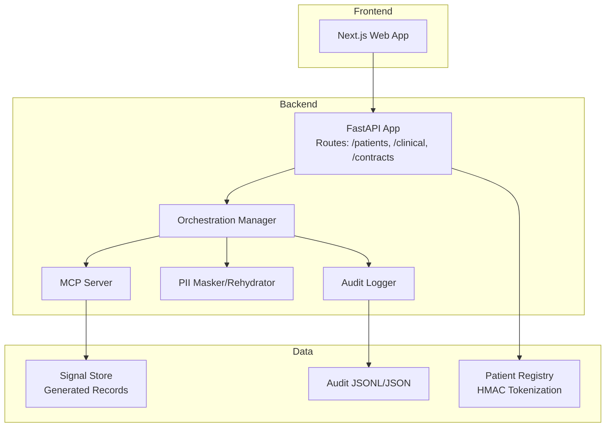

**Diagram sources**
- [backend/src/api/main.py:14-32](file://backend/src/api/main.py#L14-L32)
- [backend/src/services/orchestrator.py:17-124](file://backend/src/services/orchestrator.py#L17-L124)
- [backend/src/mcp_server/server.py:12-19](file://backend/src/mcp_server/server.py#L12-L19)
- [backend/src/mcp_server/utils.py:23-55](file://backend/src/mcp_server/utils.py#L23-L55)
- [assets/patient_registry.json:1-117](file://assets/patient_registry.json#L1-L117)
- [logs/audit.jsonl](file://logs/audit.jsonl)

**Section sources**
- [README.md:76-86](file://README.md#L76-L86)
- [backend/src/api/main.py:14-32](file://backend/src/api/main.py#L14-L32)

## Core Components
- Signal Store: JSON database of synthetic patient records containing hard constraints, clinical signals, and biomarker trends. Loaded by MCP tools and utilities.
- MCP Tools: Dedicated functions to fetch hard constraints, clinical signals, biomarker trends, program ruleset, and patient event timeline.
- Patient Registry: JSON mapping of stable patient IDs to HMAC tokens for secure identity management.
- Privacy Module: Pseudonymization of PII fields and rehydration for frontend display.
- Audit Logger: Immutable audit trail using SHA-256 hash chaining across JSONL and JSON arrays.
- Orchestration Manager: Coordinates MCP sessions, workflow execution, safety validation, and audit logging.

**Section sources**
- [backend/src/mcp_server/utils.py:99-147](file://backend/src/mcp_server/utils.py#L99-L147)
- [backend/src/mcp_server/tools/biomarker_trends.py:8-51](file://backend/src/mcp_server/tools/biomarker_trends.py#L8-L51)
- [backend/src/mcp_server/tools/clinical_signals.py:8-66](file://backend/src/mcp_server/tools/clinical_signals.py#L8-L66)
- [backend/src/mcp_server/tools/hard_constraints.py:8-47](file://backend/src/mcp_server/tools/hard_constraints.py#L8-L47)
- [backend/src/mcp_server/tools/program_ruleset.py:20-115](file://backend/src/mcp_server/tools/program_ruleset.py#L20-L115)
- [backend/src/mcp_server/tools/patient_event_timeline.py:12-35](file://backend/src/mcp_server/tools/patient_event_timeline.py#L12-L35)
- [assets/patient_registry.json:1-117](file://assets/patient_registry.json#L1-L117)
- [backend/src/services/privacy.py:22-94](file://backend/src/services/privacy.py#L22-L94)
- [backend/src/services/audit.py:14-173](file://backend/src/services/audit.py#L14-L173)
- [backend/src/services/orchestrator.py:17-151](file://backend/src/services/orchestrator.py#L17-L151)

## Architecture Overview
The system integrates a privacy-first pipeline with deterministic safety validation and immutable audit logging. The MCP server exposes tools to retrieve curated clinical signals and trends from the signal store. The orchestration manager coordinates the end-to-end workflow, applies safety rules, logs decisions, and manages PII rehydration for the frontend.

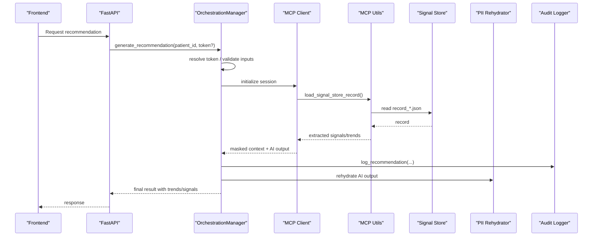

**Diagram sources**
- [backend/src/services/orchestrator.py:31-124](file://backend/src/services/orchestrator.py#L31-L124)
- [backend/src/mcp_server/utils.py:99-147](file://backend/src/mcp_server/utils.py#L99-L147)
- [backend/src/mcp_server/tools/biomarker_trends.py:8-51](file://backend/src/mcp_server/tools/biomarker_trends.py#L8-L51)
- [backend/src/mcp_server/tools/clinical_signals.py:8-66](file://backend/src/mcp_server/tools/clinical_signals.py#L8-L66)
- [backend/src/services/audit.py:55-120](file://backend/src/services/audit.py#L55-L120)
- [backend/src/services/privacy.py:60-94](file://backend/src/services/privacy.py#L60-L94)

## Detailed Component Analysis

### Signal Store System and Data Model
The signal store is a JSON-based database of synthetic patient records located under assets/synthesis/generated. Each record includes:
- hard_constraints: Demographics, eligibility exclusions, active safety flags, tier ceiling
- clinical_signals: Risk flags, screening gaps, vaccination gaps, abnormal triggers, comorbidities, behavioral flags, symptoms
- biomarker_trends: BMI, blood pressure, eGFR, labs, ASCVD 10-year risk, waist circumference
- metadata: computed_at, pipeline_run_id

MCP tools extract and return these sections per contract. Utilities support caching, path resolution, and timeline building.

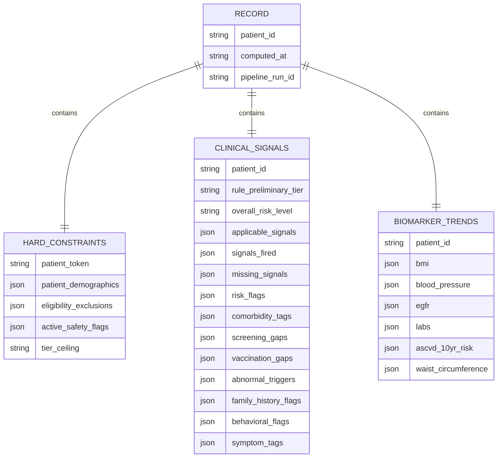

**Diagram sources**
- [backend/src/mcp_server/utils.py:150-184](file://backend/src/mcp_server/utils.py#L150-L184)
- [backend/src/mcp_server/tools/biomarker_trends.py:18-31](file://backend/src/mcp_server/tools/biomarker_trends.py#L18-L31)
- [backend/src/mcp_server/tools/clinical_signals.py:18-39](file://backend/src/mcp_server/tools/clinical_signals.py#L18-L39)

**Section sources**
- [backend/src/mcp_server/utils.py:23-55](file://backend/src/mcp_server/utils.py#L23-L55)
- [backend/src/mcp_server/utils.py:99-147](file://backend/src/mcp_server/utils.py#L99-L147)
- [backend/src/mcp_server/tools/biomarker_trends.py:8-51](file://backend/src/mcp_server/tools/biomarker_trends.py#L8-L51)
- [backend/src/mcp_server/tools/clinical_signals.py:8-66](file://backend/src/mcp_server/tools/clinical_signals.py#L8-L66)

### Patient Registry and Identity Management
The patient registry maps stable patient IDs to HMAC tokens. Utilities resolve tokens to IDs and vice versa, enabling secure identity management and HMAC tokenization across the system.

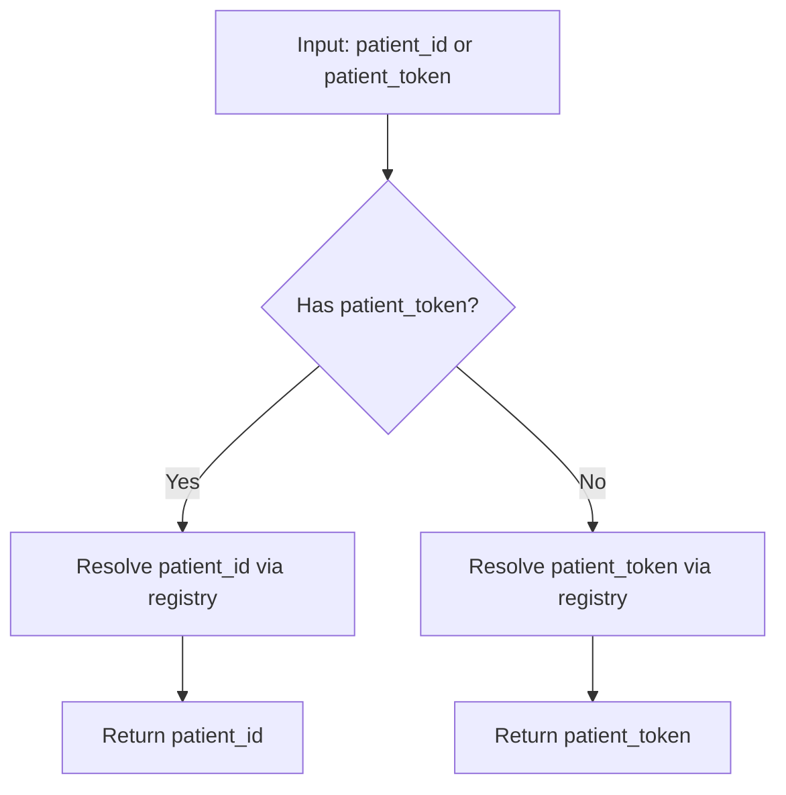

**Diagram sources**
- [backend/src/mcp_server/utils.py:87-96](file://backend/src/mcp_server/utils.py#L87-L96)
- [assets/patient_registry.json:1-117](file://assets/patient_registry.json#L1-L117)

**Section sources**
- [backend/src/mcp_server/utils.py:87-96](file://backend/src/mcp_server/utils.py#L87-L96)
- [assets/patient_registry.json:1-117](file://assets/patient_registry.json#L1-L117)

### Privacy and Pseudonymization
PII fields are automatically masked during processing and rehydrated only for frontend display. The masker generates request-scoped tokens and maintains a rehydration map. The rehydrator restores original values safely.

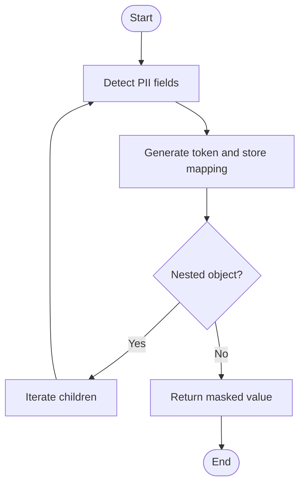

**Diagram sources**
- [backend/src/services/privacy.py:22-58](file://backend/src/services/privacy.py#L22-L58)

**Section sources**
- [backend/src/services/privacy.py:22-94](file://backend/src/services/privacy.py#L22-L94)

### Audit Trail and Immutable Logging
The audit logger writes dual-format logs (JSONL append-only and JSON array) with SHA-256 hash chaining. Each entry references previous hash to ensure immutability and includes who, what, why, how, and metadata.

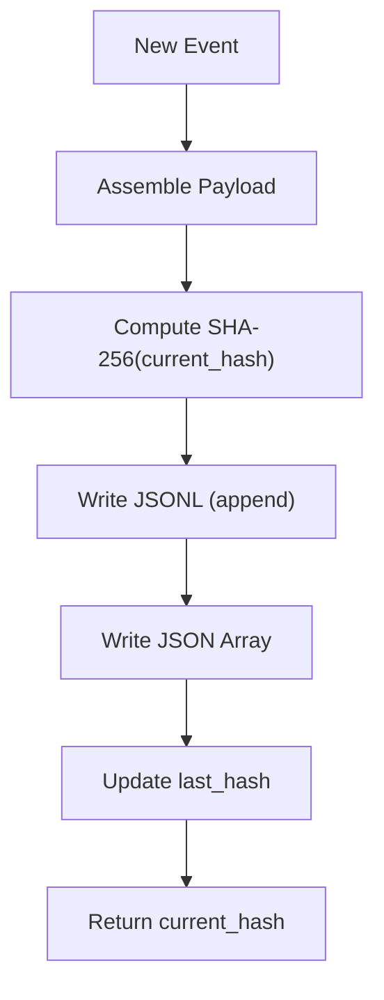

**Diagram sources**
- [backend/src/services/audit.py:55-120](file://backend/src/services/audit.py#L55-L120)
- [backend/src/services/audit.py:122-161](file://backend/src/services/audit.py#L122-L161)

**Section sources**
- [backend/src/services/audit.py:14-173](file://backend/src/services/audit.py#L14-L173)
- [logs/audit.jsonl](file://logs/audit.jsonl)

### MCP Protocol Implementation for Clinical Tools
The MCP server registers tools that expose curated clinical data to AI agents. Tools include:
- get_hard_constraints
- get_clinical_signals
- get_biomarker_trends
- get_program_ruleset
- get_patient_event_timeline

These tools leverage utilities to load and transform signal store records and timelines.

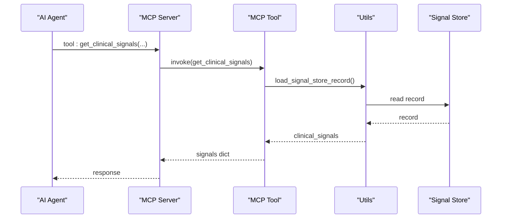

**Diagram sources**
- [backend/src/mcp_server/server.py:12-19](file://backend/src/mcp_server/server.py#L12-L19)
- [backend/src/mcp_server/tools/clinical_signals.py:8-66](file://backend/src/mcp_server/tools/clinical_signals.py#L8-L66)
- [backend/src/mcp_server/utils.py:99-147](file://backend/src/mcp_server/utils.py#L99-L147)

**Section sources**
- [backend/src/mcp_server/server.py:1-23](file://backend/src/mcp_server/server.py#L1-L23)
- [backend/src/mcp_server/tools/biomarker_trends.py:8-51](file://backend/src/mcp_server/tools/biomarker_trends.py#L8-L51)
- [backend/src/mcp_server/tools/clinical_signals.py:8-66](file://backend/src/mcp_server/tools/clinical_signals.py#L8-L66)
- [backend/src/mcp_server/tools/hard_constraints.py:8-47](file://backend/src/mcp_server/tools/hard_constraints.py#L8-L47)
- [backend/src/mcp_server/tools/program_ruleset.py:20-115](file://backend/src/mcp_server/tools/program_ruleset.py#L20-L115)
- [backend/src/mcp_server/tools/patient_event_timeline.py:12-35](file://backend/src/mcp_server/tools/patient_event_timeline.py#L12-L35)
- [backend/src/mcp_server/utils.py:99-147](file://backend/src/mcp_server/utils.py#L99-L147)

### Risk Assessment Logic and Business Rules
Risk assessment is derived from clinical signals and hard constraints. The program ruleset tool resolves preliminary tier and package based on demographics and signals, while add-on filtering considers gender and age constraints. Package resolution uses a mapping keyed by tier, gender, and age bands.

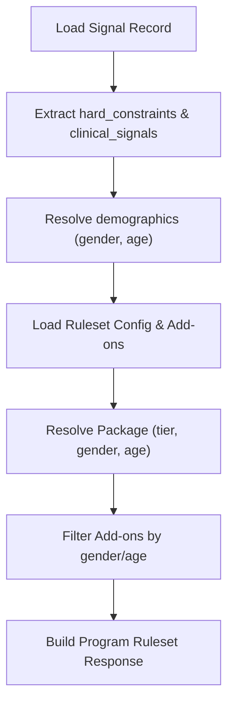

**Diagram sources**
- [backend/src/mcp_server/tools/program_ruleset.py:52-115](file://backend/src/mcp_server/tools/program_ruleset.py#L52-L115)
- [backend/src/mcp_server/utils.py:260-322](file://backend/src/mcp_server/utils.py#L260-L322)
- [backend/src/mcp_server/utils.py:324-388](file://backend/src/mcp_server/utils.py#L324-L388)

**Section sources**
- [backend/src/mcp_server/tools/program_ruleset.py:20-115](file://backend/src/mcp_server/tools/program_ruleset.py#L20-L115)
- [backend/src/mcp_server/utils.py:260-388](file://backend/src/mcp_server/utils.py#L260-L388)

### Data Validation Rules and Safety Logic
Safety validation occurs after AI output generation. The orchestrator runs deterministic safety checks against AI outputs and raw context, filtering add-ons and recording conflict events in the audit log.

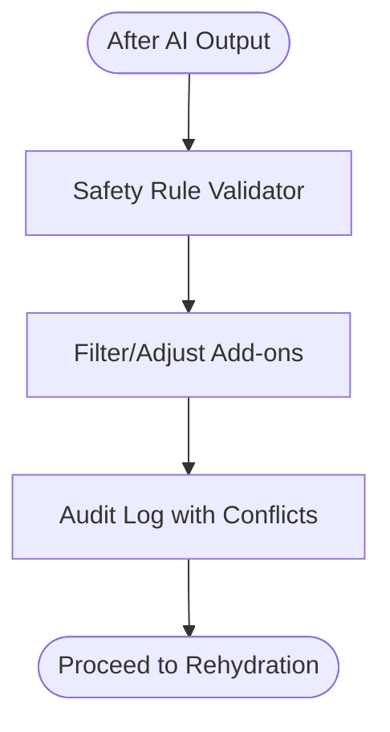

**Diagram sources**
- [backend/src/services/orchestrator.py:77-83](file://backend/src/services/orchestrator.py#L77-L83)
- [backend/src/services/audit.py:55-120](file://backend/src/services/audit.py#L55-L120)

**Section sources**
- [backend/src/services/orchestrator.py:77-83](file://backend/src/services/orchestrator.py#L77-L83)

### Data Lifecycle Management
Lifecycle stages:
- Ingestion: Signal Store records are read from assets/synthesis/generated
- Processing: MCP tools extract curated sections; privacy masking applied
- Orchestration: Workflow execution, safety validation, audit logging
- Storage: Dual audit logs (JSONL and JSON array)
- Presentation: PII rehydration for frontend display

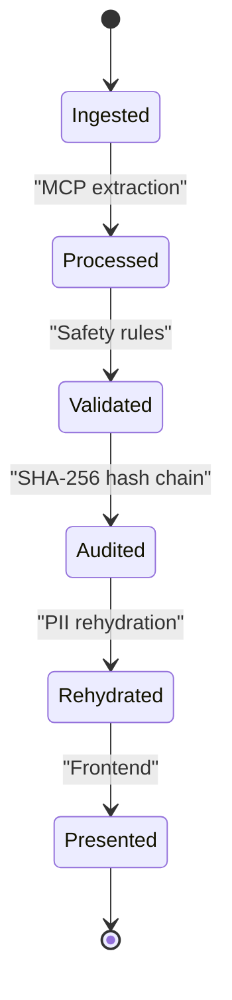

**Diagram sources**
- [backend/src/mcp_server/utils.py:99-147](file://backend/src/mcp_server/utils.py#L99-L147)
- [backend/src/services/orchestrator.py:77-124](file://backend/src/services/orchestrator.py#L77-L124)
- [backend/src/services/audit.py:55-120](file://backend/src/services/audit.py#L55-L120)
- [backend/src/services/privacy.py:60-94](file://backend/src/services/privacy.py#L60-L94)

**Section sources**
- [backend/src/mcp_server/utils.py:99-147](file://backend/src/mcp_server/utils.py#L99-L147)
- [backend/src/services/orchestrator.py:31-124](file://backend/src/services/orchestrator.py#L31-L124)
- [backend/src/services/audit.py:14-173](file://backend/src/services/audit.py#L14-L173)
- [backend/src/services/privacy.py:60-94](file://backend/src/services/privacy.py#L60-L94)

## Dependency Analysis
Key dependencies and relationships:
- API routes depend on the orchestration manager
- Orchestration manager depends on MCP client factory, safety validator, audit logger, and privacy rehydrator
- MCP server depends on utilities for signal store loading and transformations
- Utilities depend on shared settings for caching and file paths
- Audit logger depends on shared settings for log path and environment

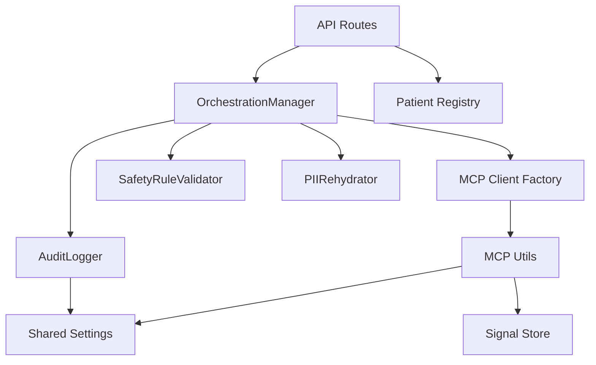

**Diagram sources**
- [backend/src/api/main.py:11-32](file://backend/src/api/main.py#L11-L32)
- [backend/src/services/orchestrator.py:8-30](file://backend/src/services/orchestrator.py#L8-L30)
- [backend/src/mcp_server/server.py:3-19](file://backend/src/mcp_server/server.py#L3-L19)
- [backend/src/mcp_server/utils.py:9-10](file://backend/src/mcp_server/utils.py#L9-L10)
- [shared/settings.py:45-69](file://shared/settings.py#L45-L69)

**Section sources**
- [backend/src/api/main.py:11-32](file://backend/src/api/main.py#L11-L32)
- [backend/src/services/orchestrator.py:8-30](file://backend/src/services/orchestrator.py#L8-L30)
- [backend/src/mcp_server/server.py:3-19](file://backend/src/mcp_server/server.py#L3-L19)
- [backend/src/mcp_server/utils.py:9-10](file://backend/src/mcp_server/utils.py#L9-L10)
- [shared/settings.py:45-69](file://shared/settings.py#L45-L69)

## Performance Considerations
- Caching: Utilities implement caching for registry, signal store, rulesets, and timelines with configurable TTLs
- Asynchronous orchestration: Workflow execution and MCP sessions are managed asynchronously
- Minimal parsing: Signal store records are parsed once per request and cached
- Audit writes: Append-only JSONL writing is optimized for streaming

[No sources needed since this section provides general guidance]

## Troubleshooting Guide
Common issues and resolutions:
- Signal Store record not found: Verify patient_token/patient_id mapping and that record_*.json exists under assets/synthesis/generated
- Missing audit logs: Confirm audit log path and permissions; check JSONL and JSON array files
- PII not rehydrated: Ensure rehydration map is present and passed through the orchestration flow
- MCP tool errors: Validate tool registration and that utilities can locate signal store and registry files

**Section sources**
- [backend/src/mcp_server/utils.py:99-147](file://backend/src/mcp_server/utils.py#L99-L147)
- [backend/src/services/audit.py:163-173](file://backend/src/services/audit.py#L163-L173)
- [backend/src/services/orchestrator.py:104-124](file://backend/src/services/orchestrator.py#L104-L124)

## Conclusion
The Navavej ROC data management system implements a robust, privacy-first pipeline integrating MCP tools, curated signal stores, deterministic safety validation, and immutable audit logging. The modular design enables scalable clinical signal processing, reliable risk assessment, and secure data handling across the entire lifecycle.

[No sources needed since this section summarizes without analyzing specific files]

## Appendices

### Signal Processing Workflow Example
- Input: patient_id or patient_token
- Resolution: resolve_patient_token/resolve_patient_id
- Extraction: load_signal_store_record -> extract_clinical_signals / extract_biomarker_trends
- Output: curated signals/trends for AI reasoning

**Section sources**
- [backend/src/mcp_server/utils.py:87-147](file://backend/src/mcp_server/utils.py#L87-L147)
- [backend/src/mcp_server/tools/clinical_signals.py:8-66](file://backend/src/mcp_server/tools/clinical_signals.py#L8-L66)
- [backend/src/mcp_server/tools/biomarker_trends.py:8-51](file://backend/src/mcp_server/tools/biomarker_trends.py#L8-L51)

### Trend Analysis Algorithm Outline
- Load record and extract labs and vital signs
- Compute temporal windows and velocities
- Aggregate metrics for visualization and risk scoring

**Section sources**
- [backend/src/mcp_server/tools/biomarker_trends.py:8-51](file://backend/src/mcp_server/tools/biomarker_trends.py#L8-L51)
- [backend/src/mcp_server/utils.py:174-183](file://backend/src/mcp_server/utils.py#L174-L183)

### Security and Access Control Patterns
- HMAC tokens for identity and cross-system exchange
- RBAC roles and scopes for API endpoints
- Audit trail with SHA-256 hash chaining for integrity
- PII masking and controlled rehydration

**Section sources**
- [assets/patient_registry.json:1-117](file://assets/patient_registry.json#L1-L117)
- [shared/settings.py:57-60](file://shared/settings.py#L57-L60)
- [backend/src/services/audit.py:14-173](file://backend/src/services/audit.py#L14-L173)
- [backend/src/services/privacy.py:22-94](file://backend/src/services/privacy.py#L22-L94)