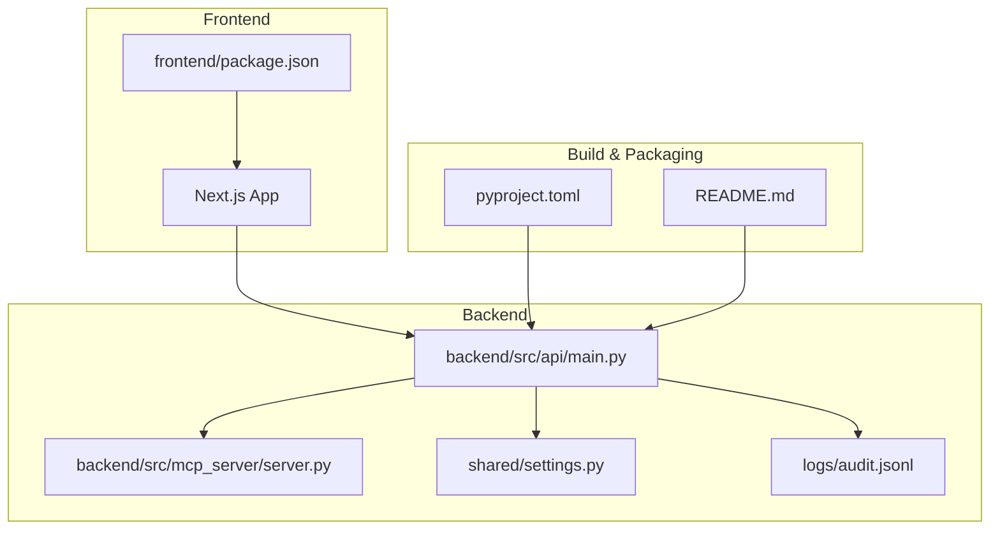
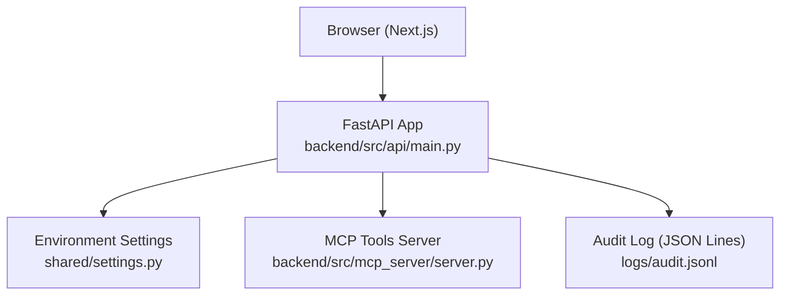
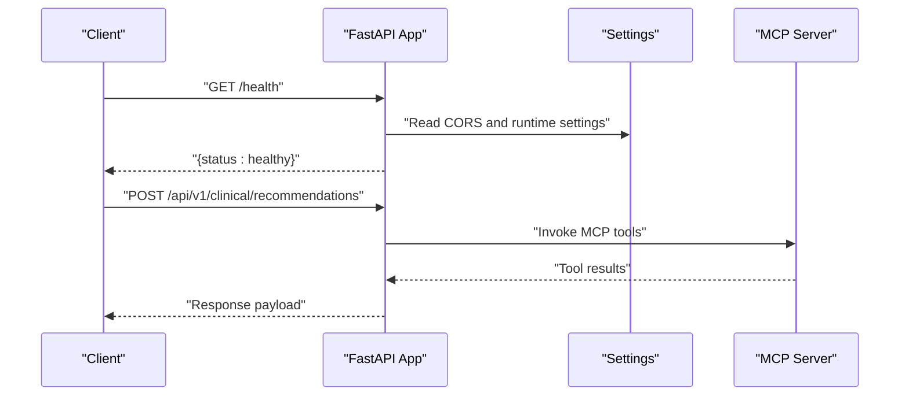
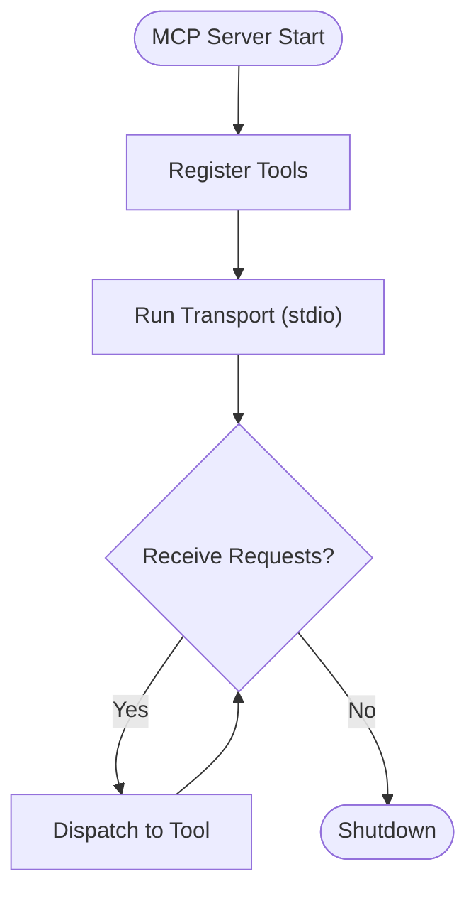
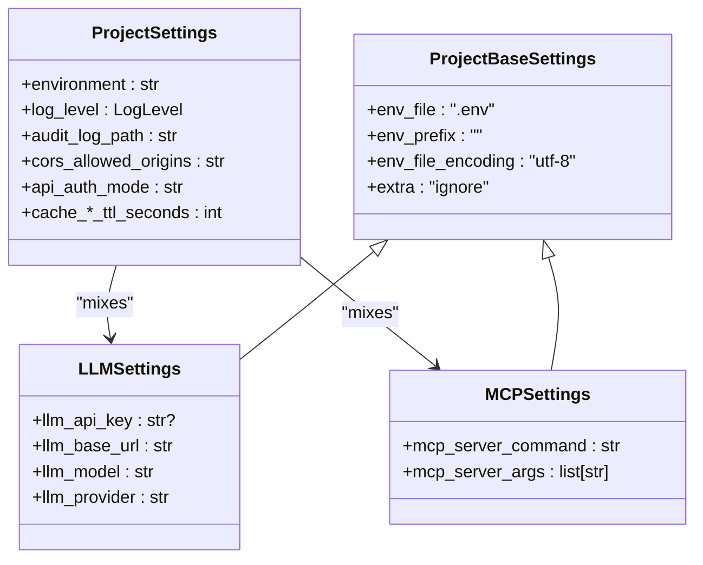
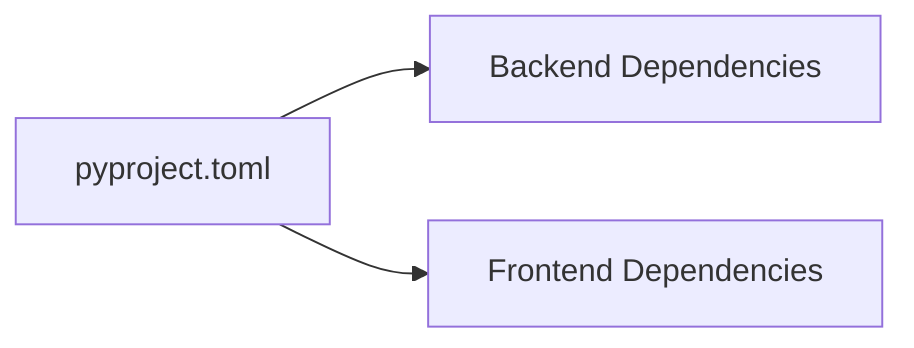

# Deployment and Operations

<cite>
**Referenced Files in This Document**
- [README.md](file://README.md)
- [pyproject.toml](file://pyproject.toml)
- [shared/settings.py](file://shared/settings.py)
- [backend/src/api/main.py](file://backend/src/api/main.py)
- [backend/src/mcp_server/server.py](file://backend/src/mcp_server/server.py)
- [frontend/package.json](file://frontend/package.json)
- [logs/audit.jsonl](file://logs/audit.jsonl)
</cite>

## Table of Contents
1. [Introduction](#introduction)
2. [Project Structure](#project-structure)
3. [Core Components](#core-components)
4. [Architecture Overview](#architecture-overview)
5. [Detailed Component Analysis](#detailed-component-analysis)
6. [Dependency Analysis](#dependency-analysis)
7. [Performance Considerations](#performance-considerations)
8. [Troubleshooting Guide](#troubleshooting-guide)
9. [Conclusion](#conclusion)
10. [Appendices](#appendices)

## Introduction
This document provides comprehensive deployment and operations guidance for Navavej ROC (Recommendation & Orchestration Center). It covers environment configuration, containerization readiness, CI/CD considerations, operational procedures (maintenance, logging, performance tuning), production deployment strategy, scaling and load balancing, monitoring and alerting, backup and disaster recovery, development workflow, security posture, and troubleshooting.

## Project Structure
Navavej ROC comprises:
- Backend API (FastAPI) with integrated MCP server tooling
- Frontend (Next.js) dashboard
- Shared settings and environment configuration
- Assets and synthetic datasets for clinical signal storage
- Scripts for tests and orchestration helpers
- Audit logs persisted to an immutable JSON Lines ledger

**Diagram sources**
- [backend/src/api/main.py:1-44](file://backend/src/api/main.py#L1-L44)
- [backend/src/mcp_server/server.py:1-23](file://backend/src/mcp_server/server.py#L1-L23)
- [shared/settings.py:1-70](file://shared/settings.py#L1-L70)
- [pyproject.toml:1-58](file://pyproject.toml#L1-L58)
- [README.md:1-95](file://README.md#L1-L95)
- [frontend/package.json:1-44](file://frontend/package.json#L1-L44)
- [logs/audit.jsonl](file://logs/audit.jsonl)

**Section sources**
- [README.md:76-86](file://README.md#L76-L86)
- [pyproject.toml:1-58](file://pyproject.toml#L1-L58)

## Core Components
- Backend API server built with FastAPI, exposing health checks and routing for patients, clinical AI, and contract APIs. It configures CORS dynamically from settings and runs on port 8000.
- MCP server providing tools for clinical signals, trends, constraints, timelines, and program rulesets.
- Shared settings module encapsulating environment-driven configuration (LLM provider, MCP command/args, audit log path, CORS origins, auth defaults, cache TTLs).
- Audit logging persisted to an immutable JSON Lines file for governance and compliance.

Key operational implications:
- Environment-driven configuration enables flexible deployments across dev/stage/prod.
- Health endpoint supports readiness/liveness probes.
- Audit log location and rotation are externalized for observability and retention policies.

**Section sources**
- [backend/src/api/main.py:14-38](file://backend/src/api/main.py#L14-L38)
- [backend/src/mcp_server/server.py:1-23](file://backend/src/mcp_server/server.py#L1-L23)
- [shared/settings.py:29-70](file://shared/settings.py#L29-L70)
- [logs/audit.jsonl](file://logs/audit.jsonl)

## Architecture Overview
The system integrates a frontend dashboard with a backend API and an MCP server. The API reads environment settings for dynamic behavior and writes immutable audit logs.

**Diagram sources**
- [backend/src/api/main.py:1-44](file://backend/src/api/main.py#L1-L44)
- [backend/src/mcp_server/server.py:1-23](file://backend/src/mcp_server/server.py#L1-L23)
- [shared/settings.py:1-70](file://shared/settings.py#L1-L70)
- [logs/audit.jsonl](file://logs/audit.jsonl)

## Detailed Component Analysis

### Backend API Server
Responsibilities:
- Serve health endpoint
- Mount routers for patients, clinical AI, and contracts
- Apply CORS middleware from settings
- Run via Uvicorn on port 8000

Operational notes:
- Host binding to 0.0.0.0 enables container/network exposure.
- Reload mode is enabled for development; disable in production.

**Diagram sources**
- [backend/src/api/main.py:14-38](file://backend/src/api/main.py#L14-L38)
- [backend/src/mcp_server/server.py:1-23](file://backend/src/mcp_server/server.py#L1-L23)
- [shared/settings.py:48-66](file://shared/settings.py#L48-L66)

**Section sources**
- [backend/src/api/main.py:14-44](file://backend/src/api/main.py#L14-L44)

### MCP Server
Responsibilities:
- Expose tools for hard constraints, clinical signals, trends, program rulesets, and patient event timelines
- Run via stdio transport

Operational notes:
- Tool registration is centralized; ensure tool availability and error handling in production.
- Command and arguments are configurable via settings for process spawning.

**Diagram sources**
- [backend/src/mcp_server/server.py:1-23](file://backend/src/mcp_server/server.py#L1-L23)
- [shared/settings.py:38-43](file://shared/settings.py#L38-L43)

**Section sources**
- [backend/src/mcp_server/server.py:1-23](file://backend/src/mcp_server/server.py#L1-L23)
- [shared/settings.py:38-43](file://shared/settings.py#L38-L43)

### Shared Settings and Environment Configuration
Configuration surface includes:
- LLM provider settings (base URL, model, API key)
- MCP server command and arguments
- Runtime environment, log level, audit log path
- CORS allowed origins
- API auth defaults and scopes
- Cache enablement and TTLs per cache domain

Operational guidance:
- Populate .env with environment-specific values.
- Validate CORS origins for production domains.
- Tune cache TTLs for hot-path data to balance freshness and latency.

**Diagram sources**
- [shared/settings.py:9-70](file://shared/settings.py#L9-L70)

**Section sources**
- [shared/settings.py:29-70](file://shared/settings.py#L29-L70)

### Audit Logging
- Immutable audit trail stored in JSON Lines format.
- Path is configurable via settings.
- Supports governance and compliance workflows.

Operational guidance:
- Back up audit logs regularly according to retention policies.
- Monitor disk usage and implement log rotation or archival.

**Section sources**
- [shared/settings.py:49-51](file://shared/settings.py#L49-L51)
- [logs/audit.jsonl](file://logs/audit.jsonl)

## Dependency Analysis
Runtime dependencies and packaging:
- Backend uses FastAPI, Uvicorn, Loguru, Pydantic, pydantic-settings, httpx, openai, mcp, pytest, ruff.
- Frontend uses Next.js, React, Tailwind, Vitest, ESLint.
- Packaging managed via setuptools with Python 3.10+.

**Diagram sources**
- [pyproject.toml:8-21](file://pyproject.toml#L8-L21)
- [frontend/package.json:14-42](file://frontend/package.json#L14-L42)

**Section sources**
- [pyproject.toml:8-21](file://pyproject.toml#L8-L21)
- [frontend/package.json:14-42](file://frontend/package.json#L14-L42)

## Performance Considerations
- Caching: Enable and tune cache TTLs for registry, rulesets, signal store, and recommendations to reduce latency and downstream load.
- LLM provider: Select appropriate base URL/model for latency SLAs; consider regional endpoints.
- MCP tooling: Ensure tool implementations are efficient; monitor tool execution times.
- Audit logging: Offload or compress logs in production to avoid I/O bottlenecks.
- Frontend builds: Use production builds and optimize asset delivery.

[No sources needed since this section provides general guidance]

## Troubleshooting Guide
Common deployment and operational issues:

- Health check failures
  - Verify backend is listening on port 8000 and CORS origins include the frontend origin.
  - Confirm environment variables are loaded (.env presence and values).

- MCP tool invocation errors
  - Validate MCP server command and arguments in settings.
  - Ensure MCP server process starts and tools register successfully.

- Audit log not written
  - Confirm audit log path exists and is writable.
  - Check permissions and disk space.

- Frontend cannot connect to backend
  - Match CORS allowed origins with the deployed frontend domain(s).
  - Ensure reverse proxy or ingress forwards headers correctly.

- Performance regressions
  - Review cache TTLs and hit rates.
  - Profile LLM latency and MCP tool durations.

**Section sources**
- [backend/src/api/main.py:20-27](file://backend/src/api/main.py#L20-L27)
- [shared/settings.py:48-66](file://shared/settings.py#L48-L66)
- [backend/src/mcp_server/server.py:1-23](file://backend/src/mcp_server/server.py#L1-L23)
- [logs/audit.jsonl](file://logs/audit.jsonl)

## Conclusion
Navavej ROC’s deployment and operations rely on environment-driven configuration, modular backend services, and immutable audit logging. By aligning environment variables, container networking, and observability controls with the documented settings and endpoints, teams can achieve reliable, secure, and scalable operations across development, staging, and production.

[No sources needed since this section summarizes without analyzing specific files]

## Appendices

### A. Environment Variables and Settings Reference
- LLM settings: provider, base URL, model, API key
- MCP settings: command and arguments for process spawning
- Runtime: environment, log level, audit log path
- CORS: allowed origins
- API auth: mode, default user/role/scopes, allowed roles and required scopes
- Cache: enable flag and TTLs per domain

**Section sources**
- [shared/settings.py:29-70](file://shared/settings.py#L29-L70)

### B. Ports and Services
- Backend API: port 8000
- MCP server: stdio transport
- Frontend: development port 3000 (default Next.js)

**Section sources**
- [backend/src/api/main.py:41-43](file://backend/src/api/main.py#L41-L43)
- [backend/src/mcp_server/server.py:21-22](file://backend/src/mcp_server/server.py#L21-L22)
- [README.md:62-72](file://README.md#L62-L72)

### C. CI/CD and Build Notes
- Backend build and linting are supported via pyproject.toml and ruff configuration.
- Frontend build and test scripts are defined in package.json.
- No repository-provided CI/CD pipeline YAML was found; teams should define jobs for linting, testing, building, and publishing artifacts.

**Section sources**
- [pyproject.toml:32-58](file://pyproject.toml#L32-L58)
- [frontend/package.json:5-12](file://frontend/package.json#L5-L12)

### D. Monitoring and Alerting
- Health endpoint (/health) suitable for liveness/readiness probes.
- Add metrics endpoints and structured logging for deeper insights.
- Alert on health probe failures, elevated error rates, slow MCP tool execution, and audit log write failures.

**Section sources**
- [backend/src/api/main.py:35-38](file://backend/src/api/main.py#L35-L38)

### E. Backup and Disaster Recovery
- Regularly back up the audit log directory.
- Archive logs off-node and enforce retention policies.
- Test restore procedures for audit logs and ensure immutable chain verification.

**Section sources**
- [shared/settings.py:49-51](file://shared/settings.py#L49-L51)
- [logs/audit.jsonl](file://logs/audit.jsonl)

### F. Security Considerations
- Enforce HTTPS/TLS termination at ingress/load balancer.
- Manage secrets via environment variables or secret managers; avoid committing secrets to source.
- Restrict CORS to trusted origins only.
- Harden API authentication and authorization scopes as defined in settings.
- Rotate HMAC token salt periodically and update configuration accordingly.

**Section sources**
- [shared/settings.py:51-60](file://shared/settings.py#L51-L60)