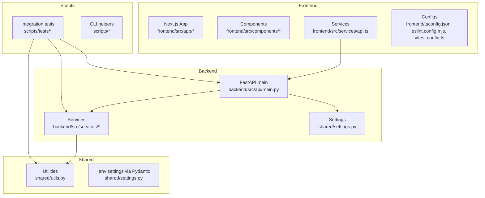
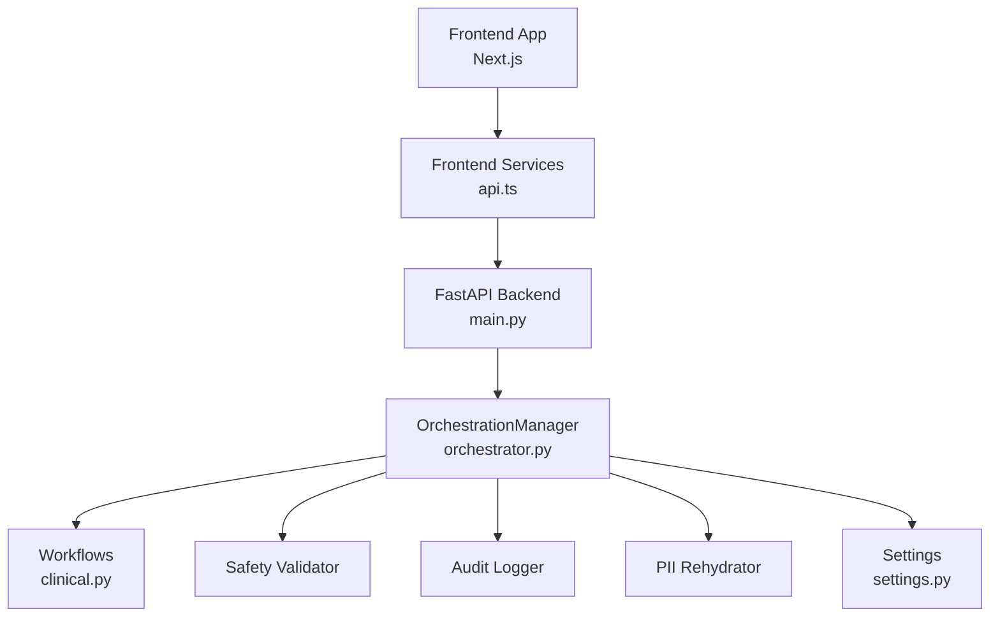
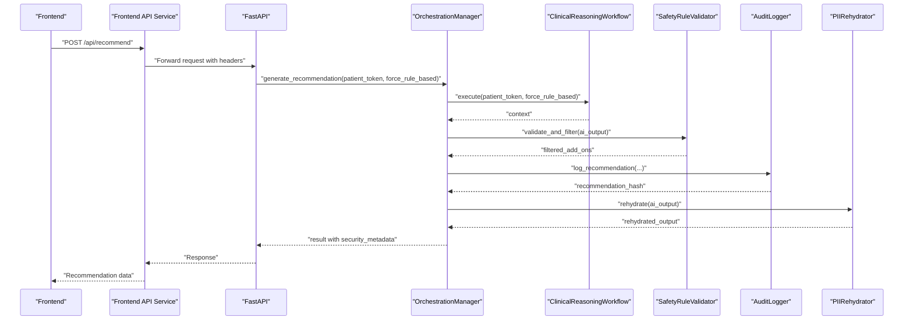
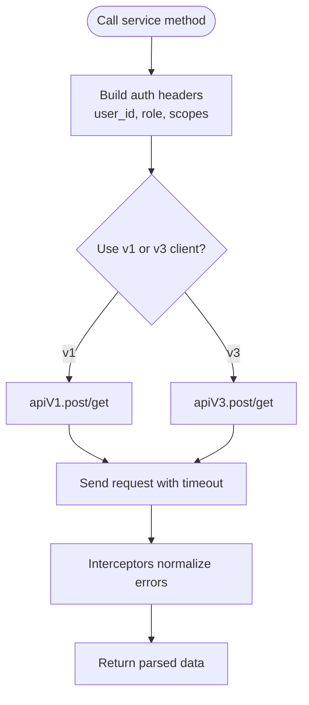
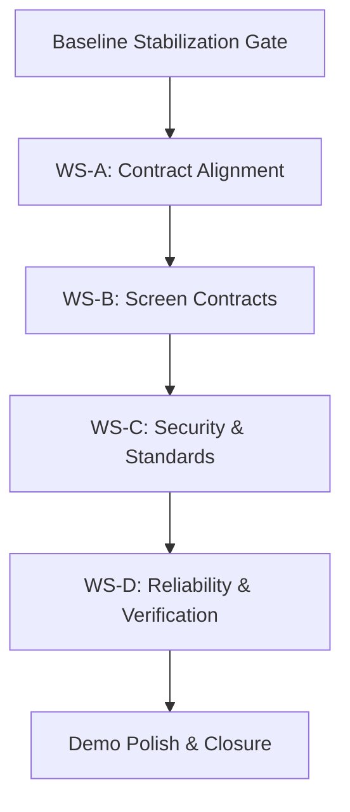
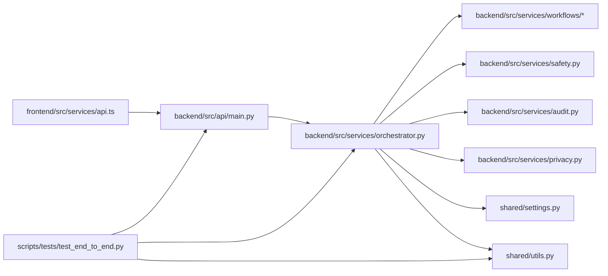

# Development Guidelines

<cite>
**Referenced Files in This Document**
- [README.md](file://README.md)
- [pyproject.toml](file://pyproject.toml)
- [frontend/package.json](file://frontend/package.json)
- [frontend/eslint.config.mjs](file://frontend/eslint.config.mjs)
- [frontend/tsconfig.json](file://frontend/tsconfig.json)
- [frontend/vitest.config.ts](file://frontend/vitest.config.ts)
- [backend/src/api/main.py](file://backend/src/api/main.py)
- [shared/settings.py](file://shared/settings.py)
- [backend/src/services/orchestrator.py](file://backend/src/services/orchestrator.py)
- [frontend/src/services/api.ts](file://frontend/src/services/api.ts)
- [shared/utils.py](file://shared/utils.py)
- [scripts/test_api.py](file://scripts/test_api.py)
- [_project_management/[DONE] 1. POC-Gap-Closure/gap-closure-plan.md](file://_project_management/[DONE] 1. POC-Gap-Closure/gap-closure-plan.md)
- [_project_management/[DONE] 2. v3-Migration/migration-plan.md](file://_project_management/[DONE] 2. v3-Migration/migration-plan.md)
- [scripts/tests/test_end_to_end.py](file://scripts/tests/test_end_to_end.py)
</cite>

## Table of Contents
1. [Introduction](#introduction)
2. [Project Structure](#project-structure)
3. [Core Components](#core-components)
4. [Architecture Overview](#architecture-overview)
5. [Detailed Component Analysis](#detailed-component-analysis)
6. [Dependency Analysis](#dependency-analysis)
7. [Performance Considerations](#performance-considerations)
8. [Troubleshooting Guide](#troubleshooting-guide)
9. [Conclusion](#conclusion)
10. [Appendices](#appendices)

## Introduction
This document provides comprehensive development guidelines for Navavej ROC, covering coding standards for Python and TypeScript/JavaScript, architectural principles, project management methodology, contribution workflow, environment setup, debugging, code quality tools, and practical development tasks. It synthesizes the repository’s configuration, backend orchestration, frontend service layer, and project management plans to deliver a unified guide for contributors.

## Project Structure
The repository is organized into distinct areas:
- Backend Python services and API entrypoint
- Frontend Next.js application
- BAML prompt templates and auto-generated client
- Scripts for tests and helpers
- Shared utilities and settings
- Project management artifacts for gap closure and migration

**Diagram sources**
- [backend/src/api/main.py:1-44](file://backend/src/api/main.py#L1-L44)
- [shared/settings.py:1-70](file://shared/settings.py#L1-L70)
- [frontend/src/services/api.ts:1-218](file://frontend/src/services/api.ts#L1-L218)
- [frontend/tsconfig.json:1-35](file://frontend/tsconfig.json#L1-L35)
- [frontend/eslint.config.mjs:1-19](file://frontend/eslint.config.mjs#L1-L19)
- [frontend/vitest.config.ts:1-20](file://frontend/vitest.config.ts#L1-L20)
- [shared/utils.py:1-28](file://shared/utils.py#L1-L28)
- [scripts/tests/test_end_to_end.py:1-129](file://scripts/tests/test_end_to_end.py#L1-L129)

**Section sources**
- [README.md:76-86](file://README.md#L76-L86)
- [backend/src/api/main.py:1-44](file://backend/src/api/main.py#L1-L44)
- [frontend/src/services/api.ts:1-218](file://frontend/src/services/api.ts#L1-L218)
- [shared/settings.py:1-70](file://shared/settings.py#L1-L70)
- [shared/utils.py:1-28](file://shared/utils.py#L1-L28)
- [frontend/tsconfig.json:1-35](file://frontend/tsconfig.json#L1-L35)
- [frontend/eslint.config.mjs:1-19](file://frontend/eslint.config.mjs#L1-L19)
- [frontend/vitest.config.ts:1-20](file://frontend/vitest.config.ts#L1-L20)
- [scripts/tests/test_end_to_end.py:1-129](file://scripts/tests/test_end_to_end.py#L1-L129)

## Core Components
- Backend API entrypoint initializes FastAPI, configures CORS, and mounts routers for patients, clinical AI, and contracts.
- Settings are centralized via Pydantic settings with environment loading and typed configuration for logging, audit, caching, and security.
- Orchestration manager coordinates workflow execution, safety validation, audit logging, and PII rehydration.
- Frontend service layer encapsulates API clients for v1 and v3 routes, request/response normalization, and authentication headers.
- Utilities provide token generation for patient identifiers using HMAC-SHA256.

Key implementation references:
- [API entrypoint and CORS:1-44](file://backend/src/api/main.py#L1-L44)
- [Settings and environment configuration:1-70](file://shared/settings.py#L1-L70)
- [Orchestration lifecycle:1-151](file://backend/src/services/orchestrator.py#L1-L151)
- [Frontend API service:1-218](file://frontend/src/services/api.ts#L1-L218)
- [Token generation utility:1-28](file://shared/utils.py#L1-L28)

**Section sources**
- [backend/src/api/main.py:1-44](file://backend/src/api/main.py#L1-L44)
- [shared/settings.py:1-70](file://shared/settings.py#L1-L70)
- [backend/src/services/orchestrator.py:1-151](file://backend/src/services/orchestrator.py#L1-L151)
- [frontend/src/services/api.ts:1-218](file://frontend/src/services/api.ts#L1-L218)
- [shared/utils.py:1-28](file://shared/utils.py#L1-L28)

## Architecture Overview
Navavej ROC follows a contract-first backend with a frontend that consumes both legacy v1 and contract-oriented v3 endpoints. The backend orchestrates workflows, enforces safety, logs immutable audit trails, and supports privacy modes with tokenization and rehydration.

**Diagram sources**
- [backend/src/api/main.py:1-44](file://backend/src/api/main.py#L1-L44)
- [backend/src/services/orchestrator.py:1-151](file://backend/src/services/orchestrator.py#L1-L151)
- [shared/settings.py:1-70](file://shared/settings.py#L1-L70)
- [frontend/src/services/api.ts:1-218](file://frontend/src/services/api.ts#L1-L218)

**Section sources**
- [backend/src/api/main.py:1-44](file://backend/src/api/main.py#L1-L44)
- [backend/src/services/orchestrator.py:1-151](file://backend/src/services/orchestrator.py#L1-L151)
- [frontend/src/services/api.ts:1-218](file://frontend/src/services/api.ts#L1-L218)
- [shared/settings.py:1-70](file://shared/settings.py#L1-L70)

## Detailed Component Analysis

### Backend API and Orchestration
- The API entrypoint sets up CORS from environment configuration and mounts routers for patients, clinical AI, and contracts.
- The OrchestrationManager coordinates workflow execution, safety validation, audit logging, and PII rehydration. It also exposes a decision recording endpoint and manages fallback logic when primary AI execution fails.

**Diagram sources**
- [backend/src/api/main.py:1-44](file://backend/src/api/main.py#L1-L44)
- [backend/src/services/orchestrator.py:1-151](file://backend/src/services/orchestrator.py#L1-L151)
- [frontend/src/services/api.ts:1-218](file://frontend/src/services/api.ts#L1-L218)

**Section sources**
- [backend/src/api/main.py:1-44](file://backend/src/api/main.py#L1-L44)
- [backend/src/services/orchestrator.py:1-151](file://backend/src/services/orchestrator.py#L1-L151)
- [frontend/src/services/api.ts:1-218](file://frontend/src/services/api.ts#L1-L218)

### Frontend Service Layer
- The frontend defines separate Axios clients for v1 and v3 endpoints, request/response interceptors for error normalization, and typed service methods for recommendations, timelines, monitoring, and audit logs.
- Authentication headers are built dynamically from an auth context endpoint, with role and scope merging.

**Diagram sources**
- [frontend/src/services/api.ts:1-218](file://frontend/src/services/api.ts#L1-L218)

**Section sources**
- [frontend/src/services/api.ts:1-218](file://frontend/src/services/api.ts#L1-L218)

### Coding Standards and Style Conventions

#### Python (Backend)
- Linting and style:
  - Ruff configured with Google-style docstrings, line length limit, and selected rule families.
  - Target Python version aligns with project requirements.
- Naming patterns:
  - Modules and classes follow descriptive names; constants are uppercase with underscores.
  - Functions/methods use snake_case; classes use PascalCase.
- Architectural principles:
  - Centralized settings via Pydantic settings with environment loading.
  - Explicit separation of concerns: API entrypoint, services, workflows, safety, audit, privacy.
  - Type hints and async/await for I/O-bound operations.

References:
- [pyproject.toml:32-58](file://pyproject.toml#L32-L58)

**Section sources**
- [pyproject.toml:32-58](file://pyproject.toml#L32-L58)

#### TypeScript/JavaScript (Frontend)
- Linting and style:
  - ESLint configuration extends Next.js recommended rules; ignores are overridden for project needs.
  - Strict TypeScript compiler options enabled with path aliases.
- Naming patterns:
  - Interfaces and types use PascalCase; service methods use camelCase.
  - Constants are uppercase with underscores.
- Architectural principles:
  - Contract-first API consumption with separate v1/v3 clients.
  - Centralized error handling via interceptors.
  - Strongly typed request/response models.

References:
- [frontend/eslint.config.mjs:1-19](file://frontend/eslint.config.mjs#L1-L19)
- [frontend/tsconfig.json:1-35](file://frontend/tsconfig.json#L1-L35)
- [frontend/package.json:1-44](file://frontend/package.json#L1-L44)

**Section sources**
- [frontend/eslint.config.mjs:1-19](file://frontend/eslint.config.mjs#L1-L19)
- [frontend/tsconfig.json:1-35](file://frontend/tsconfig.json#L1-L35)
- [frontend/package.json:1-44](file://frontend/package.json#L1-L44)

### Project Management Methodology
The repository documents two key methodologies:
- Gap-closure plan: Contract-first delivery, scoring-weighted prioritization, evidence-driven completion, low-risk migration, and stabilization gates before implementing major changes.
- Migration plan: Regression-safe delivery, contract-first BAML mapping, additive changes, and phased rollout of hybrid AI/rule-based pipeline and privacy mode toggles.

**Diagram sources**
- [_project_management/[DONE] 1. POC-Gap-Closure/gap-closure-plan.md](file://_project_management/[DONE] 1. POC-Gap-Closure/gap-closure-plan.md#L109-L200)

**Section sources**
- [_project_management/[DONE] 1. POC-Gap-Closure/gap-closure-plan.md](file://_project_management/[DONE] 1. POC-Gap-Closure/gap-closure-plan.md#L1-L290)
- [_project_management/[DONE] 2. v3-Migration/migration-plan.md](file://_project_management/[DONE] 2. v3-Migration/migration-plan.md#L1-L298)

### Contribution Workflow
- Environment setup:
  - Backend: uv sync, BAML client generation, run server with PYTHONPATH pointing to backend.
  - Frontend: npm install, npm run dev.
- Testing:
  - Backend: pytest with async support; end-to-end tests require LLM environment configuration.
  - Frontend: Vitest with jsdom environment and setup files.
- Documentation:
  - Maintain gap-closure and migration artifacts; keep discovery, latest test results, and development summaries current.

References:
- [README.md:42-73](file://README.md#L42-L73)
- [scripts/tests/test_end_to_end.py:1-129](file://scripts/tests/test_end_to_end.py#L1-L129)
- [frontend/vitest.config.ts:1-20](file://frontend/vitest.config.ts#L1-L20)

**Section sources**
- [README.md:42-73](file://README.md#L42-L73)
- [scripts/tests/test_end_to_end.py:1-129](file://scripts/tests/test_end_to_end.py#L1-L129)
- [frontend/vitest.config.ts:1-20](file://frontend/vitest.config.ts#L1-L20)

### Extending the System and Integrating Third-Party Components
- Backend extensions:
  - Add new routes under the API entrypoint and mount them with appropriate prefixes and tags.
  - Integrate new services via the OrchestrationManager or dedicated workflow classes.
  - Respect settings and environment variables for third-party integrations (e.g., LLM providers).
- Frontend extensions:
  - Define new service methods in the API service layer with typed models.
  - Add pages/components and ensure proper routing and error handling.
- BAML integration:
  - Edit BAML templates and regenerate the client; ensure output types align with contract normalization.

References:
- [backend/src/api/main.py:29-32](file://backend/src/api/main.py#L29-L32)
- [backend/src/services/orchestrator.py:1-151](file://backend/src/services/orchestrator.py#L1-L151)
- [frontend/src/services/api.ts:1-218](file://frontend/src/services/api.ts#L1-L218)

**Section sources**
- [backend/src/api/main.py:29-32](file://backend/src/api/main.py#L29-L32)
- [backend/src/services/orchestrator.py:1-151](file://backend/src/services/orchestrator.py#L1-L151)
- [frontend/src/services/api.ts:1-218](file://frontend/src/services/api.ts#L1-L218)

### Development Environment Setup and Debugging
- Backend:
  - Install dependencies with uv, generate BAML client, and run the API server with PYTHONPATH set.
  - Use the health check endpoint to verify server availability.
- Frontend:
  - Install dependencies with npm and start the development server.
  - Use Vitest for unit and integration tests; enable coverage as needed.
- Debugging:
  - Inspect logs from the backend and verify API responses.
  - Use browser developer tools for frontend debugging and network inspection.

References:
- [README.md:49-72](file://README.md#L49-L72)
- [scripts/test_api.py:1-12](file://scripts/test_api.py#L1-L12)
- [frontend/package.json:5-12](file://frontend/package.json#L5-L12)

**Section sources**
- [README.md:49-72](file://README.md#L49-L72)
- [scripts/test_api.py:1-12](file://scripts/test_api.py#L1-L12)
- [frontend/package.json:5-12](file://frontend/package.json#L5-L12)

### Code Quality Tools, Linting, and Automated Checks
- Python:
  - Ruff for linting and formatting; Google-style docstrings enforced.
- TypeScript/JavaScript:
  - ESLint with Next.js recommended rules; strict TS compiler options.
  - Vitest for unit tests with jsdom environment and coverage reporting.
- Automated checks:
  - Backend tests leverage pytest-asyncio and environment-driven skipping for external services.
  - Frontend tests use Vitest with DOM environment and setup files.

References:
- [pyproject.toml:32-58](file://pyproject.toml#L32-L58)
- [frontend/eslint.config.mjs:1-19](file://frontend/eslint.config.mjs#L1-L19)
- [frontend/tsconfig.json:1-35](file://frontend/tsconfig.json#L1-L35)
- [frontend/package.json:25-42](file://frontend/package.json#L25-L42)
- [frontend/vitest.config.ts:1-20](file://frontend/vitest.config.ts#L1-L20)
- [scripts/tests/test_end_to_end.py:1-129](file://scripts/tests/test_end_to_end.py#L1-L129)

**Section sources**
- [pyproject.toml:32-58](file://pyproject.toml#L32-L58)
- [frontend/eslint.config.mjs:1-19](file://frontend/eslint.config.mjs#L1-L19)
- [frontend/tsconfig.json:1-35](file://frontend/tsconfig.json#L1-L35)
- [frontend/package.json:25-42](file://frontend/package.json#L25-L42)
- [frontend/vitest.config.ts:1-20](file://frontend/vitest.config.ts#L1-L20)
- [scripts/tests/test_end_to_end.py:1-129](file://scripts/tests/test_end_to_end.py#L1-L129)

## Dependency Analysis
The system exhibits clear layering:
- Frontend depends on the backend API and consumes typed models.
- Backend orchestrates services and workflows, with settings and utilities providing shared behavior.
- Tests depend on backend services and settings to validate end-to-end flows.

**Diagram sources**
- [frontend/src/services/api.ts:1-218](file://frontend/src/services/api.ts#L1-L218)
- [backend/src/api/main.py:1-44](file://backend/src/api/main.py#L1-L44)
- [backend/src/services/orchestrator.py:1-151](file://backend/src/services/orchestrator.py#L1-L151)
- [shared/settings.py:1-70](file://shared/settings.py#L1-L70)
- [shared/utils.py:1-28](file://shared/utils.py#L1-L28)
- [scripts/tests/test_end_to_end.py:1-129](file://scripts/tests/test_end_to_end.py#L1-L129)

**Section sources**
- [frontend/src/services/api.ts:1-218](file://frontend/src/services/api.ts#L1-L218)
- [backend/src/api/main.py:1-44](file://backend/src/api/main.py#L1-L44)
- [backend/src/services/orchestrator.py:1-151](file://backend/src/services/orchestrator.py#L1-L151)
- [shared/settings.py:1-70](file://shared/settings.py#L1-L70)
- [shared/utils.py:1-28](file://shared/utils.py#L1-L28)
- [scripts/tests/test_end_to_end.py:1-129](file://scripts/tests/test_end_to_end.py#L1-L129)

## Performance Considerations
- Caching:
  - Centralized cache TTL settings are configurable via environment and used across services.
- Asynchronous execution:
  - Backend leverages async workflows and I/O-bound operations to improve throughput.
- Recommendations:
  - Hybrid AI/rule-based mode allows deterministic fallback and reduced latency when AI is unavailable.

References:
- [shared/settings.py:61-67](file://shared/settings.py#L61-L67)
- [backend/src/services/orchestrator.py:67-75](file://backend/src/services/orchestrator.py#L67-L75)

**Section sources**
- [shared/settings.py:61-67](file://shared/settings.py#L61-L67)
- [backend/src/services/orchestrator.py:67-75](file://backend/src/services/orchestrator.py#L67-L75)

## Troubleshooting Guide
- Backend health and connectivity:
  - Use the health check endpoint to verify server status.
- Environment configuration:
  - Ensure environment variables are loaded consistently across scripts and tests.
- LLM integration:
  - End-to-end tests skip when LLM environment is not configured; configure keys and base URLs accordingly.
- Frontend build/runtime:
  - Some environments may lack npm/Node; tests may be blocked in AI sessions—validate locally or adjust runtime.

References:
- [scripts/test_api.py:1-12](file://scripts/test_api.py#L1-L12)
- [scripts/tests/test_end_to_end.py:25-34](file://scripts/tests/test_end_to_end.py#L25-L34)
- [_project_management/[DONE] 2. v3-Migration/migration-plan.md](file://_project_management/[DONE] 2. v3-Migration/migration-plan.md#L289-L297)

**Section sources**
- [scripts/test_api.py:1-12](file://scripts/test_api.py#L1-L12)
- [scripts/tests/test_end_to_end.py:25-34](file://scripts/tests/test_end_to_end.py#L25-L34)
- [_project_management/[DONE] 2. v3-Migration/migration-plan.md](file://_project_management/[DONE] 2. v3-Migration/migration-plan.md#L289-L297)

## Conclusion
These guidelines consolidate coding standards, architectural patterns, project management practices, and operational procedures for Navavej ROC. By adhering to contract-first design, centralized settings, strict linting, and robust testing, contributors can extend the system safely and efficiently while maintaining high-quality, secure, and reliable clinical decision support capabilities.

## Appendices

### Appendix A: Common Development Tasks
- Add a new backend route:
  - Define router under the API entrypoint and include it with a prefix and tags.
  - Reference: [backend/src/api/main.py:29-32](file://backend/src/api/main.py#L29-L32)
- Integrate a new frontend service method:
  - Add a typed method in the API service and use it in components.
  - Reference: [frontend/src/services/api.ts:132-217](file://frontend/src/services/api.ts#L132-L217)
- Regenerate BAML client after schema changes:
  - Run the BAML CLI generation step and ensure imports succeed.
  - Reference: [_project_management/[DONE] 2. v3-Migration/migration-plan.md](file://_project_management/[DONE] 2. v3-Migration/migration-plan.md#L110-L112)

**Section sources**
- [backend/src/api/main.py:29-32](file://backend/src/api/main.py#L29-L32)
- [frontend/src/services/api.ts:132-217](file://frontend/src/services/api.ts#L132-L217)
- [_project_management/[DONE] 2. v3-Migration/migration-plan.md](file://_project_management/[DONE] 2. v3-Migration/migration-plan.md#L110-L112)