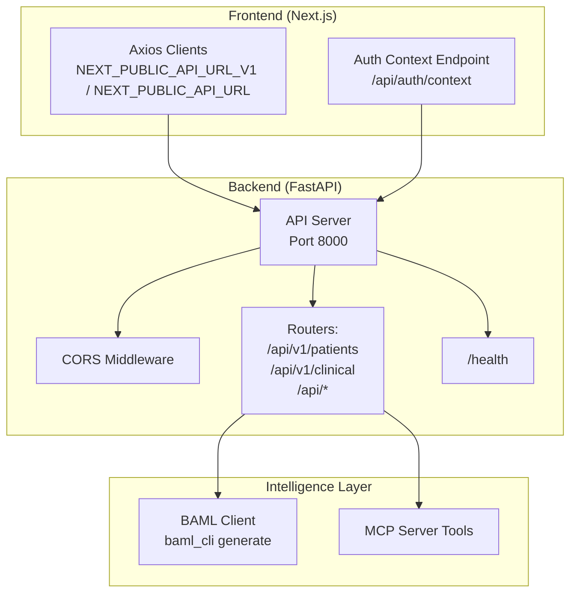

# Getting Started

<cite>
**Referenced Files in This Document**
- [README.md](file://README.md)
- [pyproject.toml](file://pyproject.toml)
- [uv.lock](file://uv.lock)
- [backend/src/api/main.py](file://backend/src/api/main.py)
- [shared/settings.py](file://shared/settings.py)
- [baml_src/clients.baml](file://baml_src/clients.baml)
- [baml_client/__init__.py](file://baml_client/__init__.py)
- [baml_client/sync_client.py](file://baml_client/sync_client.py)
- [backend/src/mcp_server/server.py](file://backend/src/mcp_server/server.py)
- [frontend/package.json](file://frontend/package.json)
- [frontend/next.config.ts](file://frontend/next.config.ts)
- [frontend/src/services/api.ts](file://frontend/src/services/api.ts)
- [frontend/src/app/api/auth/context/route.ts](file://frontend/src/app/api/auth/context/route.ts)
- [scripts/test_api.py](file://scripts/test_api.py)
</cite>

## Table of Contents
1. [Introduction](#introduction)
2. [Prerequisites](#prerequisites)
3. [Installation](#installation)
4. [Environment Configuration](#environment-configuration)
5. [Initial Startup](#initial-startup)
6. [Verification](#verification)
7. [Architecture Overview](#architecture-overview)
8. [Troubleshooting](#troubleshooting)
9. [Security Considerations](#security-considerations)
10. [Next Steps](#next-steps)

## Introduction
Navavej ROC is an enterprise-grade AI Clinical Decision Support System (CDSS) that combines structured LLM prompting with strict clinical rulesets and an immutable audit trail. This guide walks you through installing and running both the backend API server and the Next.js frontend, configuring environment variables for OpenAI-compatible LLM access, generating the BAML client, and verifying connectivity.

## Prerequisites
- Python 3.10+ and the uv package manager
- Node.js 18+ and npm
- An OpenAI-compatible LLM API key configured via environment variables

These requirements are reflected in the project’s documentation and configuration files.

**Section sources**
- [README.md:44-47](file://README.md#L44-L47)
- [pyproject.toml:22](file://pyproject.toml#L22)
- [frontend/package.json:14-24](file://frontend/package.json#L14-L24)

## Installation

### Backend Setup
1. Install Python dependencies using uv:
   - Run: uv sync
2. Generate the BAML client:
   - Run: baml-cli generate
3. Start the API server:
   - Run: PYTHONPATH=.:./backend uv run python -m src.api.main

The backend listens on port 8000 by default.

**Section sources**
- [README.md:49-59](file://README.md#L49-L59)
- [backend/src/api/main.py:41-44](file://backend/src/api/main.py#L41-L44)

### Frontend Setup
1. Navigate to the frontend directory:
   - cd frontend
2. Install Node.js dependencies:
   - npm install
3. Start the development server:
   - npm run dev

The frontend runs on port 3000 by default.

**Section sources**
- [README.md:62-72](file://README.md#L62-L72)
- [frontend/package.json:5-13](file://frontend/package.json#L5-L13)

## Environment Configuration

### LLM Provider Configuration
Configure your OpenAI-compatible LLM provider using the following environment variables:
- LLM_API_KEY: Your API key
- LLM_BASE_URL: The base URL for your LLM provider
- LLM_MODEL: The model identifier to use

These variables are consumed by the BAML client configuration and the project settings.

**Section sources**
- [baml_src/clients.baml:5-12](file://baml_src/clients.baml#L5-L12)
- [shared/settings.py:29-36](file://shared/settings.py#L29-L36)

### Backend Settings
Additional backend settings include:
- CORS origins for frontend integration
- Audit logging path
- Authentication defaults and permissions
- Cache TTL settings

**Section sources**
- [shared/settings.py:45-69](file://shared/settings.py#L45-L69)

### Frontend API Base URLs
The frontend reads API base URLs from environment variables:
- NEXT_PUBLIC_API_URL_V1: Legacy API base URL (default: http://localhost:8000/api/v1)
- NEXT_PUBLIC_API_URL: Contract API base URL (default: http://localhost:8000/api)

**Section sources**
- [frontend/src/services/api.ts:36-38](file://frontend/src/services/api.ts#L36-L38)

## Initial Startup

### Backend
- Ensure uv is installed and available in PATH
- Run uv sync to install Python dependencies
- Generate BAML client with baml-cli generate
- Start the server with uv run python -m src.api.main

The server registers CORS for frontend origins and exposes health and clinical endpoints.

**Section sources**
- [backend/src/api/main.py:14-38](file://backend/src/api/main.py#L14-L38)

### Frontend
- From the frontend directory, run npm install
- Start the dev server with npm run dev

The frontend uses axios clients configured with timeouts and interceptors for robust error handling.

**Section sources**
- [frontend/src/services/api.ts:45-59](file://frontend/src/services/api.ts#L45-L59)

## Verification

### Health Check
Run the provided health check script to verify the backend is reachable:
- python scripts/test_api.py

This script queries the /health endpoint and prints the response.

**Section sources**
- [scripts/test_api.py:4-7](file://scripts/test_api.py#L4-L7)

### Manual Browser Checks
- Backend: Visit http://localhost:8000/health
- Frontend: Visit http://localhost:3000

Both should respond without errors.

**Section sources**
- [backend/src/api/main.py:35-38](file://backend/src/api/main.py#L35-L38)

## Architecture Overview

**Diagram sources**
- [backend/src/api/main.py:14-38](file://backend/src/api/main.py#L14-L38)
- [frontend/src/services/api.ts:36-59](file://frontend/src/services/api.ts#L36-L59)
- [frontend/src/app/api/auth/context/route.ts:3-11](file://frontend/src/app/api/auth/context/route.ts#L3-L11)
- [baml_client/sync_client.py:521](file://baml_client/sync_client.py#L521)
- [backend/src/mcp_server/server.py:11-22](file://backend/src/mcp_server/server.py#L11-L22)

## Troubleshooting

### Common Issues and Solutions
- Port conflicts:
  - Backend port 8000: Change in backend/src/api/main.py if needed
  - Frontend port 3000: Adjust in frontend next.config.ts or via npm script
- CORS errors:
  - Ensure CORS origins include http://localhost:3000 in shared/settings.py
- Missing BAML client:
  - Ensure baml-cli is installed and run baml-cli generate
- LLM connectivity:
  - Verify LLM_API_KEY, LLM_BASE_URL, and LLM_MODEL are set correctly
- Frontend API base URLs:
  - Confirm NEXT_PUBLIC_API_URL_V1 and NEXT_PUBLIC_API_URL match backend address

**Section sources**
- [backend/src/api/main.py:20-27](file://backend/src/api/main.py#L20-L27)
- [shared/settings.py:52](file://shared/settings.py#L52)
- [baml_client/__init__.py:15-30](file://baml_client/__init__.py#L15-L30)
- [frontend/src/services/api.ts:36-38](file://frontend/src/services/api.ts#L36-L38)

## Security Considerations

- API Keys:
  - Store LLM_API_KEY securely; avoid committing to version control
  - Use environment-specific .env files and CI/CD secret management
- CORS:
  - Restrict allowed origins to trusted domains only
- Audit Logging:
  - Review logs/audit.jsonl for compliance and integrity checks
- Authentication:
  - The frontend reads auth context from environment variables for POC; in production, integrate with a secure session/cookie store

**Section sources**
- [shared/settings.py:50-57](file://shared/settings.py#L50-L57)
- [frontend/src/app/api/auth/context/route.ts:6-10](file://frontend/src/app/api/auth/context/route.ts#L6-L10)

## Next Steps
- Explore clinical endpoints under /api/v1/clinical and contract endpoints under /api/*
- Integrate with your OpenAI-compatible LLM provider by setting LLM_* environment variables
- Customize frontend environment variables for your deployment domain
- Review and extend BAML prompt templates in baml_src/ for your use cases

[No sources needed since this section summarizes without analyzing specific files]