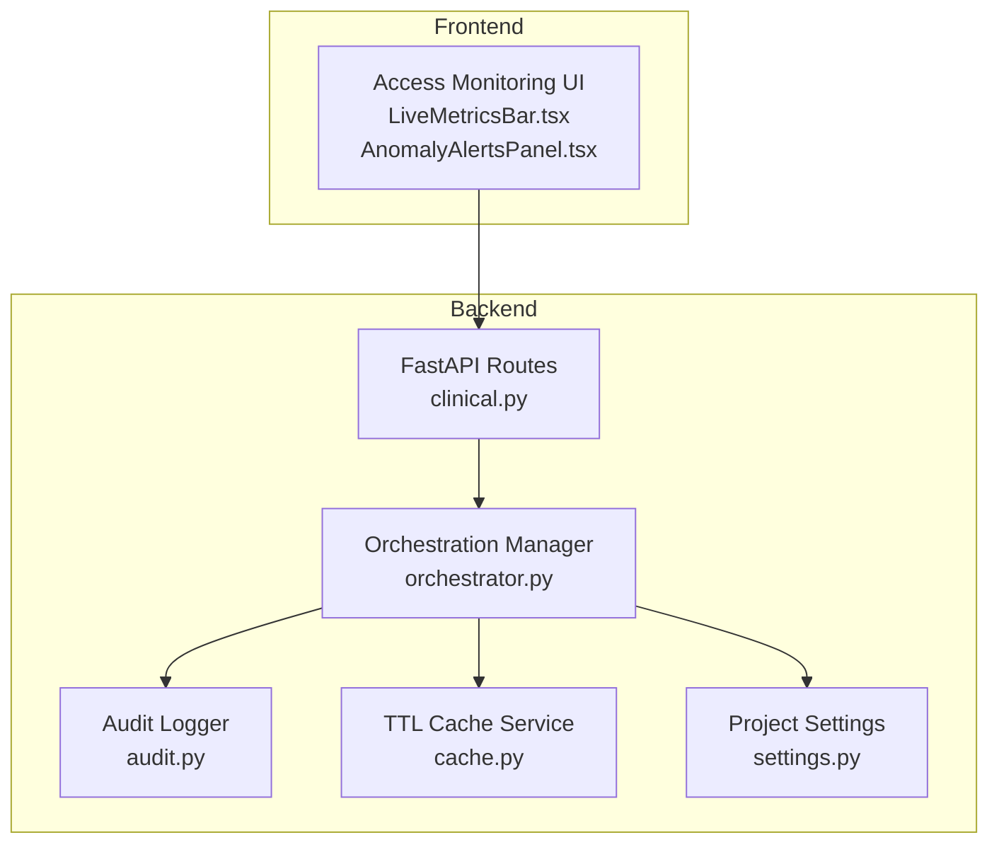
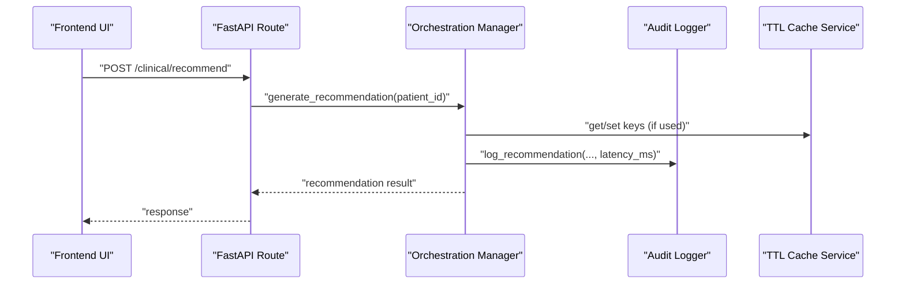
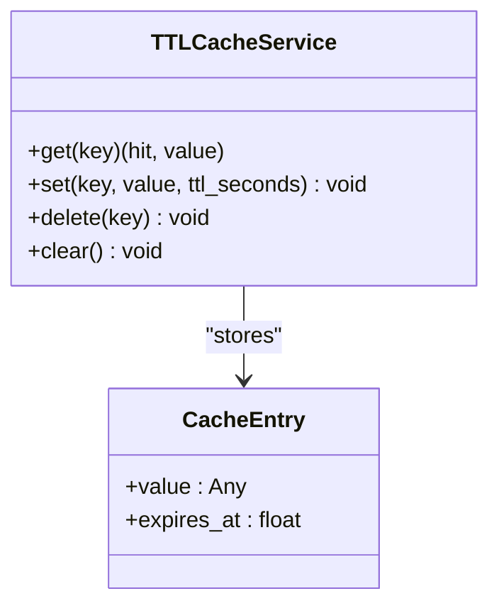
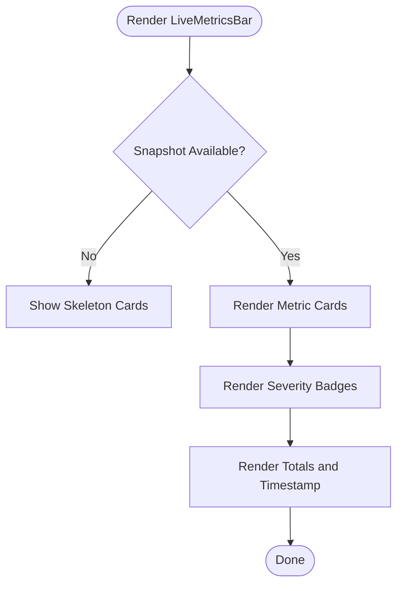
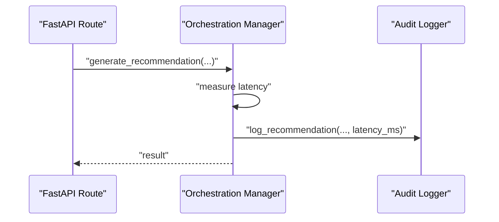
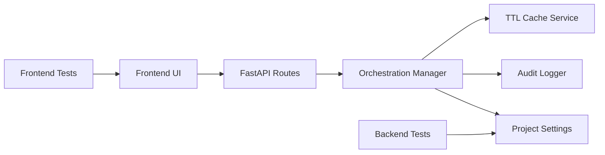

# Monitoring and Operations

<cite>
**Referenced Files in This Document**
- [settings.py](file://shared/settings.py)
- [cache.py](file://backend/src/services/cache.py)
- [test_backend_cache_ttl.py](file://scripts/tests/test_backend_cache_ttl.py)
- [LiveMetricsBar.tsx](file://frontend/src/components/access-monitoring/LiveMetricsBar.tsx)
- [AnomalyAlertsPanel.tsx](file://frontend/src/components/access-monitoring/AnomalyAlertsPanel.tsx)
- [clinical.py](file://backend/src/api/routes/clinical.py)
- [orchestrator.py](file://backend/src/services/orchestrator.py)
- [audit.py](file://backend/src/services/audit.py)
- [conftest.py](file://scripts/tests/conftest.py)
- [vitest.config.ts](file://frontend/vitest.config.ts)
- [pyproject.toml](file://pyproject.toml)
- [README.md](file://README.md)
</cite>

## Table of Contents
1. [Introduction](#introduction)
2. [Project Structure](#project-structure)
3. [Core Components](#core-components)
4. [Architecture Overview](#architecture-overview)
5. [Detailed Component Analysis](#detailed-component-analysis)
6. [Dependency Analysis](#dependency-analysis)
7. [Performance Considerations](#performance-considerations)
8. [Troubleshooting Guide](#troubleshooting-guide)
9. [Conclusion](#conclusion)
10. [Appendices](#appendices)

## Introduction
This document provides comprehensive monitoring and operations guidance for Navavej ROC. It covers live metrics and alerting, performance monitoring, anomaly detection, system health checks, cache management (including recommendation caching, TTL configuration, and cache warm-up strategies), operational procedures (maintenance, logging, performance tuning), dashboard configuration, alert thresholds and escalation, testing infrastructure (unit/integration and quality gates), deployment and rollback procedures, disaster recovery planning, and troubleshooting and optimization techniques.

## Project Structure
Navavej ROC is a dual-layer system:
- Backend service built with FastAPI and Python, exposing recommendation APIs, orchestration, audit logging, and cache utilities.
- Frontend built with Next.js and React, featuring access monitoring dashboards, live metrics, and anomaly alerts panels.

Key operational areas:
- Settings and configuration (environment variables, cache TTLs, audit paths).
- Backend cache service for in-memory TTL caching.
- Frontend monitoring UI components for live metrics and anomaly alerts.
- Audit logging with cryptographic chaining for immutable records.
- Testing infrastructure for backend and frontend with pytest and Vitest.

**Diagram sources**
- [clinical.py:1-82](file://backend/src/api/routes/clinical.py#L1-L82)
- [orchestrator.py:1-151](file://backend/src/services/orchestrator.py#L1-L151)
- [audit.py:1-173](file://backend/src/services/audit.py#L1-L173)
- [cache.py:1-46](file://backend/src/services/cache.py#L1-L46)
- [settings.py:1-70](file://shared/settings.py#L1-L70)
- [LiveMetricsBar.tsx:1-75](file://frontend/src/components/access-monitoring/LiveMetricsBar.tsx#L1-L75)
- [AnomalyAlertsPanel.tsx:1-69](file://frontend/src/components/access-monitoring/AnomalyAlertsPanel.tsx#L1-L69)

**Section sources**
- [settings.py:1-70](file://shared/settings.py#L1-L70)
- [cache.py:1-46](file://backend/src/services/cache.py#L1-L46)
- [clinical.py:1-82](file://backend/src/api/routes/clinical.py#L1-L82)
- [orchestrator.py:1-151](file://backend/src/services/orchestrator.py#L1-L151)
- [audit.py:1-173](file://backend/src/services/audit.py#L1-L173)
- [LiveMetricsBar.tsx:1-75](file://frontend/src/components/access-monitoring/LiveMetricsBar.tsx#L1-L75)
- [AnomalyAlertsPanel.tsx:1-69](file://frontend/src/components/access-monitoring/AnomalyAlertsPanel.tsx#L1-L69)

## Core Components
- Settings and configuration: Centralized environment-driven configuration including cache TTLs, audit log paths, and security scopes.
- TTL cache service: Thread-safe in-memory cache with expiration and atomic operations.
- Orchestration manager: Coordinates recommendation pipeline, safety validation, audit logging, and PII rehydration.
- Audit logger: Immutable audit trail with SHA-256 chained records and dual-file formats (JSONL and JSON).
- Frontend monitoring UI: Live metrics bar and anomaly alerts panel for real-time visibility.

**Section sources**
- [settings.py:45-69](file://shared/settings.py#L45-L69)
- [cache.py:13-46](file://backend/src/services/cache.py#L13-L46)
- [orchestrator.py:17-151](file://backend/src/services/orchestrator.py#L17-L151)
- [audit.py:14-173](file://backend/src/services/audit.py#L14-L173)
- [LiveMetricsBar.tsx:10-75](file://frontend/src/components/access-monitoring/LiveMetricsBar.tsx#L10-L75)
- [AnomalyAlertsPanel.tsx:18-69](file://frontend/src/components/access-monitoring/AnomalyAlertsPanel.tsx#L18-L69)

## Architecture Overview
The system integrates frontend monitoring with backend orchestration and persistence. Requests flow from the frontend to the backend recommendation endpoint, which coordinates workflows, applies safety rules, logs audits, and optionally uses cached data. The frontend displays live metrics and anomalies.

**Diagram sources**
- [clinical.py:22-48](file://backend/src/api/routes/clinical.py#L22-L48)
- [orchestrator.py:31-124](file://backend/src/services/orchestrator.py#L31-L124)
- [audit.py:55-120](file://backend/src/services/audit.py#L55-L120)
- [cache.py:18-33](file://backend/src/services/cache.py#L18-L33)

## Detailed Component Analysis

### Cache Management System
- Purpose: Provide in-memory caching for backend components with TTL-based expiration.
- Implementation: Thread-safe dictionary-backed cache with atomic get/set/delete/clear operations.
- TTL configuration: Controlled via centralized settings with per-category TTLs (e.g., registry, ruleset, signal store, recommendation).
- Cache warm-up: Recommended to pre-load frequently accessed data (e.g., signal store records) during startup or scheduled maintenance windows.

**Diagram sources**
- [cache.py:7-46](file://backend/src/services/cache.py#L7-L46)

Operational guidance:
- Configure TTLs per component using settings to balance freshness and performance.
- Warm cache during maintenance windows to reduce cold-start latency.
- Monitor cache hit rate and adjust TTLs based on observed access patterns.

**Section sources**
- [cache.py:13-46](file://backend/src/services/cache.py#L13-L46)
- [settings.py:61-66](file://shared/settings.py#L61-L66)
- [test_backend_cache_ttl.py:12-43](file://scripts/tests/test_backend_cache_ttl.py#L12-L43)

### Live Metrics and Alert System
- Live metrics bar displays active users, sessions today, records accessed today, alerts by severity, AI recommendations generated today, safety validator failures, and snapshot timestamp.
- Anomaly alerts panel lists triggered anomalies with severity badges and status indicators.
- These components consume a monitoring snapshot structure and render counts and statuses.

**Diagram sources**
- [LiveMetricsBar.tsx:10-75](file://frontend/src/components/access-monitoring/LiveMetricsBar.tsx#L10-L75)

Alert thresholds and escalation:
- Define severity thresholds (Critical, High, Medium, Low) and alert volume baselines.
- Escalation: If anomaly counts exceed thresholds for sustained periods, trigger notifications to on-call and auto-scale resources.

**Section sources**
- [LiveMetricsBar.tsx:34-54](file://frontend/src/components/access-monitoring/LiveMetricsBar.tsx#L34-L54)
- [AnomalyAlertsPanel.tsx:18-69](file://frontend/src/components/access-monitoring/AnomalyAlertsPanel.tsx#L18-L69)

### Performance Monitoring and Anomaly Detection
- End-to-end latency is captured during orchestration and logged as part of the audit trail.
- Anomaly detection surfaces in the UI via the anomaly alerts panel; persistence is not implemented in this POC.
- Suggested anomaly signals: sudden spikes in latency, safety validator failures, audit write errors, cache miss rates.

**Diagram sources**
- [orchestrator.py:53-99](file://backend/src/services/orchestrator.py#L53-L99)
- [audit.py:55-120](file://backend/src/services/audit.py#L55-L120)

**Section sources**
- [orchestrator.py:31-124](file://backend/src/services/orchestrator.py#L31-L124)
- [audit.py:55-120](file://backend/src/services/audit.py#L55-L120)

### System Health Checks
- Audit log health: Verify JSONL and JSON files exist and are appendable; monitor last hash consistency.
- Cache health: Validate get/set cycles and expiry behavior.
- API health: Confirm recommendation endpoint responds and handles missing patient gracefully.

**Section sources**
- [audit.py:17-43](file://backend/src/services/audit.py#L17-L43)
- [test_backend_cache_ttl.py:12-26](file://scripts/tests/test_backend_cache_ttl.py#L12-L26)
- [clinical.py:27-34](file://backend/src/api/routes/clinical.py#L27-L34)

### Operational Procedures
- Maintenance windows: Perform cache warm-up, schema updates, and dependency upgrades during low-traffic periods.
- Log management: Rotate audit logs, monitor disk usage, and retain logs per compliance requirements.
- Performance tuning: Adjust cache TTLs, scale backend workers, and optimize MCP client timeouts.

[No sources needed since this section provides general guidance]

### Monitoring Dashboard Configuration
- Live metrics bar: Display counts for active users, sessions, records, and alerts by severity.
- Anomaly alerts panel: List triggered anomalies with severity and status placeholders.
- Configure thresholds and refresh intervals in the frontend components and backend snapshot generation.

**Section sources**
- [LiveMetricsBar.tsx:34-54](file://frontend/src/components/access-monitoring/LiveMetricsBar.tsx#L34-L54)
- [AnomalyAlertsPanel.tsx:30-66](file://frontend/src/components/access-monitoring/AnomalyAlertsPanel.tsx#L30-L66)

### Testing Infrastructure
- Backend: pytest with asyncio support; centralized environment loading via conftest.
- Frontend: Vitest with jsdom environment, global setup, and React plugin.
- Quality gates: Enforce linting and docstring conventions; integrate coverage reporting.

**Section sources**
- [pyproject.toml:18-21](file://pyproject.toml#L18-L21)
- [conftest.py:1-14](file://scripts/tests/conftest.py#L1-L14)
- [vitest.config.ts:1-20](file://frontend/vitest.config.ts#L1-L20)

### Deployment, Rollback, and Disaster Recovery
- Deployment: Build and run backend with FastAPI and Uvicorn; serve frontend with Next.js production build.
- Rollback: Maintain artifact versions; revert database/state changes if audit integrity is compromised.
- Disaster recovery: Replicate audit logs to external storage; restore cache from warm-up artifacts; validate chain integrity post-restore.

[No sources needed since this section provides general guidance]

## Dependency Analysis
- Backend depends on settings for configuration, cache for in-memory storage, and audit for immutable logs.
- Frontend depends on monitoring snapshots to render live metrics and anomaly alerts.
- Tests depend on shared environment configuration and project root paths.

**Diagram sources**
- [settings.py:45-69](file://shared/settings.py#L45-L69)
- [cache.py:13-46](file://backend/src/services/cache.py#L13-L46)
- [audit.py:14-173](file://backend/src/services/audit.py#L14-L173)
- [clinical.py:12-17](file://backend/src/api/routes/clinical.py#L12-L17)
- [orchestrator.py:17-30](file://backend/src/services/orchestrator.py#L17-L30)
- [conftest.py:6-13](file://scripts/tests/conftest.py#L6-L13)
- [vitest.config.ts:5-18](file://frontend/vitest.config.ts#L5-L18)

**Section sources**
- [settings.py:45-69](file://shared/settings.py#L45-L69)
- [cache.py:13-46](file://backend/src/services/cache.py#L13-L46)
- [audit.py:14-173](file://backend/src/services/audit.py#L14-L173)
- [clinical.py:12-17](file://backend/src/api/routes/clinical.py#L12-L17)
- [orchestrator.py:17-30](file://backend/src/services/orchestrator.py#L17-L30)
- [conftest.py:6-13](file://scripts/tests/conftest.py#L6-L13)
- [vitest.config.ts:5-18](file://frontend/vitest.config.ts#L5-L18)

## Performance Considerations
- Cache TTL tuning: Align TTLs with access frequency; increase for stable data, decrease for volatile content.
- Concurrency: Use thread-safe cache operations; avoid contention by minimizing lock scope.
- Observability: Record and expose latency metrics; correlate with audit logs for end-to-end visibility.
- Resource scaling: Provision CPU/memory for MCP clients and LLM inference; monitor queue depths.

[No sources needed since this section provides general guidance]

## Troubleshooting Guide
Common issues and resolutions:
- Cache misses immediately after set: Verify TTL calculation and current time comparisons; confirm lock acquisition.
- Audit log write failures: Check file permissions and disk space; validate JSONL append mode.
- Recommendation endpoint errors: Validate patient existence and token resolution; inspect orchestration logs.
- Frontend rendering anomalies: Ensure snapshot availability; verify metric field presence.

**Section sources**
- [cache.py:18-27](file://backend/src/services/cache.py#L18-L27)
- [audit.py:112-118](file://backend/src/services/audit.py#L112-L118)
- [clinical.py:27-48](file://backend/src/api/routes/clinical.py#L27-L48)
- [LiveMetricsBar.tsx:11-29](file://frontend/src/components/access-monitoring/LiveMetricsBar.tsx#L11-L29)

## Conclusion
Navavej ROC provides a robust foundation for monitoring and operations through centralized settings, a thread-safe TTL cache, comprehensive audit logging, and a frontend-driven monitoring UI. By tuning cache TTLs, enforcing quality gates, and establishing clear alert thresholds and escalations, operators can maintain high reliability and performance. The testing infrastructure supports continuous validation, while deployment and DR plans ensure resilience against failures.

[No sources needed since this section summarizes without analyzing specific files]

## Appendices
- Environment variables and roles are configured centrally; ensure secrets are managed securely and rotated periodically.
- Review README for setup and local development guidance.

**Section sources**
- [README.md](file://README.md)