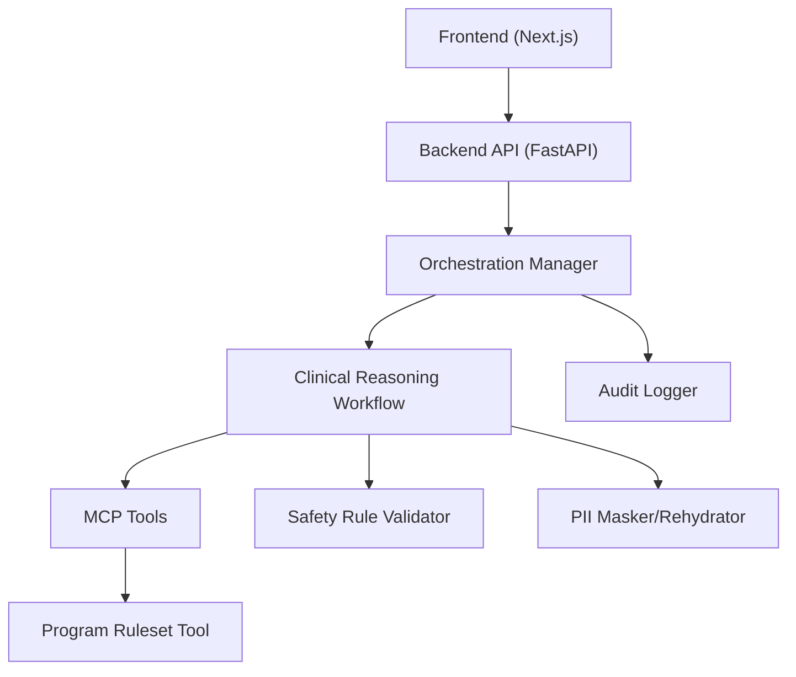
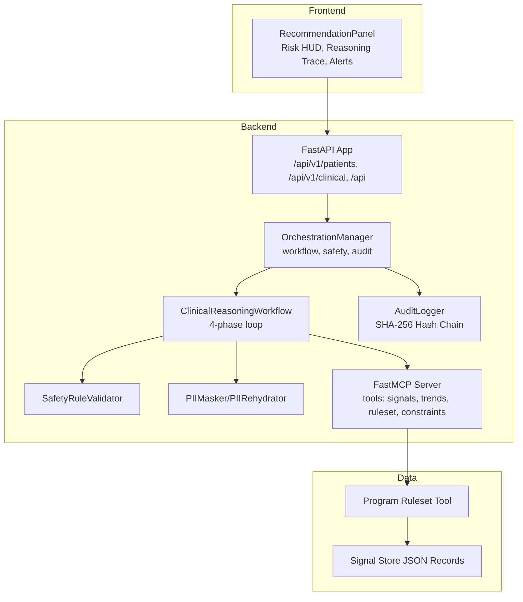
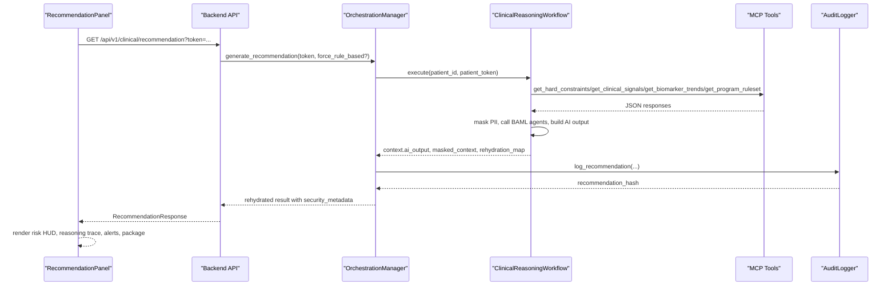
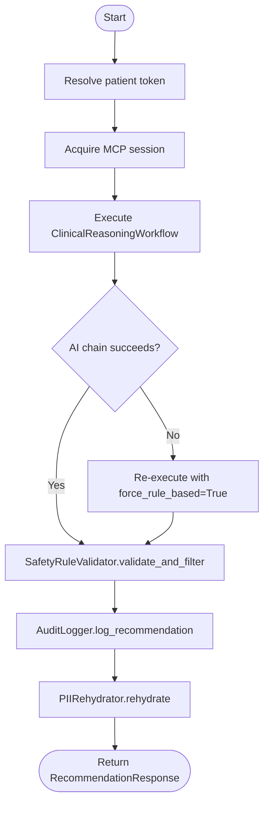
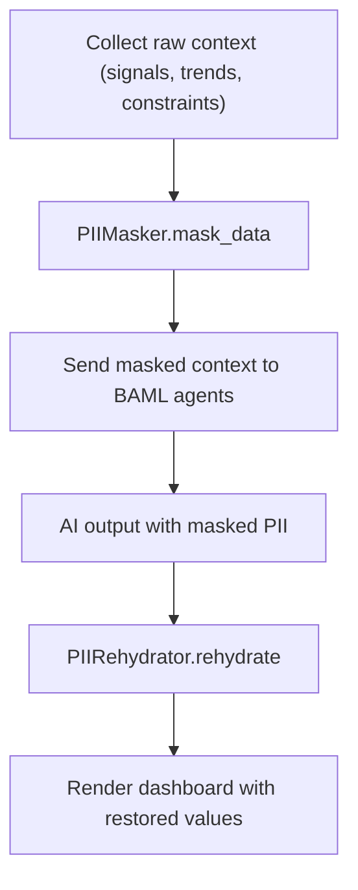
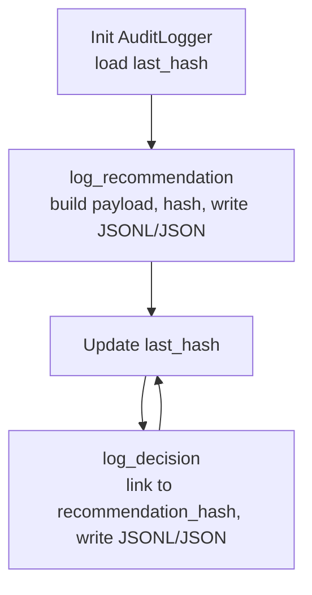
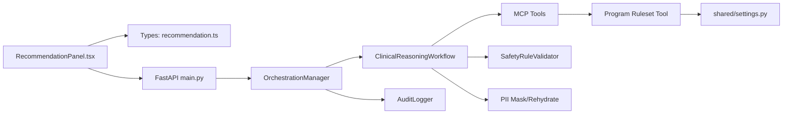

# Project Overview

<cite>
**Referenced Files in This Document**
- [README.md](file://README.md)
- [backend/src/api/main.py](file://backend/src/api/main.py)
- [backend/src/mcp_server/server.py](file://backend/src/mcp_server/server.py)
- [backend/src/services/orchestrator.py](file://backend/src/services/orchestrator.py)
- [backend/src/services/workflows/clinical.py](file://backend/src/services/workflows/clinical.py)
- [backend/src/services/audit.py](file://backend/src/services/audit.py)
- [backend/src/services/safety.py](file://backend/src/services/safety.py)
- [backend/src/services/privacy.py](file://backend/src/services/privacy.py)
- [backend/src/mcp_server/tools/program_ruleset.py](file://backend/src/mcp_server/tools/program_ruleset.py)
- [frontend/src/components/dashboard/RecommendationPanel.tsx](file://frontend/src/components/dashboard/RecommendationPanel.tsx)
- [frontend/src/types/recommendation.ts](file://frontend/src/types/recommendation.ts)
- [shared/settings.py](file://shared/settings.py)
- [assets/synthesis/generated/Test/record_test.json](file://assets/synthesis/generated/Test/record_test.json)
</cite>

## Table of Contents
1. [Introduction](#introduction)
2. [Project Structure](#project-structure)
3. [Core Components](#core-components)
4. [Architecture Overview](#architecture-overview)
5. [Detailed Component Analysis](#detailed-component-analysis)
6. [Dependency Analysis](#dependency-analysis)
7. [Performance Considerations](#performance-considerations)
8. [Troubleshooting Guide](#troubleshooting-guide)
9. [Conclusion](#conclusion)
10. [Appendices](#appendices)

## Introduction
Navavej ROC (Recommendation & Orchestration Center) is an enterprise-grade AI Clinical Decision Support System (CDSS) developed for Navavej International Hospital. It enables physicians to deliver personalized, data-driven health checkup strategies by combining advanced AI reasoning (Large Language Models) with strict clinical rulesets and an immutable audit trail. The system emphasizes transparency, safety, and privacy-first design, delivering:
- Transparent AI reasoning trace for physician trust and education
- Smart tier selection that maps risk profiles to Standard, Advanced, or Premium packages
- Privacy-preserving processing with PII masking and HMAC-based tokens
- Immutable audit logging with SHA-256 hash chaining for governance and compliance

Target audiences include:
- Physicians who need evidence-backed, explainable recommendations
- Administrators who require governance dashboards and auditability
- Healthcare data scientists who manage rulesets, signal stores, and AI prompts

Key differentiators:
- Transparent AI reasoning trace: physicians can inspect the “why” behind recommendations
- Smart tier selection: dynamic package assignment based on risk and demographics
- Privacy-first architecture: PII is masked before AI processing and rehydrated only for display

## Project Structure
The repository is organized into modular layers:
- Frontend: Next.js application rendering clinical insights, trends, and governance panels
- Backend: FastAPI service exposing clinical APIs, orchestration, MCP tools, and audit/logging
- Intelligence Layer: BAML (structured LLM prompting) and Model Context Protocol (MCP) for tooling
- Data Governance: Audit logger enforcing immutable records and safety validators ensuring eligibility

**Diagram sources**
- [backend/src/api/main.py:14-38](file://backend/src/api/main.py#L14-L38)
- [backend/src/services/orchestrator.py:17-124](file://backend/src/services/orchestrator.py#L17-L124)
- [backend/src/services/workflows/clinical.py:17-65](file://backend/src/services/workflows/clinical.py#L17-L65)
- [backend/src/mcp_server/server.py:11-19](file://backend/src/mcp_server/server.py#L11-L19)
- [backend/src/services/audit.py:14-120](file://backend/src/services/audit.py#L14-L120)
- [backend/src/services/safety.py:3-58](file://backend/src/services/safety.py#L3-L58)
- [backend/src/services/privacy.py:22-94](file://backend/src/services/privacy.py#L22-L94)
- [backend/src/mcp_server/tools/program_ruleset.py:20-115](file://backend/src/mcp_server/tools/program_ruleset.py#L20-L115)

**Section sources**
- [README.md:76-85](file://README.md#L76-L85)
- [backend/src/api/main.py:14-38](file://backend/src/api/main.py#L14-L38)
- [backend/src/mcp_server/server.py:11-19](file://backend/src/mcp_server/server.py#L11-L19)
- [backend/src/services/orchestrator.py:17-124](file://backend/src/services/orchestrator.py#L17-L124)
- [backend/src/services/workflows/clinical.py:17-65](file://backend/src/services/workflows/clinical.py#L17-L65)
- [backend/src/services/audit.py:14-120](file://backend/src/services/audit.py#L14-L120)
- [backend/src/services/safety.py:3-58](file://backend/src/services/safety.py#L3-L58)
- [backend/src/services/privacy.py:22-94](file://backend/src/services/privacy.py#L22-L94)
- [backend/src/mcp_server/tools/program_ruleset.py:20-115](file://backend/src/mcp_server/tools/program_ruleset.py#L20-L115)

## Core Components
- Frontend Dashboard: Presents risk HUD, reasoning trace, package recommendations, critical alerts, and consultation guide. Supports privacy mode with masked PII and trace.
- Backend API: FastAPI endpoints for patients, clinical AI, and contracts; CORS-enabled for frontend.
- Orchestration Manager: Coordinates MCP sessions, workflows, safety validation, and audit logging; supports deterministic fallback when AI fails.
- Clinical Reasoning Workflow: Executes 4 phases—baseline, signals, trends, and recommendation—integrating BAML agents and rulesets; masks PII before AI and rehydrates for display.
- MCP Tools: Provide hard constraints, clinical signals, trends, event timelines, and program rulesets.
- Safety Validator: Filters add-ons against gender/age constraints and contraindications.
- Audit Logger: Writes immutable JSONL/JSON logs with SHA-256 hash chaining for governance.
- Privacy Module: Pseudonymizes PII and restores it only for frontend display.

**Section sources**
- [frontend/src/components/dashboard/RecommendationPanel.tsx:169-602](file://frontend/src/components/dashboard/RecommendationPanel.tsx#L169-L602)
- [backend/src/api/main.py:14-38](file://backend/src/api/main.py#L14-L38)
- [backend/src/services/orchestrator.py:17-124](file://backend/src/services/orchestrator.py#L17-L124)
- [backend/src/services/workflows/clinical.py:17-65](file://backend/src/services/workflows/clinical.py#L17-L65)
- [backend/src/mcp_server/server.py:11-19](file://backend/src/mcp_server/server.py#L11-L19)
- [backend/src/services/safety.py:3-58](file://backend/src/services/safety.py#L3-L58)
- [backend/src/services/audit.py:14-120](file://backend/src/services/audit.py#L14-L120)
- [backend/src/services/privacy.py:22-94](file://backend/src/services/privacy.py#L22-L94)

## Architecture Overview
Navavej ROC integrates a frontend dashboard with a backend API, an intelligence layer powered by BAML and MCP, and governance components for safety and auditability.

**Diagram sources**
- [frontend/src/components/dashboard/RecommendationPanel.tsx:169-602](file://frontend/src/components/dashboard/RecommendationPanel.tsx#L169-L602)
- [backend/src/api/main.py:14-38](file://backend/src/api/main.py#L14-L38)
- [backend/src/services/orchestrator.py:17-124](file://backend/src/services/orchestrator.py#L17-L124)
- [backend/src/services/workflows/clinical.py:17-65](file://backend/src/services/workflows/clinical.py#L17-L65)
- [backend/src/mcp_server/server.py:11-19](file://backend/src/mcp_server/server.py#L11-L19)
- [backend/src/services/audit.py:14-120](file://backend/src/services/audit.py#L14-L120)
- [backend/src/services/safety.py:3-58](file://backend/src/services/safety.py#L3-L58)
- [backend/src/services/privacy.py:22-94](file://backend/src/services/privacy.py#L22-L94)
- [backend/src/mcp_server/tools/program_ruleset.py:20-115](file://backend/src/mcp_server/tools/program_ruleset.py#L20-L115)

## Detailed Component Analysis

### Frontend Dashboard: RecommendationPanel
The RecommendationPanel renders:
- Risk HUD with overall risk level and confidence indicators
- Recommended tier and resolved package pricing
- Transparent reasoning trace with optional privacy masking
- Critical signals and action panel for physician notes and approval
- Consultation guide with AI-generated communication script

**Diagram sources**
- [frontend/src/components/dashboard/RecommendationPanel.tsx:169-602](file://frontend/src/components/dashboard/RecommendationPanel.tsx#L169-L602)
- [backend/src/api/main.py:29-32](file://backend/src/api/main.py#L29-L32)
- [backend/src/services/orchestrator.py:31-124](file://backend/src/services/orchestrator.py#L31-L124)
- [backend/src/services/workflows/clinical.py:33-153](file://backend/src/services/workflows/clinical.py#L33-L153)
- [backend/src/mcp_server/server.py:11-19](file://backend/src/mcp_server/server.py#L11-L19)
- [backend/src/services/audit.py:55-120](file://backend/src/services/audit.py#L55-L120)

**Section sources**
- [frontend/src/components/dashboard/RecommendationPanel.tsx:169-602](file://frontend/src/components/dashboard/RecommendationPanel.tsx#L169-L602)
- [frontend/src/types/recommendation.ts:63-96](file://frontend/src/types/recommendation.ts#L63-L96)

### Orchestration and Safety
The OrchestrationManager coordinates:
- MCP client lifecycle via factory
- Workflow execution with deterministic fallback
- Safety validation to filter add-ons
- Audit logging with hash chaining and metadata capture
- PII rehydration for frontend display

**Diagram sources**
- [backend/src/services/orchestrator.py:31-124](file://backend/src/services/orchestrator.py#L31-L124)
- [backend/src/services/workflows/clinical.py:60-153](file://backend/src/services/workflows/clinical.py#L60-L153)
- [backend/src/services/safety.py:6-58](file://backend/src/services/safety.py#L6-L58)
- [backend/src/services/audit.py:55-120](file://backend/src/services/audit.py#L55-L120)
- [backend/src/services/privacy.py:60-94](file://backend/src/services/privacy.py#L60-L94)

**Section sources**
- [backend/src/services/orchestrator.py:17-124](file://backend/src/services/orchestrator.py#L17-L124)
- [backend/src/services/safety.py:3-58](file://backend/src/services/safety.py#L3-L58)
- [backend/src/services/audit.py:14-120](file://backend/src/services/audit.py#L14-L120)
- [backend/src/services/privacy.py:22-94](file://backend/src/services/privacy.py#L22-L94)

### Privacy-First Data Handling
The system masks PII prior to AI processing and restores it only for display:
- PIIMasker recursively replaces sensitive fields with tokens and maintains a rehydration map
- PIIRehydrator restores tokens to original values for frontend rendering
- Privacy mode toggles masked display of reasoning trace and critical alerts

**Diagram sources**
- [backend/src/services/privacy.py:22-94](file://backend/src/services/privacy.py#L22-L94)
- [backend/src/services/workflows/clinical.py:56-65](file://backend/src/services/workflows/clinical.py#L56-L65)
- [frontend/src/components/dashboard/RecommendationPanel.tsx:274](file://frontend/src/components/dashboard/RecommendationPanel.tsx#L274)

**Section sources**
- [backend/src/services/privacy.py:22-94](file://backend/src/services/privacy.py#L22-L94)
- [frontend/src/components/dashboard/RecommendationPanel.tsx:274](file://frontend/src/components/dashboard/RecommendationPanel.tsx#L274)

### Audit Trail and Governance
The AuditLogger enforces immutability:
- Dual-format logging: JSONL append-only and JSON array for retrieval
- SHA-256 hash chaining linking each entry to the previous
- Structured payload capturing who, what, where, why, how, and metadata
- Decision logging for physician approvals with reference to recommendation hash

**Diagram sources**
- [backend/src/services/audit.py:14-173](file://backend/src/services/audit.py#L14-L173)

**Section sources**
- [backend/src/services/audit.py:14-173](file://backend/src/services/audit.py#L14-L173)

### Practical Examples: Personalized Health Checkup Recommendations
Common scenarios derived from synthetic signal store records:
- High-risk patient with multiple signals (e.g., very high ASCVD risk, hypertensive crisis, obesity) receives a Premium tier recommendation with targeted add-ons and a reasoning trace highlighting contributing factors.
- Male patient with gender-ineligible screenings (e.g., mammography, pap smear) has those items excluded by safety rules; the system still recommends appropriate alternatives aligned with guidelines.
- Patient with missing data gaps receives a rule-based preliminary tier with guidance on next steps; AI fallback applies when chain failures occur.

These examples demonstrate:
- Transparent reasoning trace for physician education
- Smart tier selection based on risk and demographics
- Safety validation preventing contraindicated add-ons
- Privacy mode masking PII and reasoning for secure sharing

**Section sources**
- [assets/synthesis/generated/Test/record_test.json:1-484](file://assets/synthesis/generated/Test/record_test.json#L1-L484)
- [backend/src/services/workflows/clinical.py:109-153](file://backend/src/services/workflows/clinical.py#L109-L153)
- [backend/src/services/safety.py:28-58](file://backend/src/services/safety.py#L28-L58)

## Dependency Analysis
The system exhibits low coupling and high cohesion across layers:
- Frontend depends on backend APIs and types
- Backend orchestrates workflow, safety, and audit while delegating data fetching to MCP tools
- MCP tools encapsulate domain-specific data retrieval and ruleset resolution
- Shared settings centralize configuration for providers, caches, and audit paths

**Diagram sources**
- [frontend/src/components/dashboard/RecommendationPanel.tsx:169-602](file://frontend/src/components/dashboard/RecommendationPanel.tsx#L169-L602)
- [frontend/src/types/recommendation.ts:63-96](file://frontend/src/types/recommendation.ts#L63-L96)
- [backend/src/api/main.py:14-38](file://backend/src/api/main.py#L14-L38)
- [backend/src/services/orchestrator.py:17-124](file://backend/src/services/orchestrator.py#L17-L124)
- [backend/src/services/workflows/clinical.py:17-65](file://backend/src/services/workflows/clinical.py#L17-L65)
- [backend/src/mcp_server/server.py:11-19](file://backend/src/mcp_server/server.py#L11-L19)
- [backend/src/services/safety.py:3-58](file://backend/src/services/safety.py#L3-L58)
- [backend/src/services/audit.py:14-120](file://backend/src/services/audit.py#L14-L120)
- [backend/src/services/privacy.py:22-94](file://backend/src/services/privacy.py#L22-L94)
- [backend/src/mcp_server/tools/program_ruleset.py:20-115](file://backend/src/mcp_server/tools/program_ruleset.py#L20-L115)
- [shared/settings.py:45-67](file://shared/settings.py#L45-L67)

**Section sources**
- [shared/settings.py:45-67](file://shared/settings.py#L45-L67)

## Performance Considerations
- Caching: Centralized TTL settings for registry, ruleset, signal store, and recommendation reduce repeated MCP calls and improve latency.
- Deterministic fallback: When AI chain fails, the system retries with a rule-based path to maintain responsiveness.
- Asynchronous MCP: Client sessions are acquired per request to avoid contention and enable parallelism.
- Audit writes: Append-only JSONL and JSON updates are optimized for streaming and retrieval respectively.

[No sources needed since this section provides general guidance]

## Troubleshooting Guide
- Health endpoint: Verify backend availability at /health.
- CORS errors: Confirm allowed origins in settings and middleware configuration.
- Audit integrity: If audit hash parsing fails, the system falls back to a zero-hash chain; inspect logs for corruption.
- Safety violations: Review filtered add-ons and conflict events; ensure ruleset add-on library and contraindications are correctly configured.
- Privacy masking: If PII is not restored, check rehydration map and token consistency.

**Section sources**
- [backend/src/api/main.py:35-38](file://backend/src/api/main.py#L35-L38)
- [shared/settings.py:52](file://shared/settings.py#L52)
- [backend/src/services/audit.py:25-42](file://backend/src/services/audit.py#L25-L42)
- [backend/src/services/safety.py:28-58](file://backend/src/services/safety.py#L28-L58)
- [backend/src/services/privacy.py:60-94](file://backend/src/services/privacy.py#L60-L94)

## Conclusion
Navavej ROC delivers a robust, transparent, and privacy-preserving CDSS tailored for enterprise healthcare. By combining AI reasoning with strict clinical rulesets and immutable audit trails, it empowers physicians to make confident, evidence-backed decisions while meeting governance and compliance needs. The modular architecture ensures scalability, maintainability, and extensibility for evolving clinical programs.

[No sources needed since this section summarizes without analyzing specific files]

## Appendices
- Target audience: Physicians, administrators, healthcare data scientists
- Key differentiators: Transparent reasoning trace, smart tier selection, privacy-first architecture
- System components: Frontend dashboard, backend API, orchestration, MCP tools, safety validator, audit logger, privacy module
- Example scenarios: High-risk stratification, gender-appropriate screening exclusions, missing data handling

[No sources needed since this section provides general guidance]