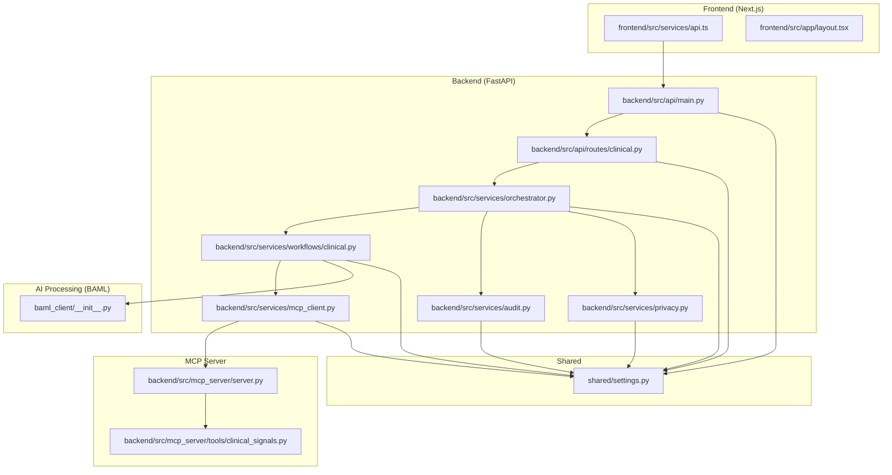
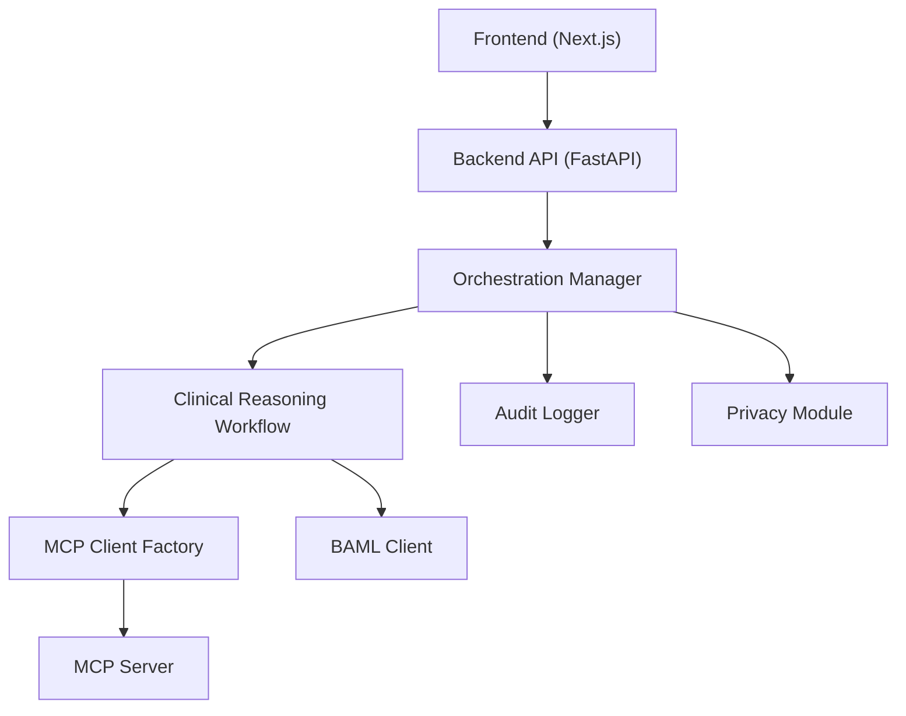
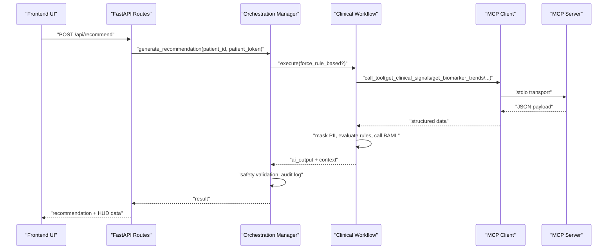
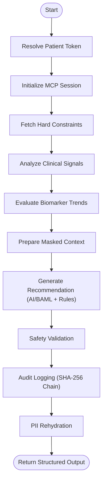
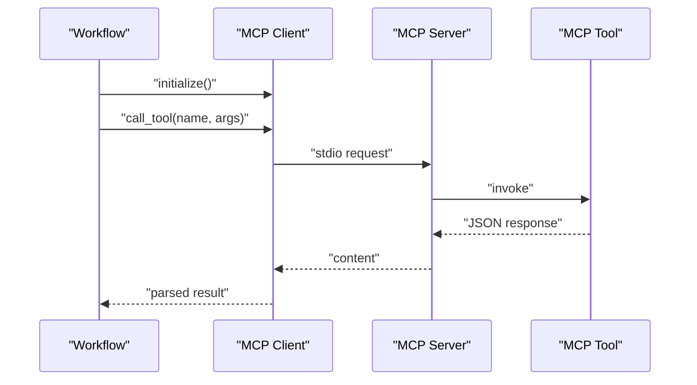
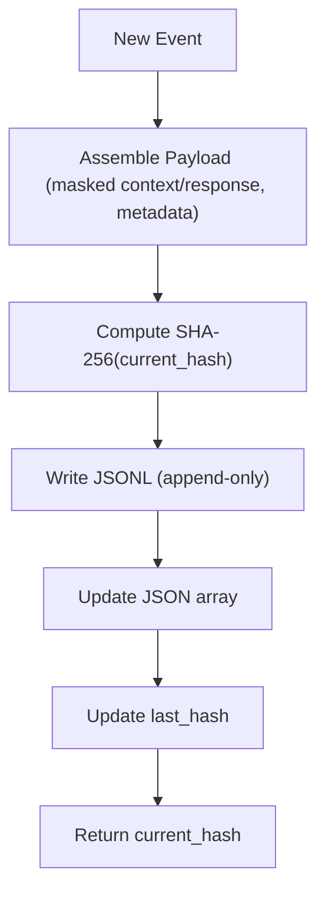
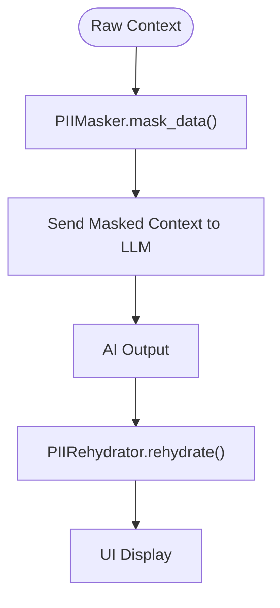
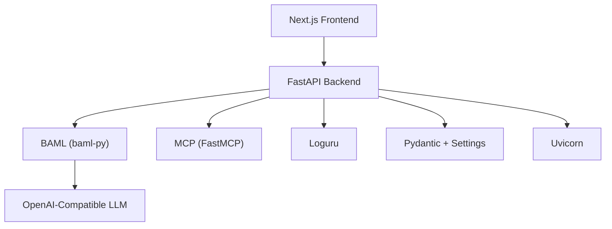
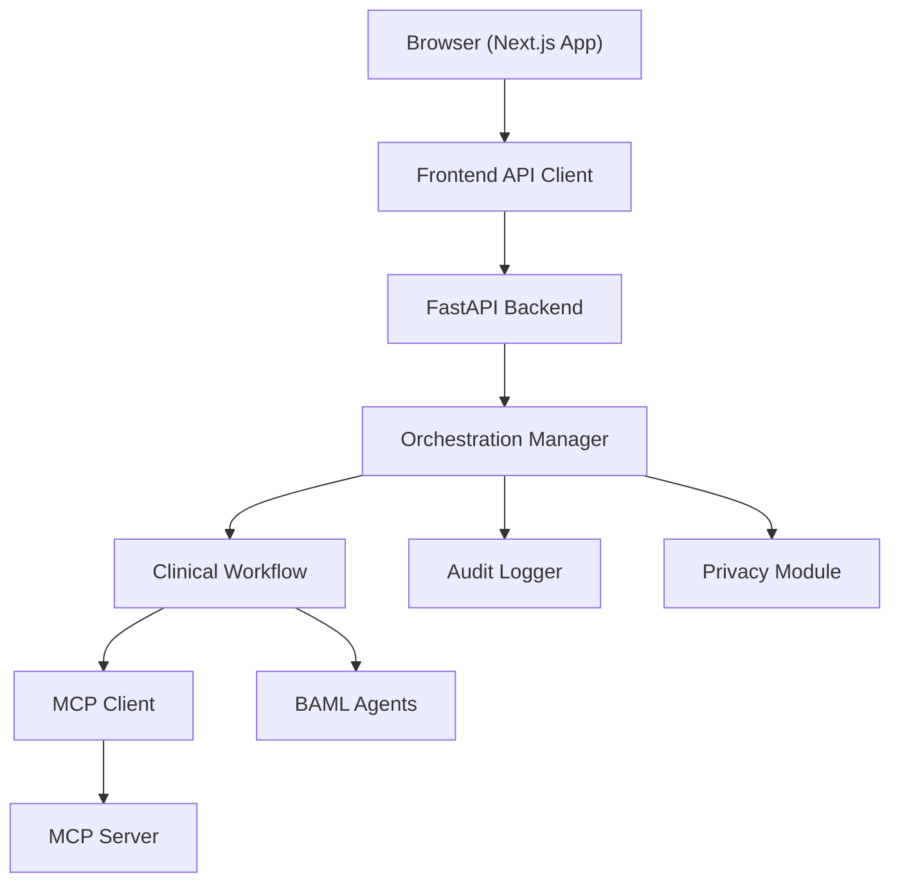

# System Architecture

<cite>
**Referenced Files in This Document**
- [README.md](file://README.md)
- [pyproject.toml](file://pyproject.toml)
- [shared/settings.py](file://shared/settings.py)
- [backend/src/api/main.py](file://backend/src/api/main.py)
- [backend/src/api/routes/clinical.py](file://backend/src/api/routes/clinical.py)
- [backend/src/mcp_server/server.py](file://backend/src/mcp_server/server.py)
- [backend/src/mcp_server/tools/clinical_signals.py](file://backend/src/mcp_server/tools/clinical_signals.py)
- [backend/src/services/orchestrator.py](file://backend/src/services/orchestrator.py)
- [backend/src/services/workflows/clinical.py](file://backend/src/services/workflows/clinical.py)
- [backend/src/services/mcp_client.py](file://backend/src/services/mcp_client.py)
- [backend/src/services/audit.py](file://backend/src/services/audit.py)
- [backend/src/services/privacy.py](file://backend/src/services/privacy.py)
- [baml_client/__init__.py](file://baml_client/__init__.py)
- [frontend/src/services/api.ts](file://frontend/src/services/api.ts)
- [frontend/src/app/layout.tsx](file://frontend/src/app/layout.tsx)
</cite>

## Table of Contents
1. [Introduction](#introduction)
2. [Project Structure](#project-structure)
3. [Core Components](#core-components)
4. [Architecture Overview](#architecture-overview)
5. [Detailed Component Analysis](#detailed-component-analysis)
6. [Dependency Analysis](#dependency-analysis)
7. [Performance Considerations](#performance-considerations)
8. [Troubleshooting Guide](#troubleshooting-guide)
9. [Conclusion](#conclusion)
10. [Appendices](#appendices)

## Introduction
Navavej ROC is an enterprise-grade AI Clinical Decision Support System (CDSS) integrating a Next.js frontend, a FastAPI backend, an AI processing layer powered by BAML and Model Context Protocol (MCP), and robust data governance with an immutable audit trail. The system emphasizes transparency, privacy-first design, and strict clinical governance. It orchestrates multi-source data retrieval, deterministic rule evaluation, and LLM-based reasoning to produce personalized health checkup recommendations with explainable risk indicators and tiered package suggestions.

## Project Structure
The repository is organized into distinct layers:
- Frontend: Next.js application with TypeScript, routing, and UI components.
- Backend: FastAPI server exposing REST endpoints, orchestration, workflow management, MCP client, privacy, audit, and rule evaluation.
- AI Processing: BAML client and prompt templates driving structured LLM reasoning.
- MCP Server: A FastMCP-based tool server providing curated clinical data and constraints.
- Shared: Environment-driven settings and utilities.
- Assets: Signal store and synthetic datasets supporting the reasoning pipeline.
- Scripts: Integration tests and helper utilities.

**Diagram sources**
- [backend/src/api/main.py:14-38](file://backend/src/api/main.py#L14-L38)
- [backend/src/api/routes/clinical.py:12-82](file://backend/src/api/routes/clinical.py#L12-L82)
- [backend/src/services/orchestrator.py:17-151](file://backend/src/services/orchestrator.py#L17-L151)
- [backend/src/services/workflows/clinical.py:17-257](file://backend/src/services/workflows/clinical.py#L17-L257)
- [backend/src/services/mcp_client.py:14-36](file://backend/src/services/mcp_client.py#L14-L36)
- [backend/src/mcp_server/server.py:11-23](file://backend/src/mcp_server/server.py#L11-L23)
- [backend/src/mcp_server/tools/clinical_signals.py:8-67](file://backend/src/mcp_server/tools/clinical_signals.py#L8-L67)
- [backend/src/services/audit.py:14-173](file://backend/src/services/audit.py#L14-L173)
- [backend/src/services/privacy.py:22-94](file://backend/src/services/privacy.py#L22-L94)
- [baml_client/__init__.py:13-60](file://baml_client/__init__.py#L13-L60)
- [shared/settings.py:45-70](file://shared/settings.py#L45-L70)
- [frontend/src/services/api.ts:36-218](file://frontend/src/services/api.ts#L36-L218)
- [frontend/src/app/layout.tsx:18-47](file://frontend/src/app/layout.tsx#L18-L47)

**Section sources**
- [README.md:76-86](file://README.md#L76-L86)
- [backend/src/api/main.py:14-38](file://backend/src/api/main.py#L14-L38)
- [frontend/src/services/api.ts:36-218](file://frontend/src/services/api.ts#L36-L218)

## Core Components
- Frontend (Next.js): Provides the user interface and API client for interacting with the backend. It constructs authenticated requests and renders clinical insights, trends, and governance dashboards.
- Backend API (FastAPI): Exposes REST endpoints for recommendations, approvals, timelines, trends, and monitoring. Implements RBAC-based access control and integrates with the orchestration layer.
- Orchestration Manager: Coordinates workflow execution, safety validation, and audit logging. Manages MCP client lifecycle and handles deterministic fallbacks.
- Clinical Reasoning Workflow: Executes a five-phase loop: baseline retrieval, signal analysis, trend evaluation, recommendation generation (AI with BAML and rule-based fallback), and context finalization.
- MCP Client Factory: Establishes and manages MCP client sessions via stdio transport, launching the MCP server as configured.
- MCP Server: Registers tools for retrieving hard constraints, clinical signals, trends, program rulesets, and patient event timelines.
- Privacy Module: Pseudonymizes PII fields prior to AI processing and restores them for frontend presentation.
- Audit Logger: Writes immutable audit entries with SHA-256 hash chaining for recommendations and decisions.
- Settings: Centralized configuration for environment, CORS, caching, audit log path, LLM provider, MCP server command, and RBAC scopes.

**Section sources**
- [frontend/src/services/api.ts:132-218](file://frontend/src/services/api.ts#L132-L218)
- [backend/src/api/main.py:14-38](file://backend/src/api/main.py#L14-L38)
- [backend/src/api/routes/clinical.py:12-82](file://backend/src/api/routes/clinical.py#L12-L82)
- [backend/src/services/orchestrator.py:17-151](file://backend/src/services/orchestrator.py#L17-L151)
- [backend/src/services/workflows/clinical.py:17-257](file://backend/src/services/workflows/clinical.py#L17-L257)
- [backend/src/services/mcp_client.py:14-36](file://backend/src/services/mcp_client.py#L14-L36)
- [backend/src/mcp_server/server.py:11-23](file://backend/src/mcp_server/server.py#L11-L23)
- [backend/src/services/privacy.py:22-94](file://backend/src/services/privacy.py#L22-L94)
- [backend/src/services/audit.py:14-173](file://backend/src/services/audit.py#L14-L173)
- [shared/settings.py:45-70](file://shared/settings.py#L45-L70)

## Architecture Overview
The system follows a layered microservices-style architecture:
- Frontend communicates with the Backend API over HTTPS with CORS enabled.
- Backend API delegates recommendation generation to the Orchestration Manager, which initializes a Workflow and an MCP session.
- The Workflow retrieves baseline, signals, and trends via MCP tools, masks PII, and invokes BAML agents to generate recommendations. A deterministic rule evaluator provides fallback behavior.
- Post-processing includes safety validation, audit logging, and PII rehydration for frontend display.
- The MCP Server runs independently and exposes curated tools for data retrieval.

**Diagram sources**
- [frontend/src/services/api.ts:132-218](file://frontend/src/services/api.ts#L132-L218)
- [backend/src/api/main.py:14-38](file://backend/src/api/main.py#L14-L38)
- [backend/src/services/orchestrator.py:17-151](file://backend/src/services/orchestrator.py#L17-L151)
- [backend/src/services/workflows/clinical.py:17-257](file://backend/src/services/workflows/clinical.py#L17-L257)
- [backend/src/services/mcp_client.py:14-36](file://backend/src/services/mcp_client.py#L14-L36)
- [backend/src/mcp_server/server.py:11-23](file://backend/src/mcp_server/server.py#L11-L23)
- [baml_client/__init__.py:13-60](file://baml_client/__init__.py#L13-L60)
- [backend/src/services/audit.py:14-173](file://backend/src/services/audit.py#L14-L173)
- [backend/src/services/privacy.py:22-94](file://backend/src/services/privacy.py#L22-L94)

## Detailed Component Analysis

### Frontend Interaction and API Contracts
- The frontend constructs Axios clients for v1 and v3 endpoints, applies request/response interceptors, and caches authentication context. It posts recommendation requests with optional rule-based override and retrieves timelines, trends, screening gaps, monitoring snapshots, anomaly alerts, audit logs, RBAC, mapping codes, and master programs.
- Authentication headers include user ID, role, and scopes derived from the auth context endpoint.

**Diagram sources**
- [frontend/src/services/api.ts:132-144](file://frontend/src/services/api.ts#L132-L144)
- [backend/src/api/routes/clinical.py:22-48](file://backend/src/api/routes/clinical.py#L22-L48)
- [backend/src/services/orchestrator.py:31-124](file://backend/src/services/orchestrator.py#L31-L124)
- [backend/src/services/workflows/clinical.py:33-153](file://backend/src/services/workflows/clinical.py#L33-L153)
- [backend/src/services/mcp_client.py:18-35](file://backend/src/services/mcp_client.py#L18-L35)
- [backend/src/mcp_server/server.py:11-23](file://backend/src/mcp_server/server.py#L11-L23)

**Section sources**
- [frontend/src/services/api.ts:36-218](file://frontend/src/services/api.ts#L36-L218)
- [backend/src/api/routes/clinical.py:12-82](file://backend/src/api/routes/clinical.py#L12-L82)

### Orchestration and Workflow Management
- Orchestration Manager initializes safety validator and audit logger, resolves patient tokens, and coordinates workflow execution. It supports deterministic fallback when AI fails and performs PII rehydration for frontend display. Audit logging captures masked context, AI output, safety conflicts, and request metadata.
- Clinical Reasoning Workflow implements a five-phase loop: baseline, signals, trends, recommendation (AI with BAML and rule-based fallback), and context finalization. It masks PII before LLM calls and builds structured outputs for the UI HUD.

**Diagram sources**
- [backend/src/services/orchestrator.py:31-124](file://backend/src/services/orchestrator.py#L31-L124)
- [backend/src/services/workflows/clinical.py:33-153](file://backend/src/services/workflows/clinical.py#L33-L153)
- [backend/src/services/audit.py:55-121](file://backend/src/services/audit.py#L55-L121)
- [backend/src/services/privacy.py:60-94](file://backend/src/services/privacy.py#L60-L94)

**Section sources**
- [backend/src/services/orchestrator.py:17-151](file://backend/src/services/orchestrator.py#L17-L151)
- [backend/src/services/workflows/clinical.py:17-257](file://backend/src/services/workflows/clinical.py#L17-L257)

### MCP Integration and Tooling
- MCP Client Factory launches the MCP server via stdio with configured command and arguments, initializes a session, and yields it to the workflow. The MCP server registers tools for retrieving hard constraints, clinical signals, trends, program rulesets, and patient event timelines. Tools return structured JSON payloads consumed by the workflow.

**Diagram sources**
- [backend/src/services/mcp_client.py:18-35](file://backend/src/services/mcp_client.py#L18-L35)
- [backend/src/mcp_server/server.py:11-23](file://backend/src/mcp_server/server.py#L11-L23)
- [backend/src/mcp_server/tools/clinical_signals.py:8-67](file://backend/src/mcp_server/tools/clinical_signals.py#L8-L67)
- [backend/src/services/workflows/clinical.py:248-257](file://backend/src/services/workflows/clinical.py#L248-L257)

**Section sources**
- [backend/src/services/mcp_client.py:14-36](file://backend/src/services/mcp_client.py#L14-L36)
- [backend/src/mcp_server/server.py:11-23](file://backend/src/mcp_server/server.py#L11-L23)
- [backend/src/mcp_server/tools/clinical_signals.py:8-67](file://backend/src/mcp_server/tools/clinical_signals.py#L8-L67)

### Data Governance and Audit Trail
- Audit Logger maintains an append-only JSONL ledger and a JSON array mirror. Each entry includes masked prompt/response, safety conflict events, model metadata, and cryptographic hashes linking to the previous entry. Decisions are recorded separately with a reference to the recommendation hash.

**Diagram sources**
- [backend/src/services/audit.py:55-121](file://backend/src/services/audit.py#L55-L121)
- [backend/src/services/audit.py:130-161](file://backend/src/services/audit.py#L130-L161)

**Section sources**
- [backend/src/services/audit.py:14-173](file://backend/src/services/audit.py#L14-L173)

### Privacy and Pseudonymization
- PIIMasker recursively replaces PII fields with request-scoped tokens and maintains a rehydration map. PIIRehydrator restores original values for frontend rendering while preserving masked context for audit and LLM processing.

**Diagram sources**
- [backend/src/services/privacy.py:44-94](file://backend/src/services/privacy.py#L44-L94)

**Section sources**
- [backend/src/services/privacy.py:22-94](file://backend/src/services/privacy.py#L22-L94)

## Dependency Analysis
- Technology stack highlights:
  - Frontend: Next.js 15+, Tailwind CSS, Recharts, Lucide Icons.
  - Backend: Python 3.10+, FastAPI, Loguru, Pydantic, Pydantic Settings, Uvicorn.
  - AI: BAML (baml-py 0.213.0), OpenAI-compatible LLM provider.
  - MCP: Model Context Protocol (FastMCP).
  - Security: RBAC via X-Auth-* headers, HMAC tokenization concept, PII masking.
  - Governance: SHA-256 hash chaining audit log.

**Diagram sources**
- [README.md:35-37](file://README.md#L35-L37)
- [pyproject.toml:8-21](file://pyproject.toml#L8-L21)
- [baml_client/__init__.py:13-30](file://baml_client/__init__.py#L13-L30)

**Section sources**
- [README.md:33-47](file://README.md#L33-L47)
- [pyproject.toml:1-58](file://pyproject.toml#L1-L58)
- [baml_client/__init__.py:13-60](file://baml_client/__init__.py#L13-L60)

## Performance Considerations
- Caching: Centralized TTL settings for registry, ruleset, signal store, and recommendation outputs reduce repeated MCP calls and LLM invocations.
- Transport: stdio-based MCP transport minimizes network overhead but requires careful process lifecycle management.
- Request timeouts: Frontend Axios clients enforce 30-second timeouts to prevent hanging requests.
- Scalability: Backend API can be horizontally scaled behind a reverse proxy; MCP server can be colocated or remote depending on latency requirements. Audit writes are append-only and suitable for local storage; consider rotating and offloading logs in production.

[No sources needed since this section provides general guidance]

## Troubleshooting Guide
- Health endpoint: Verify backend availability at the health check endpoint.
- Authentication failures: Ensure X-Auth-* headers are present and scopes include required permissions.
- MCP server startup: Confirm mcp_server_command and args in settings; verify PYTHONPATH includes backend paths.
- Audit log integrity: If JSONL parsing fails, the audit logger falls back to a zero-hash chain; inspect the last line and fix corruption before proceeding.
- Timeout errors: Frontend normalizes Axios errors and reports timeouts distinctly; increase timeouts or optimize upstream queries.

**Section sources**
- [backend/src/api/main.py:35-38](file://backend/src/api/main.py#L35-L38)
- [frontend/src/services/api.ts:63-79](file://frontend/src/services/api.ts#L63-L79)
- [shared/settings.py:41-43](file://shared/settings.py#L41-L43)
- [backend/src/services/audit.py:25-43](file://backend/src/services/audit.py#L25-L43)

## Conclusion
Navavej ROC integrates a privacy-preserving, auditable, and explainable AI recommendation engine. The frontend and backend collaborate closely, with the orchestration layer mediating between deterministic rules, MCP data retrieval, and BAML-driven reasoning. Governance is enforced through RBAC, PII masking, and an immutable audit trail. The architecture supports incremental enhancements, including hybrid toggles, privacy modes, and expanded tooling.

[No sources needed since this section summarizes without analyzing specific files]

## Appendices

### System Context Diagram

**Diagram sources**
- [frontend/src/services/api.ts:132-218](file://frontend/src/services/api.ts#L132-L218)
- [backend/src/api/main.py:14-38](file://backend/src/api/main.py#L14-L38)
- [backend/src/services/orchestrator.py:17-151](file://backend/src/services/orchestrator.py#L17-L151)
- [backend/src/services/workflows/clinical.py:17-257](file://backend/src/services/workflows/clinical.py#L17-L257)
- [backend/src/services/mcp_client.py:14-36](file://backend/src/services/mcp_client.py#L14-L36)
- [backend/src/mcp_server/server.py:11-23](file://backend/src/mcp_server/server.py#L11-L23)
- [baml_client/__init__.py:13-60](file://baml_client/__init__.py#L13-L60)
- [backend/src/services/audit.py:14-173](file://backend/src/services/audit.py#L14-L173)
- [backend/src/services/privacy.py:22-94](file://backend/src/services/privacy.py#L22-L94)

### Cross-Cutting Concerns
- Security: RBAC via X-Auth-* headers, HMAC tokenization concept, PII masking, and CORS configuration.
- Monitoring: Frontend monitors request durations and displays anomaly alerts; backend health checks and audit logs provide operational visibility.
- Audit Trail: Immutable ledger with SHA-256 chaining ensures tamper-proof records of AI prompts, outputs, safety conflicts, and physician decisions.

**Section sources**
- [shared/settings.py:45-70](file://shared/settings.py#L45-L70)
- [frontend/src/services/api.ts:181-201](file://frontend/src/services/api.ts#L181-L201)
- [backend/src/api/main.py:20-27](file://backend/src/api/main.py#L20-L27)
- [backend/src/services/audit.py:55-121](file://backend/src/services/audit.py#L55-L121)

### Technology Stack and Compatibility
- Frontend: Next.js 15+, Tailwind CSS, Recharts, Lucide Icons.
- Backend: Python 3.10+, FastAPI, Loguru, Pydantic, Pydantic Settings, Uvicorn.
- AI: BAML (baml-py 0.213.0), OpenAI-compatible LLM provider.
- MCP: Model Context Protocol (FastMCP).
- Dependencies and versions are declared in the project configuration.

**Section sources**
- [README.md:35-37](file://README.md#L35-L37)
- [pyproject.toml:8-21](file://pyproject.toml#L8-L21)
- [baml_client/__init__.py:13-30](file://baml_client/__init__.py#L13-L30)