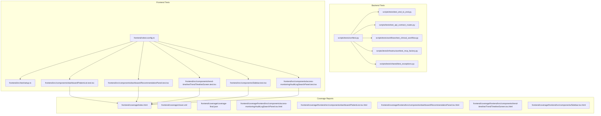
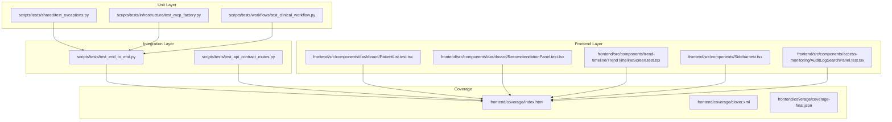
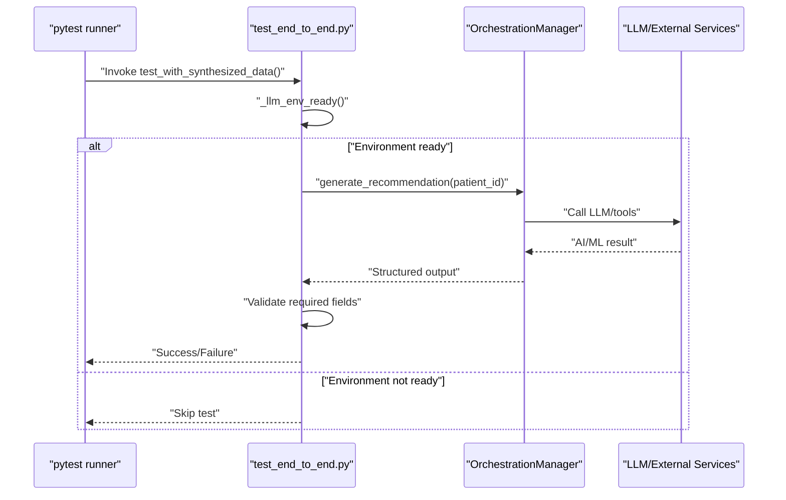
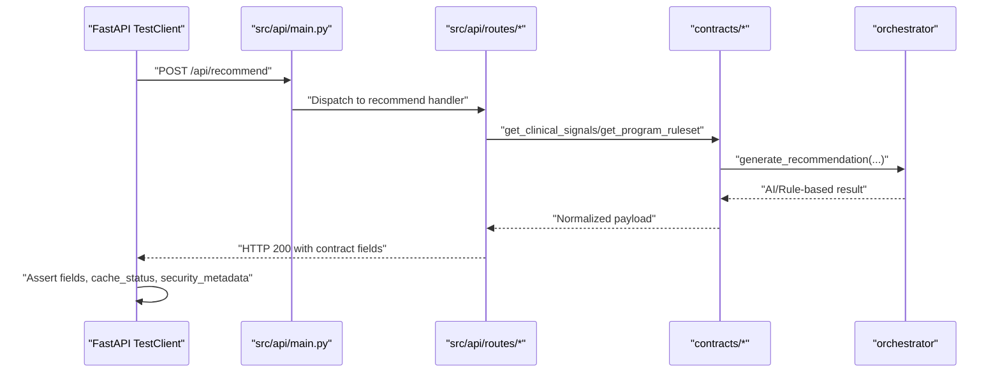
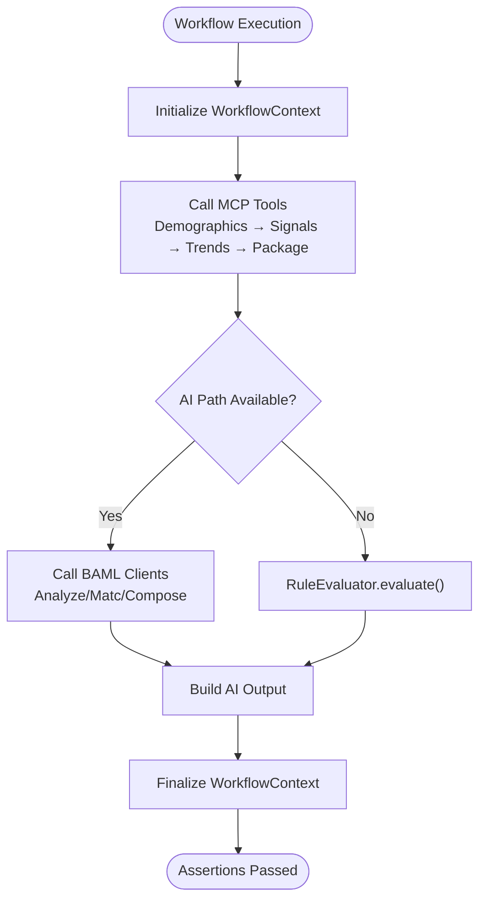
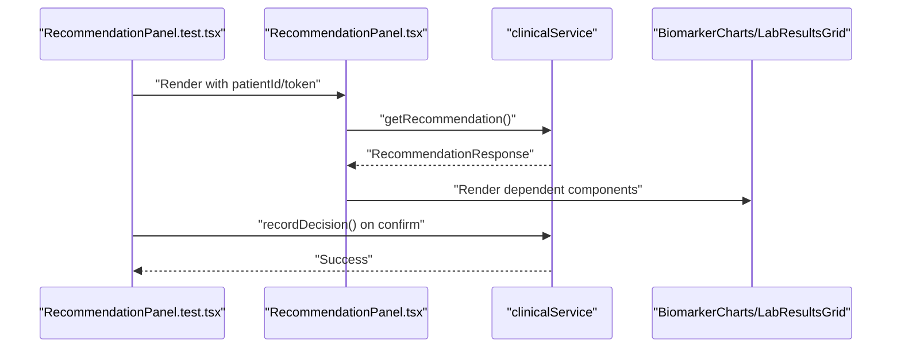
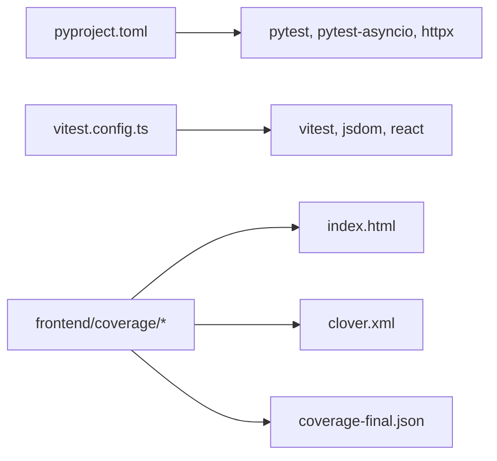

# Testing and Quality Assurance

<cite>
**Referenced Files in This Document**
- [conftest.py](file://scripts/tests/conftest.py)
- [vitest.config.ts](file://frontend/vitest.config.ts)
- [setup.ts](file://frontend/src/test/setup.ts)
- [pyproject.toml](file://pyproject.toml)
- [test_end_to_end.py](file://scripts/tests/test_end_to_end.py)
- [test_api_contract_routes.py](file://scripts/tests/test_api_contract_routes.py)
- [test_clinical_workflow.py](file://scripts/tests/workflows/test_clinical_workflow.py)
- [test_mcp_factory.py](file://scripts/tests/infrastructure/test_mcp_factory.py)
- [test_exceptions.py](file://scripts/tests/shared/test_exceptions.py)
- [PatientList.test.tsx](file://frontend/src/components/dashboard/PatientList.test.tsx)
- [RecommendationPanel.test.tsx](file://frontend/src/components/dashboard/RecommendationPanel.test.tsx)
- [TrendTimelineScreen.test.tsx](file://frontend/src/components/trend-timeline/TrendTimelineScreen.test.tsx)
- [Sidebar.test.tsx](file://frontend/src/components/Sidebar.test.tsx)
- [AuditLogSearchPanel.test.tsx](file://frontend/src/components/access-monitoring/AuditLogSearchPanel.test.tsx)
- [AuditLogSearchPanel.tsx.html](file://frontend/coverage/frontend/src/components/access-monitoring/AuditLogSearchPanel.tsx.html)
- [PatientList.tsx.html](file://frontend/coverage/frontend/src/components/dashboard/PatientList.tsx.html)
- [RecommendationPanel.tsx.html](file://frontend/coverage/frontend/src/components/dashboard/RecommendationPanel.tsx.html)
- [TrendTimelineScreen.tsx.html](file://frontend/coverage/frontend/src/components/trend-timeline/TrendTimelineScreen.tsx.html)
- [Sidebar.tsx.html](file://frontend/coverage/frontend/src/components/Sidebar.tsx.html)
- [index.html](file://frontend/coverage/index.html)
- [clover.xml](file://frontend/coverage/clover.xml)
- [coverage-final.json](file://frontend/coverage/coverage-final.json)
- [test_api.py](file://scripts/test_api.py)
- [test_orchestrator.py](file://scripts/test_orchestrator.py)
</cite>

## Table of Contents
1. [Introduction](#introduction)
2. [Project Structure](#project-structure)
3. [Core Components](#core-components)
4. [Architecture Overview](#architecture-overview)
5. [Detailed Component Analysis](#detailed-component-analysis)
6. [Dependency Analysis](#dependency-analysis)
7. [Performance Considerations](#performance-considerations)
8. [Troubleshooting Guide](#troubleshooting-guide)
9. [Conclusion](#conclusion)
10. [Appendices](#appendices)

## Introduction
This document describes the complete testing and quality assurance system for Navavej ROC. It covers the unit testing framework, integration testing procedures, contract testing methodologies, coverage reporting, quality gates, and CI-aligned practices. It also details testing strategies for backend services, frontend components, and AI processing workflows, along with guidelines for writing effective tests, mocking external dependencies, performance benchmarking, security scanning integration, and automated quality checks.

## Project Structure
The repository organizes tests across three primary areas:
- Backend Python tests under scripts/tests/, including unit, integration, and contract tests.
- Frontend Vitest tests under frontend/src/components/ and related test files.
- Coverage reports under frontend/coverage/ for frontend code.

Key configuration and discovery:
- Backend test discovery and environment loading via scripts/tests/conftest.py.
- Frontend test configuration via frontend/vitest.config.ts and global setup via frontend/src/test/setup.ts.
- Backend linting and formatting via pyproject.toml’s ruff configuration.

**Diagram sources**
- [conftest.py:1-14](file://scripts/tests/conftest.py#L1-L14)
- [vitest.config.ts:1-20](file://frontend/vitest.config.ts#L1-L20)
- [setup.ts:1-3](file://frontend/src/test/setup.ts#L1-L3)
- [test_end_to_end.py:1-129](file://scripts/tests/test_end_to_end.py#L1-L129)
- [test_api_contract_routes.py:1-943](file://scripts/tests/test_api_contract_routes.py#L1-L943)
- [test_clinical_workflow.py:1-176](file://scripts/tests/workflows/test_clinical_workflow.py#L1-L176)
- [test_mcp_factory.py:1-34](file://scripts/tests/infrastructure/test_mcp_factory.py#L1-L34)
- [test_exceptions.py:1-39](file://scripts/tests/shared/test_exceptions.py#L1-L39)
- [PatientList.test.tsx:1-29](file://frontend/src/components/dashboard/PatientList.test.tsx#L1-L29)
- [RecommendationPanel.test.tsx:1-158](file://frontend/src/components/dashboard/RecommendationPanel.test.tsx#L1-L158)
- [TrendTimelineScreen.test.tsx:1-78](file://frontend/src/components/trend-timeline/TrendTimelineScreen.test.tsx#L1-L78)
- [Sidebar.test.tsx:1-38](file://frontend/src/components/Sidebar.test.tsx#L1-L38)
- [AuditLogSearchPanel.test.tsx:1-44](file://frontend/src/components/access-monitoring/AuditLogSearchPanel.test.tsx#L1-L44)

**Section sources**
- [conftest.py:1-14](file://scripts/tests/conftest.py#L1-L14)
- [vitest.config.ts:1-20](file://frontend/vitest.config.ts#L1-L20)
- [setup.ts:1-3](file://frontend/src/test/setup.ts#L1-L3)
- [pyproject.toml:1-58](file://pyproject.toml#L1-L58)

## Core Components
- Backend test discovery and environment loading:
  - Adds project roots to sys.path and loads environment variables for backend tests.
- Frontend test configuration:
  - Uses jsdom environment, global setup, aliases, and React plugin.
- Contract and integration tests:
  - FastAPI TestClient-based contract tests validate API surface and response contracts.
- Workflow and AI processing tests:
  - Mocked MCP client sessions and BAML clients exercise AI/ML orchestration paths and fallbacks.
- Frontend component tests:
  - Unit tests for UI components with mocked services and privacy-mode behavior.
- Coverage reporting:
  - Frontend coverage HTML, Clover XML, and coverage JSON artifacts.

**Section sources**
- [conftest.py:1-14](file://scripts/tests/conftest.py#L1-L14)
- [vitest.config.ts:1-20](file://frontend/vitest.config.ts#L1-L20)
- [test_api_contract_routes.py:1-943](file://scripts/tests/test_api_contract_routes.py#L1-L943)
- [test_clinical_workflow.py:1-176](file://scripts/tests/workflows/test_clinical_workflow.py#L1-L176)
- [PatientList.test.tsx:1-29](file://frontend/src/components/dashboard/PatientList.test.tsx#L1-L29)
- [RecommendationPanel.test.tsx:1-158](file://frontend/src/components/dashboard/RecommendationPanel.test.tsx#L1-L158)
- [TrendTimelineScreen.test.tsx:1-78](file://frontend/src/components/trend-timeline/TrendTimelineScreen.test.tsx#L1-L78)
- [Sidebar.test.tsx:1-38](file://frontend/src/components/Sidebar.test.tsx#L1-L38)
- [AuditLogSearchPanel.test.tsx:1-44](file://frontend/src/components/access-monitoring/AuditLogSearchPanel.test.tsx#L1-L44)
- [index.html](file://frontend/coverage/index.html)
- [clover.xml](file://frontend/coverage/clover.xml)
- [coverage-final.json](file://frontend/coverage/coverage-final.json)

## Architecture Overview
The testing architecture separates concerns across unit, integration, and contract layers, with dedicated environments and coverage reporting.

**Diagram sources**
- [test_exceptions.py:1-39](file://scripts/tests/shared/test_exceptions.py#L1-L39)
- [test_mcp_factory.py:1-34](file://scripts/tests/infrastructure/test_mcp_factory.py#L1-L34)
- [test_clinical_workflow.py:1-176](file://scripts/tests/workflows/test_clinical_workflow.py#L1-L176)
- [test_end_to_end.py:1-129](file://scripts/tests/test_end_to_end.py#L1-L129)
- [test_api_contract_routes.py:1-943](file://scripts/tests/test_api_contract_routes.py#L1-L943)
- [PatientList.test.tsx:1-29](file://frontend/src/components/dashboard/PatientList.test.tsx#L1-L29)
- [RecommendationPanel.test.tsx:1-158](file://frontend/src/components/dashboard/RecommendationPanel.test.tsx#L1-L158)
- [TrendTimelineScreen.test.tsx:1-78](file://frontend/src/components/trend-timeline/TrendTimelineScreen.test.tsx#L1-L78)
- [Sidebar.test.tsx:1-38](file://frontend/src/components/Sidebar.test.tsx#L1-L38)
- [AuditLogSearchPanel.test.tsx:1-44](file://frontend/src/components/access-monitoring/AuditLogSearchPanel.test.tsx#L1-L44)
- [index.html](file://frontend/coverage/index.html)
- [clover.xml](file://frontend/coverage/clover.xml)
- [coverage-final.json](file://frontend/coverage/coverage-final.json)

## Detailed Component Analysis

### Backend Test Infrastructure
- Environment and discovery:
  - Adds project and backend roots to sys.path and loads environment variables for deterministic test runs.
- Linting and formatting:
  - Ruff configuration enforces style and docstring conventions for Python code.

**Section sources**
- [conftest.py:1-14](file://scripts/tests/conftest.py#L1-L14)
- [pyproject.toml:32-58](file://pyproject.toml#L32-L58)

### End-to-End Testing
- Purpose:
  - Validates the full orchestration pipeline with synthesized Signal Store data and real LLM environment readiness checks.
- Key behaviors:
  - Skips tests when LLM environment is not configured.
  - Detects external service errors and marks them as xfail.
  - Verifies required output fields and logs results.

**Diagram sources**
- [test_end_to_end.py:47-86](file://scripts/tests/test_end_to_end.py#L47-L86)

**Section sources**
- [test_end_to_end.py:1-129](file://scripts/tests/test_end_to_end.py#L1-L129)

### API Contract Testing
- Purpose:
  - Ensures API routes return a stable, versioned contract and enforce RBAC and caching semantics.
- Key behaviors:
  - Uses FastAPI TestClient to hit routes and assert response shapes.
  - Mocks orchestration and service layers to isolate contract assertions.
  - Validates cache partitioning by request parameters and fallback behavior.

**Diagram sources**
- [test_api_contract_routes.py:33-118](file://scripts/tests/test_api_contract_routes.py#L33-L118)
- [test_api_contract_routes.py:196-268](file://scripts/tests/test_api_contract_routes.py#L196-L268)
- [test_api_contract_routes.py:270-363](file://scripts/tests/test_api_contract_routes.py#L270-L363)

**Section sources**
- [test_api_contract_routes.py:1-943](file://scripts/tests/test_api_contract_routes.py#L1-L943)

### Workflow and AI Processing Testing
- Purpose:
  - Validates the clinical reasoning workflow end-to-end, including AI path, rule-based fallback, and error handling.
- Key behaviors:
  - Mocks MCP client session and BAML clients to simulate AI/ML tool calls.
  - Asserts output fields, recommendation source, and fallback decisions.

**Diagram sources**
- [test_clinical_workflow.py:41-110](file://scripts/tests/workflows/test_clinical_workflow.py#L41-L110)
- [test_clinical_workflow.py:112-146](file://scripts/tests/workflows/test_clinical_workflow.py#L112-L146)
- [test_clinical_workflow.py:148-176](file://scripts/tests/workflows/test_clinical_workflow.py#L148-L176)

**Section sources**
- [test_clinical_workflow.py:1-176](file://scripts/tests/workflows/test_clinical_workflow.py#L1-L176)

### Infrastructure and Shared Testing Utilities
- Exception hierarchy tests:
  - Validates inheritance and metadata propagation for Navavej-specific exceptions.
- MCP client factory lifecycle:
  - Ensures proper context-manager entry/exit for client sessions.

**Section sources**
- [test_exceptions.py:1-39](file://scripts/tests/shared/test_exceptions.py#L1-L39)
- [test_mcp_factory.py:1-34](file://scripts/tests/infrastructure/test_mcp_factory.py#L1-L34)

### Frontend Testing
- Test configuration:
  - jsdom environment, global setup, and React plugin enable DOM rendering and hooks.
- Component tests:
  - PatientList: error state when API fails.
  - RecommendationPanel: risk labels, decision recording, privacy masking.
  - TrendTimelineScreen: privacy-mode header text.
  - Sidebar: active link detection.
  - AuditLogSearchPanel: secure context warning for hash verification.

**Diagram sources**
- [RecommendationPanel.test.tsx:72-131](file://frontend/src/components/dashboard/RecommendationPanel.test.tsx#L72-L131)

**Section sources**
- [vitest.config.ts:1-20](file://frontend/vitest.config.ts#L1-L20)
- [setup.ts:1-3](file://frontend/src/test/setup.ts#L1-L3)
- [PatientList.test.tsx:1-29](file://frontend/src/components/dashboard/PatientList.test.tsx#L1-L29)
- [RecommendationPanel.test.tsx:1-158](file://frontend/src/components/dashboard/RecommendationPanel.test.tsx#L1-L158)
- [TrendTimelineScreen.test.tsx:1-78](file://frontend/src/components/trend-timeline/TrendTimelineScreen.test.tsx#L1-L78)
- [Sidebar.test.tsx:1-38](file://frontend/src/components/Sidebar.test.tsx#L1-L38)
- [AuditLogSearchPanel.test.tsx:1-44](file://frontend/src/components/access-monitoring/AuditLogSearchPanel.test.tsx#L1-L44)

## Dependency Analysis
- Backend test dependencies:
  - pytest, pytest-asyncio, httpx TestClient, loguru, python-dotenv.
- Frontend test dependencies:
  - Vitest, @testing-library/react, user-event, jsdom, jest-dom.
- Coverage:
  - Frontend coverage artifacts include HTML report, Clover XML, and coverage JSON.

**Diagram sources**
- [pyproject.toml:18-21](file://pyproject.toml#L18-L21)
- [vitest.config.ts:1-20](file://frontend/vitest.config.ts#L1-L20)
- [index.html](file://frontend/coverage/index.html)
- [clover.xml](file://frontend/coverage/clover.xml)
- [coverage-final.json](file://frontend/coverage/coverage-final.json)

**Section sources**
- [pyproject.toml:1-58](file://pyproject.toml#L1-L58)
- [vitest.config.ts:1-20](file://frontend/vitest.config.ts#L1-L20)
- [index.html](file://frontend/coverage/index.html)
- [clover.xml](file://frontend/coverage/clover.xml)
- [coverage-final.json](file://frontend/coverage/coverage-final.json)

## Performance Considerations
- Deterministic end-to-end tests:
  - Skip when LLM environment is not configured to avoid flakiness.
- Caching behavior:
  - Contract tests validate cache miss/hit transitions and partitioning by request parameters.
- Tool call simulation:
  - Workflow tests mock MCP/BAML calls to reduce external dependency variability.

**Section sources**
- [test_end_to_end.py:25-33](file://scripts/tests/test_end_to_end.py#L25-L33)
- [test_api_contract_routes.py:120-194](file://scripts/tests/test_api_contract_routes.py#L120-L194)
- [test_api_contract_routes.py:270-363](file://scripts/tests/test_api_contract_routes.py#L270-L363)
- [test_clinical_workflow.py:20-39](file://scripts/tests/workflows/test_clinical_workflow.py#L20-L39)

## Troubleshooting Guide
- External service errors:
  - End-to-end tests detect network/service unavailability and mark as xfail.
- Authentication and RBAC:
  - Contract tests use explicit headers to validate role/scopes enforcement.
- Privacy mode and security:
  - Frontend tests assert masked outputs and secure context warnings.
- Coverage gaps:
  - Review coverage HTML and Clover XML to identify untested components.

**Section sources**
- [test_end_to_end.py:36-38](file://scripts/tests/test_end_to_end.py#L36-L38)
- [test_api_contract_routes.py:13-18](file://scripts/tests/test_api_contract_routes.py#L13-L18)
- [AuditLogSearchPanel.test.tsx:21-41](file://frontend/src/components/access-monitoring/AuditLogSearchPanel.test.tsx#L21-L41)
- [index.html](file://frontend/coverage/index.html)
- [clover.xml](file://frontend/coverage/clover.xml)

## Conclusion
Navavej ROC employs a layered testing strategy with robust contract and integration tests, comprehensive frontend unit tests, and strong coverage reporting. The backend leverages pytest and FastAPI TestClient for deterministic validations, while the frontend uses Vitest with jsdom for component-level reliability. Exceptions and infrastructure lifecycles are covered by targeted unit tests. Coverage artifacts provide visibility into testing completeness.

## Appendices

### Guidelines for Writing Effective Tests
- Backend
  - Use fixtures to encapsulate common mocks and session lifecycles.
  - Prefer AsyncMock for async services and tools.
  - Validate response contracts and cache behavior explicitly.
- Frontend
  - Mock services and third-party modules to isolate component logic.
  - Test user interactions and privacy-mode transformations.
  - Use @testing-library utilities for realistic DOM queries.

**Section sources**
- [test_mcp_factory.py:10-34](file://scripts/tests/infrastructure/test_mcp_factory.py#L10-L34)
- [test_clinical_workflow.py:12-17](file://scripts/tests/workflows/test_clinical_workflow.py#L12-L17)
- [RecommendationPanel.test.tsx:8-30](file://frontend/src/components/dashboard/RecommendationPanel.test.tsx#L8-L30)
- [Sidebar.test.tsx:7-17](file://frontend/src/components/Sidebar.test.tsx#L7-L17)

### Mocking Strategies for External Dependencies
- Backend
  - Patch orchestration and service functions to return controlled outputs.
  - Replace MCP client sessions and BAML clients with AsyncMock.
- Frontend
  - Mock service modules and UI libraries (e.g., motion/framer components) to simplify rendering.

**Section sources**
- [test_api_contract_routes.py:74-99](file://scripts/tests/test_api_contract_routes.py#L74-L99)
- [test_clinical_workflow.py:78-91](file://scripts/tests/workflows/test_clinical_workflow.py#L78-L91)
- [RecommendationPanel.test.tsx:15-29](file://frontend/src/components/dashboard/RecommendationPanel.test.tsx#L15-L29)

### Continuous Integration Testing Procedures
- Backend
  - Use pytest markers to categorize tests (unit/integration/contract).
  - Load environment variables via dotenv for reproducible runs.
- Frontend
  - Configure Vitest with jsdom and React plugin for browser-like behavior.
  - Generate coverage artifacts for PR checks.

**Section sources**
- [conftest.py:13](file://scripts/tests/conftest.py#L13)
- [vitest.config.ts:7-12](file://frontend/vitest.config.ts#L7-L12)

### Test Data Management and Scenario Testing
- Use seeded patient registries and synthesized Signal Store data for deterministic scenarios.
- Validate multiple patients and edge cases (e.g., insufficient signals, privacy mode).

**Section sources**
- [test_end_to_end.py:41-44](file://scripts/tests/test_end_to_end.py#L41-L44)
- [RecommendationPanel.test.tsx:77-90](file://frontend/src/components/dashboard/RecommendationPanel.test.tsx#L77-L90)

### Regression Testing Procedures
- Maintain contract tests for API routes to prevent breaking changes.
- Re-run end-to-end tests after backend or AI pipeline updates.

**Section sources**
- [test_api_contract_routes.py:33-118](file://scripts/tests/test_api_contract_routes.py#L33-L118)
- [test_end_to_end.py:47-86](file://scripts/tests/test_end_to_end.py#L47-L86)

### Security Scanning Integration
- Validate secure context requirements for cryptographic operations in the UI.
- Enforce RBAC headers in contract tests to prevent unauthorized access.

**Section sources**
- [AuditLogSearchPanel.test.tsx:21-41](file://frontend/src/components/access-monitoring/AuditLogSearchPanel.test.tsx#L21-L41)
- [test_api_contract_routes.py:13-18](file://scripts/tests/test_api_contract_routes.py#L13-L18)

### Automated Quality Checks
- Linting and formatting via ruff to maintain code quality.
- Coverage thresholds can be enforced in CI using coverage artifacts.

**Section sources**
- [pyproject.toml:32-58](file://pyproject.toml#L32-L58)
- [index.html](file://frontend/coverage/index.html)
- [clover.xml](file://frontend/coverage/clover.xml)
- [coverage-final.json](file://frontend/coverage/coverage-final.json)