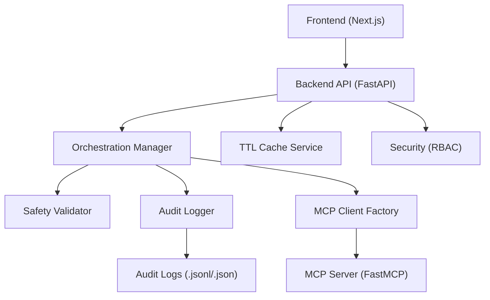
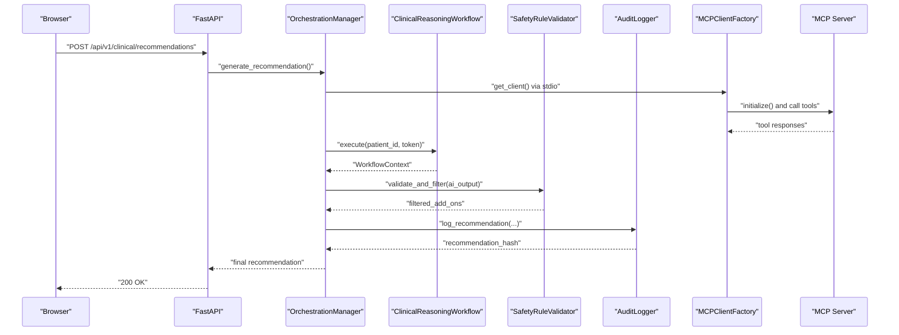
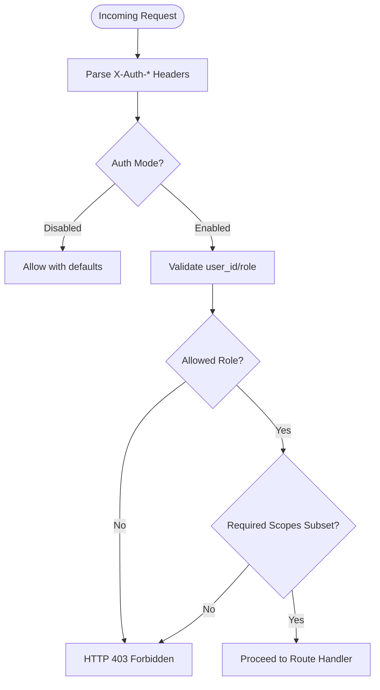
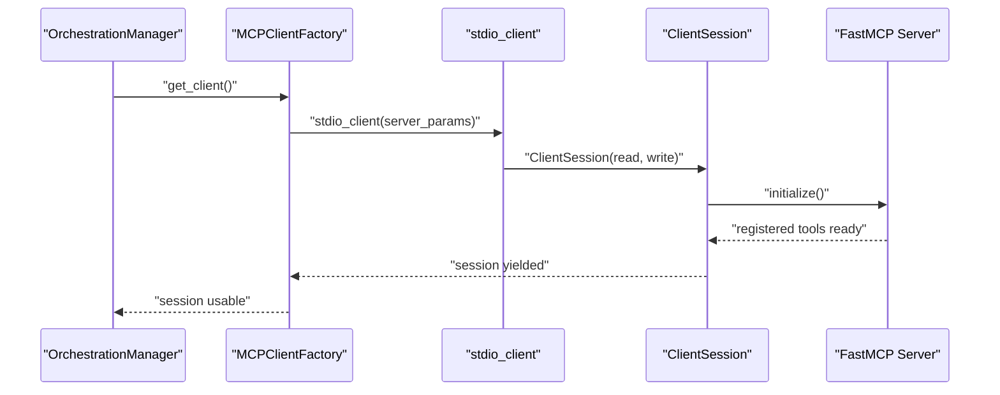
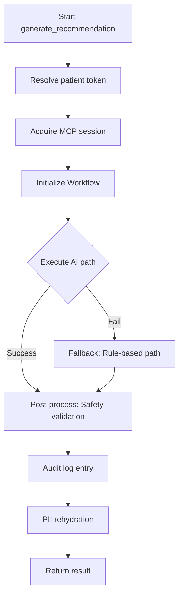
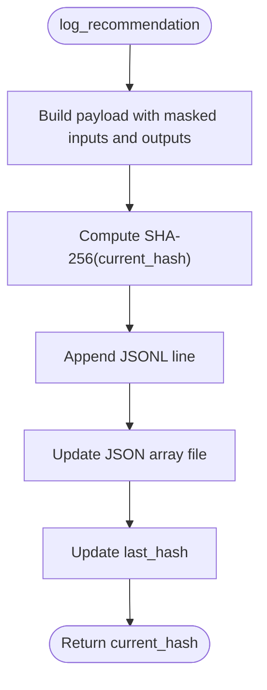
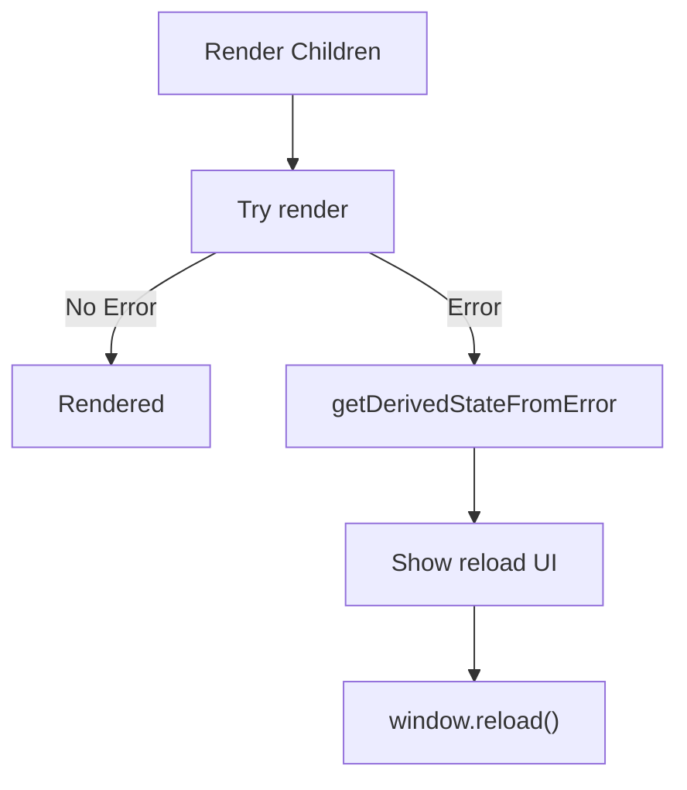
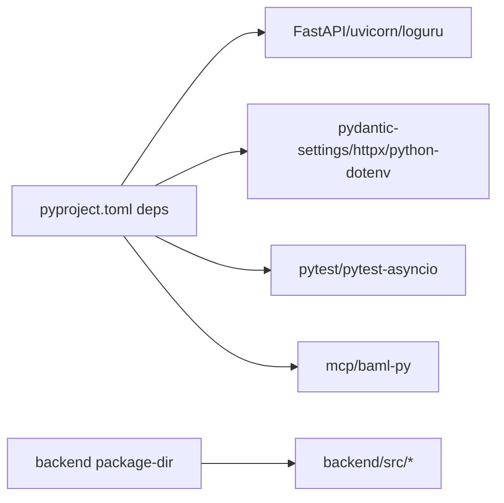

# Troubleshooting and FAQ

<cite>
**Referenced Files in This Document**
- [README.md](file://README.md)
- [pyproject.toml](file://pyproject.toml)
- [shared/settings.py](file://shared/settings.py)
- [shared/exceptions.py](file://shared/exceptions.py)
- [backend/src/api/main.py](file://backend/src/api/main.py)
- [backend/src/api/security.py](file://backend/src/api/security.py)
- [backend/src/mcp_server/server.py](file://backend/src/mcp_server/server.py)
- [backend/src/services/mcp_client.py](file://backend/src/services/mcp_client.py)
- [backend/src/services/orchestrator.py](file://backend/src/services/orchestrator.py)
- [backend/src/services/audit.py](file://backend/src/services/audit.py)
- [backend/src/services/cache.py](file://backend/src/services/cache.py)
- [frontend/src/app/layout.tsx](file://frontend/src/app/layout.tsx)
- [frontend/src/components/ErrorBoundary.tsx](file://frontend/src/components/ErrorBoundary.tsx)
- [scripts/tests/workflows/test_clinical_workflow.py](file://scripts/tests/workflows/test_clinical_workflow.py)
- [scripts/tests/shared/test_exceptions.py](file://scripts/tests/shared/test_exceptions.py)
- [logs/audit.jsonl](file://logs/audit.jsonl)
</cite>

## Table of Contents
1. [Introduction](#introduction)
2. [Project Structure](#project-structure)
3. [Core Components](#core-components)
4. [Architecture Overview](#architecture-overview)
5. [Detailed Component Analysis](#detailed-component-analysis)
6. [Dependency Analysis](#dependency-analysis)
7. [Performance Considerations](#performance-considerations)
8. [Troubleshooting Guide](#troubleshooting-guide)
9. [Conclusion](#conclusion)
10. [Appendices](#appendices)

## Introduction
This document provides comprehensive troubleshooting and FAQ guidance for Navavej ROC (Recommendation & Orchestration Center). It focuses on diagnosing and resolving setup, runtime, performance, and integration issues across the frontend, backend, AI orchestration, and audit/logging layers. It also covers debugging techniques, error interpretation, and operational best practices grounded in the repository’s code and artifacts.

## Project Structure
Navavej ROC is organized into:
- Backend API (FastAPI) with routing, security, and orchestration
- Intelligence layer using BAML and Model Context Protocol (MCP)
- Frontend (Next.js) with error boundaries and layout
- Shared settings and exceptions
- Audit logging and caching utilities
- Scripts and tests validating workflows and exception handling

**Diagram sources**
- [backend/src/api/main.py:14-38](file://backend/src/api/main.py#L14-L38)
- [backend/src/services/orchestrator.py:17-124](file://backend/src/services/orchestrator.py#L17-L124)
- [backend/src/services/mcp_client.py:14-35](file://backend/src/services/mcp_client.py#L14-L35)
- [backend/src/mcp_server/server.py:11-19](file://backend/src/mcp_server/server.py#L11-L19)
- [backend/src/services/audit.py:14-120](file://backend/src/services/audit.py#L14-L120)
- [backend/src/services/cache.py:13-45](file://backend/src/services/cache.py#L13-L45)
- [backend/src/api/security.py:26-53](file://backend/src/api/security.py#L26-L53)
- [frontend/src/app/layout.tsx:23-41](file://frontend/src/app/layout.tsx#L23-L41)

**Section sources**
- [README.md:76-85](file://README.md#L76-L85)
- [backend/src/api/main.py:14-38](file://backend/src/api/main.py#L14-L38)

## Core Components
- Settings and Environment: Centralized configuration via Pydantic settings, including LLM provider, MCP server command, CORS origins, audit log path, and cache TTLs.
- Exceptions: Hierarchical exception types for clinical, safety, infrastructure, and base errors.
- API and Security: Health endpoint, CORS middleware, and RBAC-based access control.
- MCP Integration: Factory-based client creation and stdio transport to the MCP server.
- Orchestration: End-to-end recommendation pipeline with deterministic fallback and audit logging.
- Audit: Immutable audit trail with SHA-256 chaining and dual-format persistence.
- Cache: Thread-safe TTL cache for short-lived data.
- Frontend Layout and Error Boundary: Global layout and error boundary for rendering failures.

**Section sources**
- [shared/settings.py:29-69](file://shared/settings.py#L29-L69)
- [shared/exceptions.py:6-43](file://shared/exceptions.py#L6-L43)
- [backend/src/api/main.py:14-38](file://backend/src/api/main.py#L14-L38)
- [backend/src/api/security.py:26-53](file://backend/src/api/security.py#L26-L53)
- [backend/src/services/mcp_client.py:14-35](file://backend/src/services/mcp_client.py#L14-L35)
- [backend/src/services/orchestrator.py:17-124](file://backend/src/services/orchestrator.py#L17-L124)
- [backend/src/services/audit.py:14-120](file://backend/src/services/audit.py#L14-L120)
- [backend/src/services/cache.py:13-45](file://backend/src/services/cache.py#L13-L45)
- [frontend/src/app/layout.tsx:23-41](file://frontend/src/app/layout.tsx#L23-L41)
- [frontend/src/components/ErrorBoundary.tsx:9-41](file://frontend/src/components/ErrorBoundary.tsx#L9-L41)

## Architecture Overview
The system integrates a frontend dashboard, a FastAPI backend, an MCP server for clinical data retrieval, and an AI orchestration layer powered by BAML. Audit logs are persisted immutably with SHA-256 chaining.

**Diagram sources**
- [backend/src/services/orchestrator.py:31-124](file://backend/src/services/orchestrator.py#L31-L124)
- [backend/src/services/mcp_client.py:18-35](file://backend/src/services/mcp_client.py#L18-L35)
- [backend/src/mcp_server/server.py:11-19](file://backend/src/mcp_server/server.py#L11-L19)
- [backend/src/services/audit.py:55-120](file://backend/src/services/audit.py#L55-L120)

## Detailed Component Analysis

### Backend API and Security
- Health endpoint and CORS configuration are defined centrally.
- Authentication and authorization rely on headers and role/scopes validation with configurable modes.

**Diagram sources**
- [backend/src/api/security.py:26-53](file://backend/src/api/security.py#L26-L53)

**Section sources**
- [backend/src/api/main.py:14-38](file://backend/src/api/main.py#L14-L38)
- [backend/src/api/security.py:26-53](file://backend/src/api/security.py#L26-L53)

### MCP Client and Server
- The MCP client factory starts the MCP server via stdio with configured command and arguments, passing PYTHONPATH for module discovery.
- The MCP server registers tools for hard constraints, clinical signals, trends, program rules, and patient event timelines.

**Diagram sources**
- [backend/src/services/mcp_client.py:18-35](file://backend/src/services/mcp_client.py#L18-L35)
- [backend/src/mcp_server/server.py:11-19](file://backend/src/mcp_server/server.py#L11-L19)

**Section sources**
- [backend/src/services/mcp_client.py:14-35](file://backend/src/services/mcp_client.py#L14-L35)
- [backend/src/mcp_server/server.py:1-23](file://backend/src/mcp_server/server.py#L1-L23)

### Orchestration and Fallback Behavior
- The orchestration manager coordinates workflow execution, safety validation, audit logging, and PII rehydration.
- On primary path failure, the system retries deterministically with rule-based execution.

**Diagram sources**
- [backend/src/services/orchestrator.py:31-124](file://backend/src/services/orchestrator.py#L31-L124)
- [scripts/tests/workflows/test_clinical_workflow.py:148-175](file://scripts/tests/workflows/test_clinical_workflow.py#L148-L175)

**Section sources**
- [backend/src/services/orchestrator.py:31-124](file://backend/src/services/orchestrator.py#L31-L124)
- [scripts/tests/workflows/test_clinical_workflow.py:148-175](file://scripts/tests/workflows/test_clinical_workflow.py#L148-L175)

### Audit Logging and Immutable Trail
- Audit entries include masked context, AI output, safety conflict events, and model metadata.
- SHA-256 chaining ensures immutability; logs are written in both JSONL (append-only) and JSON array formats.

**Diagram sources**
- [backend/src/services/audit.py:55-120](file://backend/src/services/audit.py#L55-L120)

**Section sources**
- [backend/src/services/audit.py:14-173](file://backend/src/services/audit.py#L14-L173)
- [logs/audit.jsonl:1-6](file://logs/audit.jsonl#L1-L6)

### Frontend Error Boundary
- A class-based error boundary catches rendering errors and prompts a reload.

**Diagram sources**
- [frontend/src/components/ErrorBoundary.tsx:9-41](file://frontend/src/components/ErrorBoundary.tsx#L9-L41)

**Section sources**
- [frontend/src/components/ErrorBoundary.tsx:1-44](file://frontend/src/components/ErrorBoundary.tsx#L1-L44)
- [frontend/src/app/layout.tsx:23-41](file://frontend/src/app/layout.tsx#L23-L41)

## Dependency Analysis
- Python dependencies include FastAPI, uvicorn, loguru, pydantic-settings, httpx, pytest, MCP, and BAML.
- The backend package layout is configured to scan the backend directory.

**Diagram sources**
- [pyproject.toml:8-21](file://pyproject.toml#L8-L21)
- [pyproject.toml:28-30](file://pyproject.toml#L28-L30)

**Section sources**
- [pyproject.toml:1-58](file://pyproject.toml#L1-L58)

## Performance Considerations
- Cache TTLs are configurable and applied to registry, ruleset, signal store, and recommendation caches. Tune TTLs for hotspots to balance freshness and latency.
- The orchestration manager measures end-to-end latency and logs it with the audit trail.
- MCP stdio transport overhead can impact latency; ensure the MCP server starts quickly and tools are efficient.
- Frontend rendering performance depends on component composition and data hydration; minimize unnecessary re-renders and leverage the error boundary to recover from transient UI failures.

[No sources needed since this section provides general guidance]

## Troubleshooting Guide

### Setup and Environment
- Missing environment variables or misconfigured paths:
  - Verify .env loading and settings precedence. Confirm LLM provider, base URL, and model are set appropriately.
  - Ensure PYTHONPATH includes backend modules when launching the MCP server via stdio.
- Dependency installation:
  - Use the documented commands to sync dependencies and generate the BAML client before starting services.
- CORS and frontend-backend mismatch:
  - Confirm allowed origins include the frontend URL; otherwise, preflight or fetch requests may fail.

**Section sources**
- [README.md:42-72](file://README.md#L42-L72)
- [shared/settings.py:29-69](file://shared/settings.py#L29-L69)
- [backend/src/api/main.py:20-27](file://backend/src/api/main.py#L20-L27)
- [backend/src/services/mcp_client.py:24-28](file://backend/src/services/mcp_client.py#L24-L28)

### API Connectivity and MCP Issues
- MCP server not reachable:
  - Check stdio transport parameters and command arguments. Validate that the MCP server registers tools and responds to initialize.
  - Confirm the MCP server process starts and remains healthy; inspect logs around initialization.
- Tool call failures:
  - Review tool implementations and ensure required tokens and inputs are present.
  - Validate that the MCP client yields a session and that tools are invoked with the correct parameters.

**Section sources**
- [backend/src/services/mcp_client.py:18-35](file://backend/src/services/mcp_client.py#L18-L35)
- [backend/src/mcp_server/server.py:11-19](file://backend/src/mcp_server/server.py#L11-L19)

### Runtime Errors and Diagnostics
- Exception hierarchy:
  - Use the centralized exception types to categorize issues (e.g., DataIntegrityError, SafetyViolationError, InfrastructureError).
  - Tests demonstrate exception metadata propagation and inheritance behavior.
- Frontend rendering crashes:
  - The error boundary displays a reload prompt. Investigate recent state changes or data fetching failures that cause render errors.
- Health checks:
  - Use the /health endpoint to verify API availability and version.

**Section sources**
- [shared/exceptions.py:6-43](file://shared/exceptions.py#L6-L43)
- [scripts/tests/shared/test_exceptions.py:14-38](file://scripts/tests/shared/test_exceptions.py#L14-L38)
- [frontend/src/components/ErrorBoundary.tsx:9-41](file://frontend/src/components/ErrorBoundary.tsx#L9-L41)
- [backend/src/api/main.py:35-38](file://backend/src/api/main.py#L35-L38)

### Performance Bottlenecks
- Slow response times:
  - Inspect audit latency_ms values to identify stages with increased duration.
  - Review MCP tool execution times and AI orchestration steps.
- Memory usage:
  - Monitor cache growth and TTLs; excessive TTLs can increase memory retention.
  - Validate that cache keys are scoped and cleaned up appropriately.
- AI processing delays:
  - Confirm LLM provider responsiveness and network connectivity.
  - Consider deterministic rule-based fallback when AI is unavailable.

**Section sources**
- [backend/src/services/orchestrator.py:53-99](file://backend/src/services/orchestrator.py#L53-L99)
- [backend/src/services/cache.py:13-45](file://backend/src/services/cache.py#L13-L45)
- [scripts/tests/workflows/test_clinical_workflow.py:148-175](file://scripts/tests/workflows/test_clinical_workflow.py#L148-L175)

### Debugging Techniques
- Backend:
  - Enable appropriate log levels via settings and inspect logs around orchestration, safety validation, and audit writes.
  - Add targeted logs around MCP tool calls and workflow execution.
- Frontend:
  - Use the error boundary to isolate rendering issues and reload to recover.
  - Inspect network tab for failed API calls and verify auth headers.
- Audit trail:
  - Review audit.jsonl for masked context snapshots, safety conflict events, and model metadata to reconstruct decision flows.

**Section sources**
- [shared/settings.py:48-49](file://shared/settings.py#L48-L49)
- [backend/src/services/audit.py:55-120](file://backend/src/services/audit.py#L55-L120)
- [logs/audit.jsonl:1-6](file://logs/audit.jsonl#L1-L6)

### Integration Problems with External Systems
- Authentication and authorization:
  - If roles or scopes are missing or mismatched, the API returns 403. Verify X-Auth-* headers and configured allowed roles/scopes.
- CORS:
  - If the frontend cannot reach the backend, confirm allowed origins and credentials policies.
- Audit integrity:
  - If audit logs appear corrupted, the reader falls back to a neutral initial hash and continues. Investigate file permissions and append-only behavior.

**Section sources**
- [backend/src/api/security.py:26-53](file://backend/src/api/security.py#L26-L53)
- [backend/src/api/main.py:20-27](file://backend/src/api/main.py#L20-L27)
- [backend/src/services/audit.py:25-42](file://backend/src/services/audit.py#L25-L42)

### Frequently Asked Questions

Q: How do I configure the LLM provider?
A: Set the LLM API key, base URL, and model in environment variables or .env. These are loaded by the settings module.

Q: How does the system handle AI outages?
A: On primary AI path failure, the orchestration manager retries deterministically using rule-based execution.

Q: How is audit integrity ensured?
A: Each audit entry includes a SHA-256 hash derived from the sorted payload; the chain advances with each new entry.

Q: How do I enable local MCP development?
A: Configure the MCP server command and arguments; the factory spawns the server via stdio with proper environment.

Q: What are the supported log levels?
A: Supported levels include DEBUG, INFO, WARNING, and ERROR.

Q: How do I verify API health?
A: Call the /health endpoint to confirm service availability and version.

Q: How are roles and scopes enforced?
A: The security module validates X-Auth-* headers and enforces allowed roles and required scopes.

Q: How is PII handled?
A: PII is masked in audit logs and rehydrated only for frontend display using a rehydration map.

Q: How do I tune cache performance?
A: Adjust cache TTLs for registry, ruleset, signal store, and recommendations to balance freshness and latency.

Q: How do I interpret audit entries?
A: Audit entries include masked context, AI output, safety conflict events, latency, model info, and hashes. Use these to trace decision-making.

**Section sources**
- [shared/settings.py:29-69](file://shared/settings.py#L29-L69)
- [backend/src/services/orchestrator.py:61-75](file://backend/src/services/orchestrator.py#L61-L75)
- [backend/src/services/audit.py:55-120](file://backend/src/services/audit.py#L55-L120)
- [backend/src/services/mcp_client.py:24-28](file://backend/src/services/mcp_client.py#L24-L28)
- [shared/settings.py:20-27](file://shared/settings.py#L20-L27)
- [backend/src/api/main.py:35-38](file://backend/src/api/main.py#L35-L38)
- [backend/src/api/security.py:26-53](file://backend/src/api/security.py#L26-L53)

## Conclusion
This guide consolidates actionable steps to diagnose and resolve common setup, runtime, performance, and integration issues in Navavej ROC. By leveraging the provided architecture insights, exception taxonomy, audit trail, and configuration, teams can efficiently troubleshoot and operate the system reliably.

## Appendices

### Quick Reference: Common Commands and Paths
- Backend run: uv sync, baml-cli generate, PYTHONPATH-aware run of the API main module.
- Frontend run: npm install, npm run dev.
- Audit logs: JSONL and JSON array formats under logs/.

**Section sources**
- [README.md:42-72](file://README.md#L42-L72)
- [logs/audit.jsonl:1-6](file://logs/audit.jsonl#L1-L6)