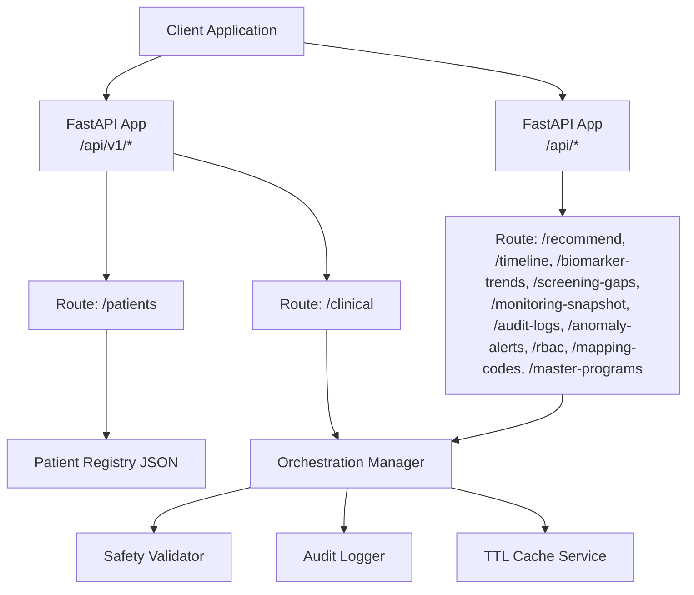
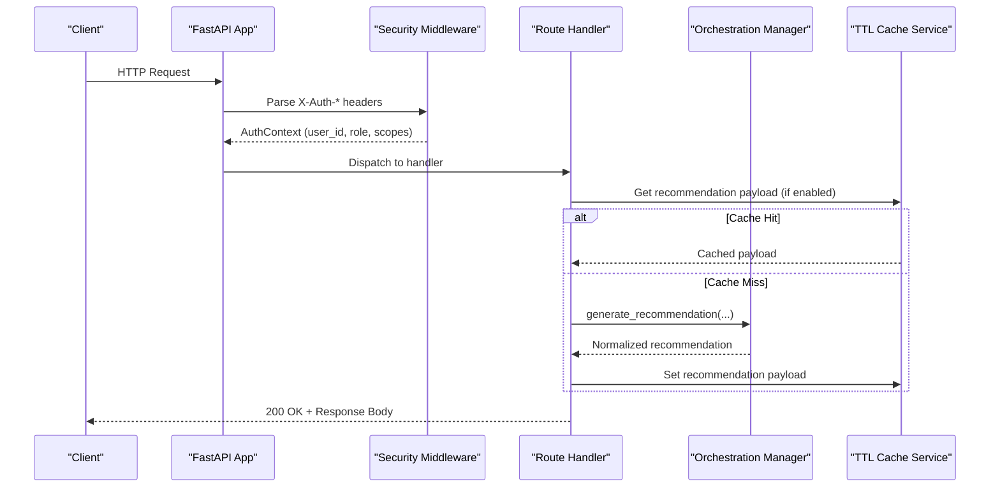
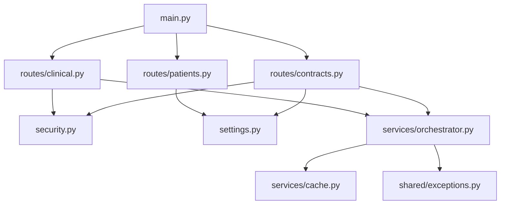

# API Reference

<cite>
**Referenced Files in This Document**
- [README.md](file://README.md)
- [backend/src/api/main.py](file://backend/src/api/main.py)
- [backend/src/api/routes/contracts.py](file://backend/src/api/routes/contracts.py)
- [backend/src/api/routes/clinical.py](file://backend/src/api/routes/clinical.py)
- [backend/src/api/routes/patients.py](file://backend/src/api/routes/patients.py)
- [backend/src/api/security.py](file://backend/src/api/security.py)
- [shared/settings.py](file://shared/settings.py)
- [shared/exceptions.py](file://shared/exceptions.py)
- [backend/src/services/orchestrator.py](file://backend/src/services/orchestrator.py)
- [backend/src/services/cache.py](file://backend/src/services/cache.py)
- [assets/patient_registry.json](file://assets/patient_registry.json)
- [frontend/src/services/api.ts](file://frontend/src/services/api.ts)
- [scripts/test_api.py](file://scripts/test_api.py)
</cite>

## Table of Contents
1. [Introduction](#introduction)
2. [Project Structure](#project-structure)
3. [Core Components](#core-components)
4. [Architecture Overview](#architecture-overview)
5. [Detailed Component Analysis](#detailed-component-analysis)
6. [Dependency Analysis](#dependency-analysis)
7. [Performance Considerations](#performance-considerations)
8. [Troubleshooting Guide](#troubleshooting-guide)
9. [Conclusion](#conclusion)
10. [Appendices](#appendices)

## Introduction
This document provides a comprehensive API reference for Navavej ROC (Recommendation & Orchestration Center). It covers all API endpoints, request/response schemas, authentication and authorization, error handling, caching, and practical integration examples. The API supports two primary route groups:
- Legacy routes under /api/v1 for patient management and clinical decision logging.
- Contract-oriented routes under /api for recommendation generation, timelines, monitoring, audit logs, and administrative dashboards.

The system emphasizes privacy-first design, deterministic safety validation, and immutable audit trails.

## Project Structure
The API is implemented with FastAPI and organized by feature domains:
- Routes: /api/v1/patients, /api/v1/clinical, /api
- Security: Authentication header parsing and access control
- Services: Orchestration, caching, safety validation, audit logging
- Shared: Settings and centralized exception hierarchy



**Diagram sources**
- [backend/src/api/main.py:29-32](file://backend/src/api/main.py#L29-L32)
- [backend/src/api/routes/patients.py:54-71](file://backend/src/api/routes/patients.py#L54-L71)
- [backend/src/api/routes/clinical.py:22-82](file://backend/src/api/routes/clinical.py#L22-L82)
- [backend/src/api/routes/contracts.py:584-795](file://backend/src/api/routes/contracts.py#L584-L795)
- [backend/src/services/orchestrator.py:17-151](file://backend/src/services/orchestrator.py#L17-L151)
- [backend/src/services/cache.py:13-46](file://backend/src/services/cache.py#L13-L46)

**Section sources**
- [backend/src/api/main.py:14-38](file://backend/src/api/main.py#L14-L38)
- [README.md:76-86](file://README.md#L76-L86)

## Core Components
- Authentication and Authorization
  - Authentication mode and defaults are configured via environment settings.
  - Access control enforces allowed roles and required scopes per endpoint.
- Orchestration Manager
  - Coordinates MCP client lifecycle, executes workflows, applies safety validation, and logs immutable audit trails.
- Caching
  - TTL-based in-memory cache service for recommendation responses and registry data.
- Patient Registry
  - Static JSON dataset mapping patient identifiers to tokens.

**Section sources**
- [backend/src/api/security.py:9-58](file://backend/src/api/security.py#L9-L58)
- [shared/settings.py:45-70](file://shared/settings.py#L45-L70)
- [backend/src/services/orchestrator.py:17-151](file://backend/src/services/orchestrator.py#L17-L151)
- [backend/src/services/cache.py:13-46](file://backend/src/services/cache.py#L13-L46)
- [assets/patient_registry.json:1-117](file://assets/patient_registry.json#L1-L117)

## Architecture Overview
The API exposes two route families:
- /api/v1: Legacy endpoints for patient listing/details and clinical decision approvals/audits.
- /api: Contract-oriented endpoints for recommendations, timelines, monitoring, and governance.



**Diagram sources**
- [backend/src/api/main.py:29-32](file://backend/src/api/main.py#L29-L32)
- [backend/src/api/security.py:26-53](file://backend/src/api/security.py#L26-L53)
- [backend/src/api/routes/contracts.py:584-660](file://backend/src/api/routes/contracts.py#L584-L660)
- [backend/src/services/orchestrator.py:31-124](file://backend/src/services/orchestrator.py#L31-L124)
- [backend/src/services/cache.py:18-33](file://backend/src/services/cache.py#L18-L33)

## Detailed Component Analysis

### Authentication and Authorization
- Headers
  - X-Auth-User-Id: Unique identifier for the authenticated user.
  - X-Auth-Role: Role of the user (lowercased internally).
  - X-Auth-Scopes: Comma-separated list of scopes (lowercased internally).
- Modes
  - Disabled: Accepts default user/role/scopes from settings.
  - poc_claims: Requires X-Auth-User-Id and X-Auth-Role; validates against allowed roles and required scopes.
- Access Control
  - Enforced per endpoint via dependency injection that checks role membership and scope inclusion.

**Section sources**
- [backend/src/api/security.py:26-53](file://backend/src/api/security.py#L26-L53)
- [shared/settings.py:53-60](file://shared/settings.py#L53-L60)

### Health Check
- Endpoint: GET /health
- Purpose: Verify service availability and report version.
- Response: status, version

**Section sources**
- [backend/src/api/main.py:35-38](file://backend/src/api/main.py#L35-L38)

### Contract API (/api)

#### GET /monitoring-snapshot
- Description: Retrieve current system monitoring metrics snapshot.
- Authentication: Monitoring scope required.
- Response Schema: MonitoringSnapshotResponse
  - Fields: snapshot_at, refresh_interval_seconds, active_users_now, sessions_today, patient_records_accessed_today, ai_recommendations_generated_today, alert_counts, safety_validator_failures_today, top_active_departments

**Section sources**
- [backend/src/api/routes/contracts.py:692-706](file://backend/src/api/routes/contracts.py#L692-L706)

#### GET /audit-logs
- Description: Search and filter audit logs.
- Authentication: Monitoring scope required.
- Query Parameters:
  - user_id: Filter by user ID.
  - patient_token_prefix: Prefix filter for patient token.
  - action_type: Filter by action type.
  - resource_type: Filter by resource type.
  - start_date: ISO UTC timestamp.
  - end_date: ISO UTC timestamp.
- Response Schema: AuditLogsResponse
  - Fields: total, entries

**Section sources**
- [backend/src/api/routes/contracts.py:709-727](file://backend/src/api/routes/contracts.py#L709-L727)

#### GET /anomaly-alerts
- Description: Retrieve anomaly alerts.
- Authentication: Monitoring scope required.
- Response Schema: AnomalyAlertsResponse
  - Fields: alerts

**Section sources**
- [backend/src/api/routes/contracts.py:730-732](file://backend/src/api/routes/contracts.py#L730-L732)

#### GET /rbac
- Description: Retrieve RBAC roles.
- Authentication: Monitoring scope required.
- Response Schema: RbacResponse
  - Fields: roles

**Section sources**
- [backend/src/api/routes/contracts.py:735-737](file://backend/src/api/routes/contracts.py#L735-L737)

#### GET /mapping-codes
- Description: Retrieve normalized mapping codes.
- Authentication: Monitoring scope required.
- Response Schema: MappingCodesResponse
  - Fields: mappings

**Section sources**
- [backend/src/api/routes/contracts.py:740-743](file://backend/src/api/routes/contracts.py#L740-L743)

#### GET /master-programs
- Description: Retrieve master programs.
- Authentication: Monitoring scope required.
- Response Schema: MasterProgramsResponse
  - Fields: programs

**Section sources**
- [backend/src/api/routes/contracts.py:746-748](file://backend/src/api/routes/contracts.py#L746-L748)

#### GET /admin/monitoring/snapshot
- Description: Admin-only monitoring snapshot.
- Authentication: Monitoring scope required.
- Response Schema: MonitoringSnapshotResponse

**Section sources**
- [backend/src/api/routes/contracts.py:751-753](file://backend/src/api/routes/contracts.py#L751-L753)

#### GET /admin/audit-logs/search
- Description: Admin-only audit log search.
- Authentication: Monitoring scope required.
- Query Parameters: Same as /audit-logs.
- Response Schema: AuditLogsResponse

**Section sources**
- [backend/src/api/routes/contracts.py:756-774](file://backend/src/api/routes/contracts.py#L756-L774)

#### GET /admin/anomaly-alerts
- Description: Admin-only anomaly alerts.
- Authentication: Monitoring scope required.
- Response Schema: AnomalyAlertsResponse

**Section sources**
- [backend/src/api/routes/contracts.py:777-779](file://backend/src/api/routes/contracts.py#L777-L779)

#### GET /admin/rbac
- Description: Admin-only RBAC roles.
- Authentication: Monitoring scope required.
- Response Schema: RbacResponse

**Section sources**
- [backend/src/api/routes/contracts.py:782-784](file://backend/src/api/routes/contracts.py#L782-L784)

#### GET /admin/mapping-codes
- Description: Admin-only mapping codes.
- Authentication: Monitoring scope required.
- Response Schema: MappingCodesResponse

**Section sources**
- [backend/src/api/routes/contracts.py:787-789](file://backend/src/api/routes/contracts.py#L787-L789)

#### GET /admin/master-programs
- Description: Admin-only master programs.
- Authentication: Monitoring scope required.
- Response Schema: MasterProgramsResponse

**Section sources**
- [backend/src/api/routes/contracts.py:792-794](file://backend/src/api/routes/contracts.py#L792-L794)

#### POST /recommend
- Description: Generate a recommendation for a patient using their token.
- Authentication: Recommendation scope required.
- Request Schema: RecommendRequest
  - Fields: patient_token (string), force_rule_based (boolean, optional)
- Response Schema: RecommendResponse
  - Fields:
    - ai_recommended_tier (string)
    - tier_deviation_justification (string or null)
    - add_ons (array of objects)
      - item_code (string)
      - item_id (string)
      - priority_level (string)
      - priority (string)
      - rationale (string)
      - label (string)
      - product_code (string)
      - price_thb (number or null)
      - category (string)
      - navavej_product (object)
        - product_name (string)
        - product_code (string)
        - price_thb (number or null)
      - trigger_signals_matched (array of strings)
    - reasoning_trace (string)
    - supporting_signals (array of strings)
    - missing_signals (array of strings)
    - communication_script (object)
      - opening (string)
      - health_summary (string)
      - recommendation_explanation (string)
      - add_on_highlights (array of strings)
      - next_steps (string)
    - rule_preliminary_tier (string)
    - resolved_package (object)
      - tier (string)
      - package_name (string)
      - package_code (string)
      - price_thb (number or null)
      - age_band (string)
      - gender (string)
    - confidence_score (float)
    - confidence_tier (string)
    - review_required (boolean)
    - recommendation_source (string)
    - recommendation_hash (string or null)
    - patient_high_alert (object)
      - critical_signals (array of objects)
        - signal_id (string)
        - label (string)
        - severity (string)
        - clinical_note (string)
      - missing_data_alerts (array of objects)
        - signal_id (string)
        - label (string)
        - recommendation_impact (string)
    - security_metadata (object)
    - metadata (object)
      - request_id (string)
      - patient_token (string)
      - model_id (string)
      - template_version (string)
      - ruleset_version (string)
      - signal_store_pipeline_run_id (string)
      - generated_at (string)
      - latency_ms (integer)
- Notes:
  - If stage-1 validation fails and force_rule_based is false, the system retries deterministically.
  - Caching: Enabled when cache_enabled is true; cache keys include model_id, template_version, and auth mode.

**Section sources**
- [backend/src/api/routes/contracts.py:26-49](file://backend/src/api/routes/contracts.py#L26-L49)
- [backend/src/api/routes/contracts.py:584-660](file://backend/src/api/routes/contracts.py#L584-L660)
- [backend/src/api/routes/contracts.py:336-382](file://backend/src/api/routes/contracts.py#L336-L382)
- [backend/src/api/routes/contracts.py:423-558](file://backend/src/api/routes/contracts.py#L423-L558)
- [backend/src/services/cache.py:18-33](file://backend/src/services/cache.py#L18-L33)

#### POST /recommend/stream
- Description: Same as `POST /recommend` but delivers pipeline progress as SSE events before the final result. Used by the frontend to show a live step-by-step loading panel.
- Authentication: Recommendation scope required.
- Request Schema: Same as `POST /recommend` (`patient_token`, `force_rule_based`).
- Response: `text/event-stream` (SSE). Each event is a JSON object on a `data:` line followed by a blank line.
  - Stage events (emitted during execution):
    ```json
    {"type": "stage", "stage": 1, "label": "Fetching patient data"}
    {"type": "stage", "stage": 2, "label": "Running program rules"}
    {"type": "stage", "stage": 3, "label": "Matching profile and composing recommendation"}
    {"type": "stage", "stage": 6, "label": "Finalizing"}
    ```
  - Result event (emitted on success): `{"type": "result", ...full RecommendResponse fields...}`
  - Error event (emitted on failure): `{"type": "error", "detail": "..."}`
- Notes:
  - Stream timeout is 120 seconds.
  - The full result payload is identical in shape to the `POST /recommend` response plus the `"type": "result"` field.

**Section sources**
- [backend/src/api/routes/contracts.py:696-752](file://backend/src/api/routes/contracts.py#L696-L752)
- [frontend/src/services/api.ts](file://frontend/src/services/api.ts)

#### GET /timeline/{patient_token}
- Description: Retrieve the patient event timeline.
- Authentication: Recommendation scope required.
- Path Parameter: patient_token (string)
- Response Schema: TimelineResponse
  - Fields: patient_token, timeline_span, diagnoses, hospitalizations, significant_lab_events, screening_procedure_history, medication_changes, pipeline_run_id, computed_at

**Section sources**
- [backend/src/api/routes/contracts.py:663-670](file://backend/src/api/routes/contracts.py#L663-L670)

#### GET /biomarker-trends/{patient_token}
- Description: Retrieve biomarker trends for a patient.
- Authentication: Recommendation scope required.
- Path Parameter: patient_token (string)
- Response: JSON object from the signal store

**Section sources**
- [backend/src/api/routes/contracts.py:673-676](file://backend/src/api/routes/contracts.py#L673-L676)

#### GET /screening-gaps/{patient_token}
- Description: Retrieve screening and vaccination gaps for a patient.
- Authentication: Recommendation scope required.
- Path Parameter: patient_token (string)
- Response Schema: Object with fields: patient_token, screening_gaps, vaccination_gaps, computed_at, pipeline_run_id

**Section sources**
- [backend/src/api/routes/contracts.py:679-689](file://backend/src/api/routes/contracts.py#L679-L689)

### Legacy API (/api/v1)

#### GET /api/v1/patients
- Description: List all registered patients with names and tokens.
- Authentication: Recommendation scope required.
- Response: Array of patient objects (see PatientResponse in frontend types)

**Section sources**
- [backend/src/api/routes/patients.py:54-62](file://backend/src/api/routes/patients.py#L54-L62)

#### GET /api/v1/patients/{patient_id}
- Description: Retrieve details for a specific patient.
- Authentication: Recommendation scope required.
- Path Parameter: patient_id (string)
- Response: Patient object (see PatientResponse in frontend types)
- Errors: 404 Not Found if patient not found

**Section sources**
- [backend/src/api/routes/patients.py:64-71](file://backend/src/api/routes/patients.py#L64-L71)

#### POST /api/v1/clinical/recommend
- Description: Trigger AI reasoning for a specific patient by patient_id.
- Authentication: Recommendation scope required.
- Request Schema: RecommendationRequest
  - Fields: patient_id (string)
- Response: RecommendationResponse (same as /api/recommend, excluding metadata)
- Errors:
  - 404 Not Found if patient not found or token not found
  - 500 Internal Server Error on orchestration failure

**Section sources**
- [backend/src/api/routes/clinical.py:19-21](file://backend/src/api/routes/clinical.py#L19-L21)
- [backend/src/api/routes/clinical.py:22-48](file://backend/src/api/routes/clinical.py#L22-L48)

#### POST /api/v1/clinical/approve
- Description: Record physician's approval/rejection decision.
- Authentication: Recommendation scope required.
- Request Schema: DecisionRequest
  - Fields: patient_id (string), recommendation_hash (string), decision ("Approve" or "Reject"), physician_id (string, optional), notes (string, optional)
- Response: Object with status, decision_hash, patient_id, decision

**Section sources**
- [backend/src/api/routes/clinical.py:50-56](file://backend/src/api/routes/clinical.py#L50-L56)
- [backend/src/api/routes/clinical.py:57-73](file://backend/src/api/routes/clinical.py#L57-L73)

#### GET /api/v1/clinical/audit
- Description: Retrieve all clinical decision logs.
- Authentication: Recommendation scope required.
- Response: Array of audit log entries

**Section sources**
- [backend/src/api/routes/clinical.py:74-81](file://backend/src/api/routes/clinical.py#L74-L81)

### Error Responses and Status Codes
- 401 Unauthorized: Missing or invalid authentication headers when mode is not disabled.
- 403 Forbidden: Role not allowed or required scope missing.
- 404 Not Found: Patient or patient token not found in registry.
- 500 Internal Server Error: Unexpected server-side failures during orchestration or data loading.

**Section sources**
- [backend/src/api/security.py:38-50](file://backend/src/api/security.py#L38-L50)
- [backend/src/api/routes/clinical.py:29-34](file://backend/src/api/routes/clinical.py#L29-L34)
- [backend/src/api/routes/clinical.py:47-48](file://backend/src/api/routes/clinical.py#L47-L48)
- [backend/src/api/routes/patients.py:68-70](file://backend/src/api/routes/patients.py#L68-L70)

### Caching Behavior
- Recommendations:
  - Cache key includes patient_token, pipeline_run_id, ruleset_version, model_id, template_version, and auth mode.
  - On cache hit, metadata is refreshed (request_id, generated_at, latency_ms, cache_status).
- Registry:
  - Cache key includes registry path and mtime; TTL configurable.
- Cache TTLs:
  - Recommendation TTL, general TTL, registry TTL, ruleset TTL, signal store TTL are configurable.

**Section sources**
- [backend/src/api/routes/contracts.py:561-581](file://backend/src/api/routes/contracts.py#L561-L581)
- [backend/src/api/routes/contracts.py:603-615](file://backend/src/api/routes/contracts.py#L603-L615)
- [backend/src/api/routes/patients.py:16-31](file://backend/src/api/routes/patients.py#L16-L31)
- [shared/settings.py:61-66](file://shared/settings.py#L61-L66)

### Pagination and Bulk Operations
- No pagination endpoints are exposed in the current API.
- Bulk operations are not supported; requests are per-resource.

**Section sources**
- [backend/src/api/routes/contracts.py:709-727](file://backend/src/api/routes/contracts.py#L709-L727)
- [backend/src/api/routes/contracts.py:756-774](file://backend/src/api/routes/contracts.py#L756-L774)

### Rate Limiting
- No explicit rate limiting is implemented in the current API.

**Section sources**
- [backend/src/api/main.py:14-18](file://backend/src/api/main.py#L14-L18)

### Versioning and Backward Compatibility
- Version is reported by the health endpoint.
- Route prefixes indicate versioning:
  - /api/v1 for legacy patient and clinical endpoints
  - /api for contract-oriented endpoints
- Backward compatibility is maintained by keeping /api/v1 endpoints functional while evolving /api.

**Section sources**
- [backend/src/api/main.py:17-18](file://backend/src/api/main.py#L17-L18)
- [backend/src/api/main.py:35-38](file://backend/src/api/main.py#L35-L38)

### Deprecation Policy
- No deprecation notices are present in the current codebase.

**Section sources**
- [backend/src/api/main.py:14-18](file://backend/src/api/main.py#L14-L18)

### Security Considerations
- Authentication headers must be provided when api_auth_mode is not disabled.
- PII rehydration occurs only in memory for frontend display; security metadata is included for transparency.
- Audit logs are immutable and chain previous hashes; sensitive fields are masked in logs.

**Section sources**
- [backend/src/api/security.py:31-42](file://backend/src/api/security.py#L31-L42)
- [backend/src/services/orchestrator.py:104-124](file://backend/src/services/orchestrator.py#L104-L124)

## Dependency Analysis


**Diagram sources**
- [backend/src/api/main.py:11-32](file://backend/src/api/main.py#L11-L32)
- [backend/src/api/routes/clinical.py:7-17](file://backend/src/api/routes/clinical.py#L7-L17)
- [backend/src/api/routes/patients.py:8-9](file://backend/src/api/routes/patients.py#L8-L9)
- [backend/src/api/routes/contracts.py:12-23](file://backend/src/api/routes/contracts.py#L12-L23)
- [backend/src/api/security.py:6-7](file://backend/src/api/security.py#L6-L7)
- [shared/settings.py:45-70](file://shared/settings.py#L45-L70)
- [backend/src/services/orchestrator.py:8-14](file://backend/src/services/orchestrator.py#L8-L14)
- [backend/src/services/cache.py:45-46](file://backend/src/services/cache.py#L45-L46)
- [shared/exceptions.py:6-44](file://shared/exceptions.py#L6-L44)

**Section sources**
- [backend/src/api/main.py:11-32](file://backend/src/api/main.py#L11-L32)
- [backend/src/api/security.py:6-7](file://backend/src/api/security.py#L6-L7)
- [shared/settings.py:45-70](file://shared/settings.py#L45-L70)
- [backend/src/services/orchestrator.py:8-14](file://backend/src/services/orchestrator.py#L8-L14)
- [backend/src/services/cache.py:45-46](file://backend/src/services/cache.py#L45-L46)
- [shared/exceptions.py:6-44](file://shared/exceptions.py#L6-L44)

## Performance Considerations
- Caching: Enable cache_enabled to reduce latency and load on downstream services.
- Recommendation normalization: Stage-2 normalization computes confidence scores and completeness; avoid unnecessary recomputation by leveraging cache.
- Registry caching: Patient registry is cached with configurable TTL.

**Section sources**
- [shared/settings.py:61-66](file://shared/settings.py#L61-L66)
- [backend/src/api/routes/contracts.py:423-558](file://backend/src/api/routes/contracts.py#L423-L558)
- [backend/src/api/routes/patients.py:16-31](file://backend/src/api/routes/patients.py#L16-L31)

## Troubleshooting Guide
- Authentication failures:
  - Ensure X-Auth-User-Id and X-Auth-Role are provided when api_auth_mode is not disabled.
  - Verify required scopes match allowed roles.
- Patient not found:
  - Confirm patient_id or patient_token exists in the registry.
- Orchestration errors:
  - Review audit logs for chained hash and timestamps.
  - Check safety validator outcomes and logs.

**Section sources**
- [backend/src/api/security.py:38-50](file://backend/src/api/security.py#L38-L50)
- [backend/src/api/routes/clinical.py:29-34](file://backend/src/api/routes/clinical.py#L29-L34)
- [backend/src/services/orchestrator.py:86-100](file://backend/src/services/orchestrator.py#L86-L100)

## Conclusion
Navavej ROC’s API provides a secure, auditable, and cache-aware interface for generating clinical recommendations, retrieving timelines and screening gaps, and accessing monitoring and governance data. Authentication and authorization are enforced per endpoint, and the system includes deterministic safety validation and immutable audit trails. Clients should leverage caching, adhere to scope requirements, and integrate using the documented endpoints and schemas.

## Appendices

### API Usage Examples

#### Example: Health Check
- Endpoint: GET /health
- Expected Response: { "status": "...", "version": "..." }

**Section sources**
- [scripts/test_api.py:4-7](file://scripts/test_api.py#L4-L7)

#### Example: Get Monitoring Snapshot
- Endpoint: GET /api/monitoring-snapshot
- Required Scopes: monitoring:read
- Response: MonitoringSnapshotResponse

**Section sources**
- [backend/src/api/routes/contracts.py:692-706](file://backend/src/api/routes/contracts.py#L692-L706)

#### Example: Search Audit Logs
- Endpoint: GET /api/audit-logs
- Required Scopes: monitoring:read
- Query Parameters: user_id, patient_token_prefix, action_type, resource_type, start_date, end_date
- Response: AuditLogsResponse

**Section sources**
- [backend/src/api/routes/contracts.py:709-727](file://backend/src/api/routes/contracts.py#L709-L727)

#### Example: Generate Recommendation
- Endpoint: POST /api/recommend
- Required Scopes: recommendation:read
- Request: { patient_token: "...", force_rule_based: boolean }
- Response: RecommendResponse

**Section sources**
- [backend/src/api/routes/contracts.py:584-660](file://backend/src/api/routes/contracts.py#L584-L660)

#### Example: Record Decision (Legacy)
- Endpoint: POST /api/v1/clinical/approve
- Required Scopes: recommendation:write
- Request: { patient_id: "...", recommendation_hash: "...", decision: "Approve|Reject", physician_id: "...", notes: "..." }
- Response: { status, decision_hash, patient_id, decision }

**Section sources**
- [backend/src/api/routes/clinical.py:57-73](file://backend/src/api/routes/clinical.py#L57-L73)

### Client Implementation Guidelines

#### JavaScript/TypeScript (Frontend)
- Use axios instances for v1 and v3 endpoints.
- Build authentication headers with X-Auth-User-Id, X-Auth-Role, X-Auth-Scopes.
- Merge scopes dynamically for fine-grained access.
- Handle timeouts and network errors gracefully.

**Section sources**
- [frontend/src/services/api.ts:45-79](file://frontend/src/services/api.ts#L45-L79)
- [frontend/src/services/api.ts:109-117](file://frontend/src/services/api.ts#L109-L117)
- [frontend/src/services/api.ts:132-217](file://frontend/src/services/api.ts#L132-L217)

#### Python
- Use httpx or requests to call endpoints.
- Set X-Auth-* headers according to environment configuration.
- Respect timeouts and handle 4xx/5xx responses.

**Section sources**
- [scripts/test_api.py:1-12](file://scripts/test_api.py#L1-L12)

#### Go
- Use net/http or a similar HTTP client.
- Construct requests with appropriate headers and query parameters.
- Implement retry logic for transient failures.

[No sources needed since this section provides general guidance]

### Third-Party Integrations
- MCP Server: The orchestration manager interacts with MCP tools for signals and trends.
- LLM Provider: Configurable via settings for OpenAI-compatible endpoints.
- Audit Trail: Immutable ledger stored locally for compliance and governance.

**Section sources**
- [backend/src/services/orchestrator.py:56-75](file://backend/src/services/orchestrator.py#L56-L75)
- [shared/settings.py:29-36](file://shared/settings.py#L29-L36)
- [README.md:89-90](file://README.md#L89-L90)