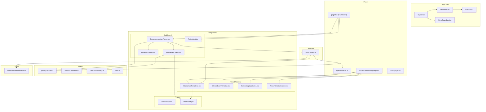
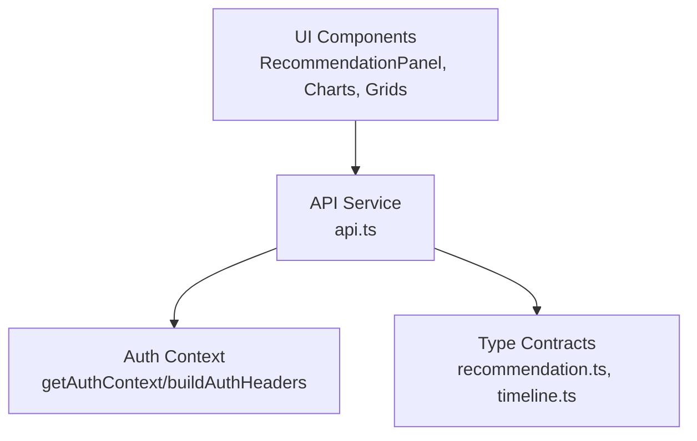
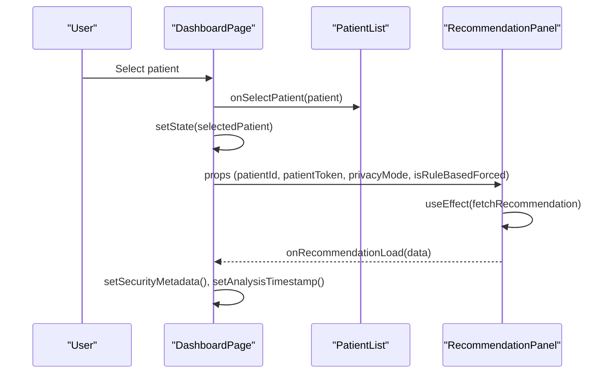
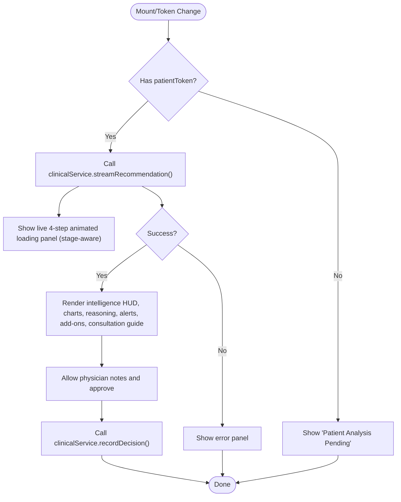
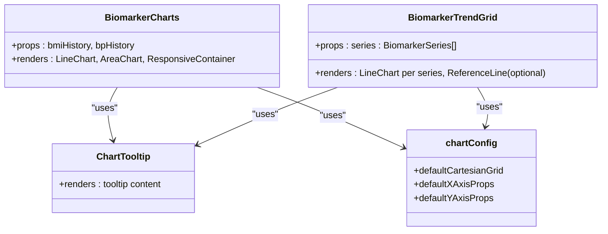
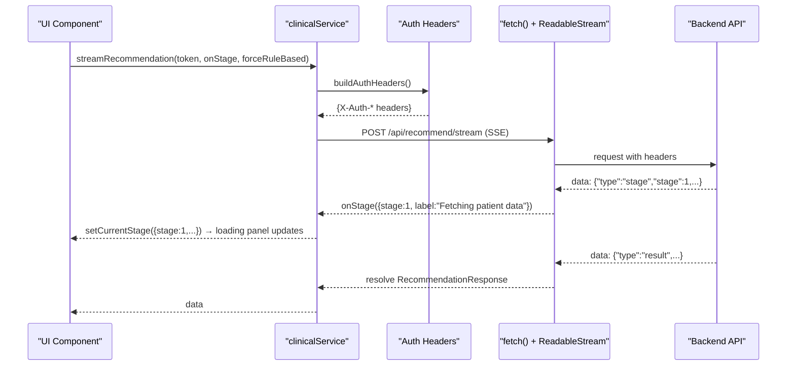
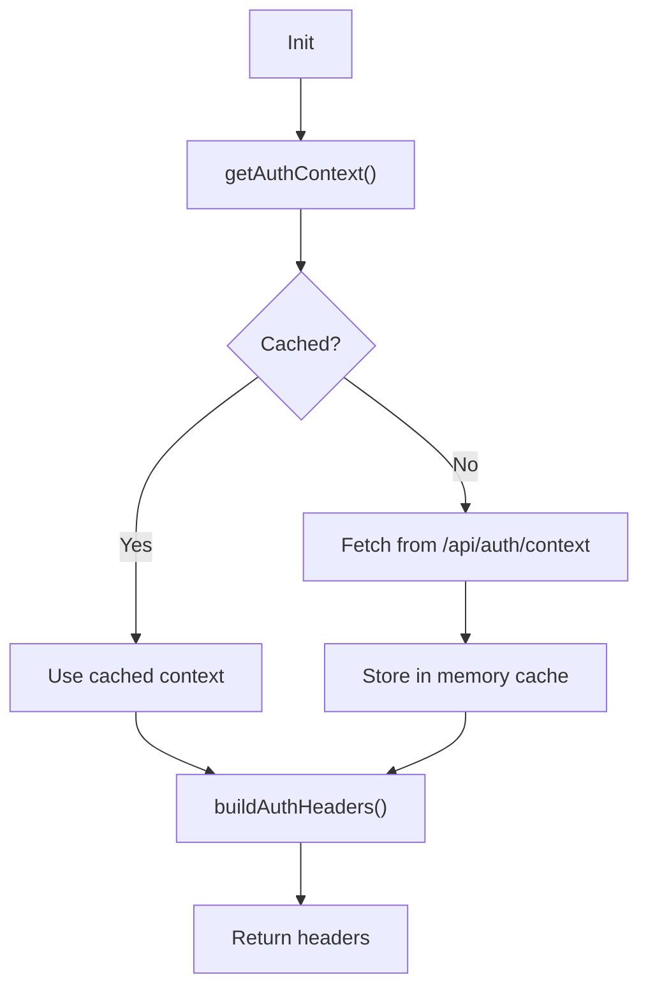
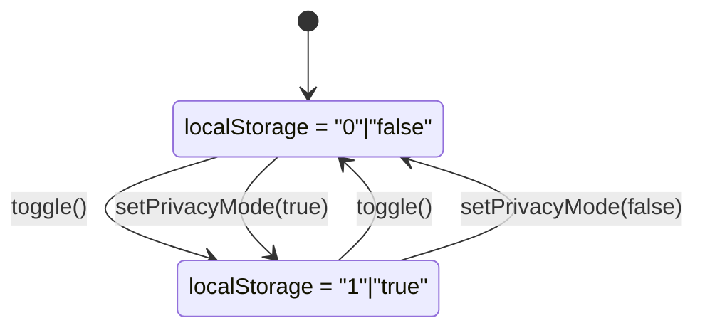
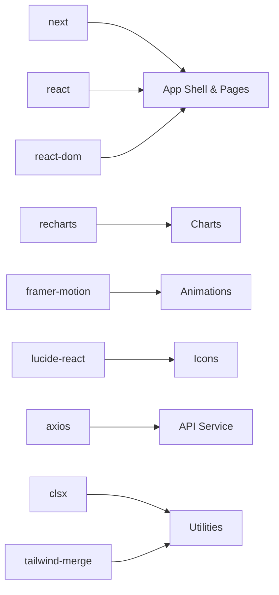

# Frontend Application

<cite>
**Referenced Files in This Document**
- [layout.tsx](file://frontend/src/app/layout.tsx)
- [page.tsx](file://frontend/src/app/page.tsx)
- [RoleAwareMain.tsx](file://frontend/src/app/RoleAwareMain.tsx)
- [Providers.tsx](file://frontend/src/app/Providers.tsx)
- [package.json](file://frontend/package.json)
- [next.config.ts](file://frontend/next.config.ts)
- [Sidebar.tsx](file://frontend/src/components/Sidebar.tsx)
- [RecommendationPanel.tsx](file://frontend/src/components/dashboard/RecommendationPanel.tsx)
- [PatientSearchEntry.tsx](file://frontend/src/components/dashboard/PatientSearchEntry.tsx)
- [BiomarkerCharts.tsx](file://frontend/src/components/dashboard/BiomarkerCharts.tsx)
- [ClinicalDrawer.tsx](file://frontend/src/components/ClinicalDrawer.tsx)
- [BiomarkerTrendGrid.tsx](file://frontend/src/components/trend-timeline/BiomarkerTrendGrid.tsx)
- [api.ts](file://frontend/src/services/api.ts)
- [privacy-mode.tsx](file://frontend/src/shared/privacy-mode.tsx)
- [chartConfig.ts](file://frontend/src/components/charts/chartConfig.ts)
- [clinicalConstants.ts](file://frontend/src/shared/clinicalConstants.ts)
- [recommendation.ts](file://frontend/src/types/recommendation.ts)
- [timeline.ts](file://frontend/src/types/timeline.ts)
</cite>

## Table of Contents
1. [Introduction](#introduction)
2. [Project Structure](#project-structure)
3. [Core Components](#core-components)
4. [Architecture Overview](#architecture-overview)
5. [Detailed Component Analysis](#detailed-component-analysis)
6. [Dependency Analysis](#dependency-analysis)
7. [Performance Considerations](#performance-considerations)
8. [Troubleshooting Guide](#troubleshooting-guide)
9. [Conclusion](#conclusion)
10. [Appendices](#appendices)

## Introduction
This document describes the Navavej ROC frontend application built with Next.js and React. It focuses on the dashboard, recommendation panel, trend visualization, and monitoring interfaces. It documents state management patterns, the API integration layer, authentication state handling, UI components (including Recharts-powered charts and interactive grids), and guidelines for responsive design, accessibility, and cross-browser compatibility. It also outlines component composition patterns, prop interfaces, backend integration contracts, common user workflows, performance optimization techniques, and error handling strategies.

## Project Structure
The frontend is organized using Next.js App Router conventions. Key areas:
- App shell and providers: global layout, sidebar, error boundary, and provider wrappers
- Pages: dashboard, trend-timeline, access-monitoring, audit
- Components: dashboard widgets, trend-timeline views, charts, and reusable UI
- Services: typed API client for backend integration
- Shared: privacy mode, constants, and utilities
- Types: strongly typed contracts for backend responses

**Diagram sources**
- [layout.tsx:1-47](file://frontend/src/app/layout.tsx#L1-L47)
- [page.tsx:1-280](file://frontend/src/app/page.tsx#L1-L280)
- [Providers.tsx:1-10](file://frontend/src/app/Providers.tsx#L1-L10)
- [RecommendationPanel.tsx:1-603](file://frontend/src/components/dashboard/RecommendationPanel.tsx#L1-L603)
- [BiomarkerCharts.tsx:1-141](file://frontend/src/components/dashboard/BiomarkerCharts.tsx#L1-L141)
- [BiomarkerTrendGrid.tsx:1-65](file://frontend/src/components/trend-timeline/BiomarkerTrendGrid.tsx#L1-L65)
- [api.ts:1-218](file://frontend/src/services/api.ts#L1-L218)
- [privacy-mode.tsx:1-64](file://frontend/src/shared/privacy-mode.tsx#L1-L64)
- [chartConfig.ts:1-18](file://frontend/src/components/charts/chartConfig.ts#L1-L18)
- [clinicalConstants.ts:1-4](file://frontend/src/shared/clinicalConstants.ts#L1-L4)
- [recommendation.ts:1-97](file://frontend/src/types/recommendation.ts#L1-L97)
- [timeline.ts:1-91](file://frontend/src/types/timeline.ts#L1-L91)

**Section sources**
- [layout.tsx:1-47](file://frontend/src/app/layout.tsx#L1-L47)
- [page.tsx:1-280](file://frontend/src/app/page.tsx#L1-L280)
- [Providers.tsx:1-10](file://frontend/src/app/Providers.tsx#L1-L10)

## Core Components
- Dashboard page orchestrates patient selection, privacy mode, and recommendation loading. It composes PatientList and RecommendationPanel and passes derived props for UI masking and timestamps.
- RecommendationPanel renders risk gauges, strategy assignment, reasoning trace, critical alerts, add-on recommendations, and consultation guide. It integrates with the API service and supports rule-based fallback modes.
- BiomarkerCharts visualizes BMI progression and blood pressure trends using Recharts with shared chart defaults and tooltips.
- BiomarkerTrendGrid displays individual biomarker series with optional reference lines and trend direction indicators.
- PatientSearchEntry provides a full-page centered search entry point for physician and nurse roles, replacing the patient list column.
- ClinicalDrawer is a slide-up overlay panel that wraps TrendTimelineScreen; it is opened on-demand from the physician/nurse Clinical Hub.

**Section sources**
- [page.tsx:29-280](file://frontend/src/app/page.tsx#L29-L280)
- [RecommendationPanel.tsx:169-603](file://frontend/src/components/dashboard/RecommendationPanel.tsx#L169-L603)
- [BiomarkerCharts.tsx:32-141](file://frontend/src/components/dashboard/BiomarkerCharts.tsx#L32-L141)
- [BiomarkerTrendGrid.tsx:23-65](file://frontend/src/components/trend-timeline/BiomarkerTrendGrid.tsx#L23-L65)
- [PatientSearchEntry.tsx](file://frontend/src/components/dashboard/PatientSearchEntry.tsx)
- [ClinicalDrawer.tsx](file://frontend/src/components/ClinicalDrawer.tsx)

## Role-Split UX (Physician/Nurse vs Admin)

The application renders a different interface depending on the user's role, determined by `useAuth().role`.

**Roles `physician` and `nurse` — Single-entry-point search flow:**
1. On login, user lands on a clean centered search screen (`PatientSearchEntry`). No sidebar is shown.
2. User types a name to filter, then clicks a patient card.
3. The full-width Clinical Hub for that patient is shown, including AI recommendations and screening gaps.
4. A "View Charts & Timeline" button opens `ClinicalDrawer` — a slide-up panel containing `TrendTimelineScreen`.
5. A "← Search" button in the navbar returns the user to the search screen.

**Roles `admin` and `dpo` — Original 3-column layout:**
- Sidebar navigation is visible.
- Patient list column, recommendation panel, and trend charts are all shown simultaneously.

**Implementation files:**
- `RoleAwareMain.tsx` — client component in `app/` that conditionally applies sidebar left-padding only for admin/DPO.
- `Sidebar.tsx` — returns `null` for physician/nurse roles, hiding the sidebar entirely.
- `page.tsx` — `SEARCH_FLOW_ROLES = new Set(["physician", "nurse"])` drives the render branch.

**Section sources**
- [page.tsx](file://frontend/src/app/page.tsx)
- [RoleAwareMain.tsx](file://frontend/src/app/RoleAwareMain.tsx)
- [Sidebar.tsx](file://frontend/src/components/Sidebar.tsx)
- [PatientSearchEntry.tsx](file://frontend/src/components/dashboard/PatientSearchEntry.tsx)
- [ClinicalDrawer.tsx](file://frontend/src/components/ClinicalDrawer.tsx)

## Architecture Overview
The frontend follows a layered architecture:
- App shell sets up providers, layout, and global styles
- Pages define routes and compose domain-specific components
- Components encapsulate UI and orchestrate service calls
- Services abstract HTTP clients, authentication headers, and error normalization
- Types enforce contracts for backend responses

**Diagram sources**
- [RecommendationPanel.tsx:169-201](file://frontend/src/components/dashboard/RecommendationPanel.tsx#L169-L201)
- [api.ts:93-117](file://frontend/src/services/api.ts#L93-L117)
- [api.ts:132-180](file://frontend/src/services/api.ts#L132-L180)
- [recommendation.ts:63-96](file://frontend/src/types/recommendation.ts#L63-L96)
- [timeline.ts:51-61](file://frontend/src/types/timeline.ts#L51-L61)

## Detailed Component Analysis

### Dashboard Page Composition
The dashboard page manages:
- Selected patient state and privacy mode via a context provider
- Timestamp formatting and display logic
- Privacy-aware display helpers for sensitive fields
- Rule-based mode toggling for recommendation engine fallback
- Composition of PatientList and RecommendationPanel

**Diagram sources**
- [page.tsx:63-67](file://frontend/src/app/page.tsx#L63-L67)
- [page.tsx:245-254](file://frontend/src/app/page.tsx#L245-L254)
- [RecommendationPanel.tsx:178-201](file://frontend/src/components/dashboard/RecommendationPanel.tsx#L178-L201)

**Section sources**
- [page.tsx:29-280](file://frontend/src/app/page.tsx#L29-L280)
- [Providers.tsx:1-10](file://frontend/src/app/Providers.tsx#L1-L10)

### Recommendation Panel
Responsibilities:
- Fetches recommendation using patient token and rule-based override
- Renders risk level gauge, strategy assignment, reasoning trace, critical alerts, add-ons, and consultation guide
- Supports approval workflow with notes and error handling
- Integrates privacy-aware rendering via security metadata

**Diagram sources**
- [RecommendationPanel.tsx:169-201](file://frontend/src/components/dashboard/RecommendationPanel.tsx#L169-L201)
- [RecommendationPanel.tsx:203-216](file://frontend/src/components/dashboard/RecommendationPanel.tsx#L203-L216)
- [api.ts:132-160](file://frontend/src/services/api.ts#L132-L160)

**Section sources**
- [RecommendationPanel.tsx:169-603](file://frontend/src/components/dashboard/RecommendationPanel.tsx#L169-L603)
- [api.ts:132-160](file://frontend/src/services/api.ts#L132-L160)

### Trend Visualization Components
- BiomarkerCharts: Renders BMI area chart and SBP/DBP line chart with shared chart defaults and gradient fills
- BiomarkerTrendGrid: Renders multiple biomarker series with optional reference lines and trend direction labels

**Diagram sources**
- [BiomarkerCharts.tsx:32-141](file://frontend/src/components/dashboard/BiomarkerCharts.tsx#L32-L141)
- [BiomarkerTrendGrid.tsx:23-65](file://frontend/src/components/trend-timeline/BiomarkerTrendGrid.tsx#L23-L65)
- [chartConfig.ts:1-18](file://frontend/src/components/charts/chartConfig.ts#L1-L18)

**Section sources**
- [BiomarkerCharts.tsx:32-141](file://frontend/src/components/dashboard/BiomarkerCharts.tsx#L32-L141)
- [BiomarkerTrendGrid.tsx:23-65](file://frontend/src/components/trend-timeline/BiomarkerTrendGrid.tsx#L23-L65)
- [chartConfig.ts:1-18](file://frontend/src/components/charts/chartConfig.ts#L1-L18)
- [clinicalConstants.ts:1-4](file://frontend/src/shared/clinicalConstants.ts#L1-L4)

### API Integration Layer
- Two API clients: apiV1 (legacy routes) and apiV3 (contract-oriented routes)
- Centralized request/response interceptors for timeouts and normalized errors
- Authentication headers built from a cached auth context with user_id, role, and scopes
- Typed service methods for recommendations, decisions, timelines, trends, screening gaps, monitoring snapshots, anomaly alerts, audit logs, RBAC, mapping codes, and master programs
- `streamRecommendation()` uses native `fetch()` + `ReadableStream` to consume SSE events from `POST /api/recommend/stream`, calling an `onStage` callback for each pipeline stage update

**Diagram sources**
- [api.ts:132-144](file://frontend/src/services/api.ts#L132-L144)
- [api.ts:93-117](file://frontend/src/services/api.ts#L93-L117)

**Section sources**
- [api.ts:1-218](file://frontend/src/services/api.ts#L1-218)

### Authentication State Handling
- Auth context is fetched once and cached
- Headers are constructed dynamically with merged scopes
- Fallback behavior when auth context is unavailable

**Diagram sources**
- [api.ts:93-117](file://frontend/src/services/api.ts#L93-L117)

**Section sources**
- [api.ts:93-117](file://frontend/src/services/api.ts#L93-L117)

### Privacy Mode State Management
- Local storage-backed provider persists user preference
- Context exposes toggle and setter functions
- Dashboard and RecommendationPanel consume privacyMode to mask sensitive content

**Diagram sources**
- [privacy-mode.tsx:15-54](file://frontend/src/shared/privacy-mode.tsx#L15-L54)

**Section sources**
- [privacy-mode.tsx:1-64](file://frontend/src/shared/privacy-mode.tsx#L1-L64)
- [page.tsx:30-61](file://frontend/src/app/page.tsx#L30-L61)
- [RecommendationPanel.tsx:274](file://frontend/src/components/dashboard/RecommendationPanel.tsx#L274)

### Type Contracts and Prop Interfaces
- RecommendationResponse defines the shape of recommendation payloads, including risk levels, tiers, reasoning traces, add-ons, communication scripts, and biomarker trends
- TimelinePayload defines the structure for clinical event timelines and related metadata
- Props for components are declared with explicit interfaces to ensure type safety

**Section sources**
- [recommendation.ts:63-96](file://frontend/src/types/recommendation.ts#L63-L96)
- [timeline.ts:51-61](file://frontend/src/types/timeline.ts#L51-L61)
- [RecommendationPanel.tsx:28-34](file://frontend/src/components/dashboard/RecommendationPanel.tsx#L28-L34)
- [BiomarkerCharts.tsx:27-30](file://frontend/src/components/dashboard/BiomarkerCharts.tsx#L27-L30)
- [BiomarkerTrendGrid.tsx:19-21](file://frontend/src/components/trend-timeline/BiomarkerTrendGrid.tsx#L19-L21)

## Dependency Analysis
External libraries and their roles:
- next: framework and routing
- react/react-dom: UI library
- recharts: charting library for trend visualizations
- framer-motion: animations and transitions
- lucide-react: icons
- axios: HTTP client with interceptors
- clsx/tailwind-merge: class merging utilities

**Diagram sources**
- [package.json:14-24](file://frontend/package.json#L14-L24)

**Section sources**
- [package.json:14-44](file://frontend/package.json#L14-L44)

## Performance Considerations
- Lazy loading and code splitting are implicit via Next.js App Router pages and component boundaries
- Recharts charts are wrapped in ResponsiveContainer; ensure minimal re-renders by passing stable arrays and avoiding inline object/array creation in render paths
- Memoization: use useMemo/useCallback for derived values in RecommendationPanel and dashboard page
- Network timeouts: centralized 30-second timeout in axios clients
- Privacy mode toggles should avoid unnecessary re-fetches; cache recommendation data per token while respecting mode changes
- Animations: limit heavy animations to entrance/exit; prefer lightweight transitions
- Bundle size: keep chart tooltips and configs small; defer non-critical assets

## Troubleshooting Guide
Common issues and strategies:
- Backend connectivity failures: normalized via response interceptor; surface user-friendly messages
- Timeout errors: ECONNABORTED mapped to a clear message
- Missing auth context: fallback to default admin context with read/write scopes
- Recommendation loading errors: error panel with actionable message
- Approval failures: display localized error and preserve notes

**Section sources**
- [api.ts:63-79](file://frontend/src/services/api.ts#L63-L79)
- [api.ts:93-107](file://frontend/src/services/api.ts#L93-L107)
- [RecommendationPanel.tsx:262-270](file://frontend/src/components/dashboard/RecommendationPanel.tsx#L262-L270)
- [RecommendationPanel.tsx:203-216](file://frontend/src/components/dashboard/RecommendationPanel.tsx#L203-L216)

## Conclusion
The Navavej ROC frontend leverages Next.js for routing and SSR/SSG capabilities, React for component composition, and Recharts for trend visualization. The API service centralizes authentication and error handling, while privacy mode ensures sensitive data masking. The dashboard and recommendation panel present a cohesive clinical advisory experience, integrating evidence streams, risk visualization, and actionable insights. Following the outlined patterns and guidelines will help maintain type safety, responsiveness, accessibility, and performance.

## Appendices

### Responsive Design Guidelines
- Use Tailwind’s responsive prefixes (sm, md, lg, xl) consistently
- Prefer grid and flex utilities for adaptive layouts
- Ensure charts fit containers with ResponsiveContainer and appropriate heights
- Test breakpoints for sidebar, cards, and typography scaling

### Accessibility Compliance
- Provide meaningful alt text for logos and icons
- Ensure sufficient color contrast for text and backgrounds
- Use semantic HTML and ARIA attributes where necessary
- Support keyboard navigation and focus management

### Cross-Browser Compatibility
- Next.js builds target modern browsers; verify chart rendering in Edge, Safari, and Chrome
- Polyfill fetch if targeting very old browsers (not applicable given current deps)
- Validate icon rendering and CSS custom properties across browsers

### Component Usage Patterns
- Pass stable props to charts to minimize re-renders
- Use privacyMode to conditionally render masked or full content
- Compose RecommendationPanel with PatientList and pass derived props
- Integrate approval flow with proper loading and error states