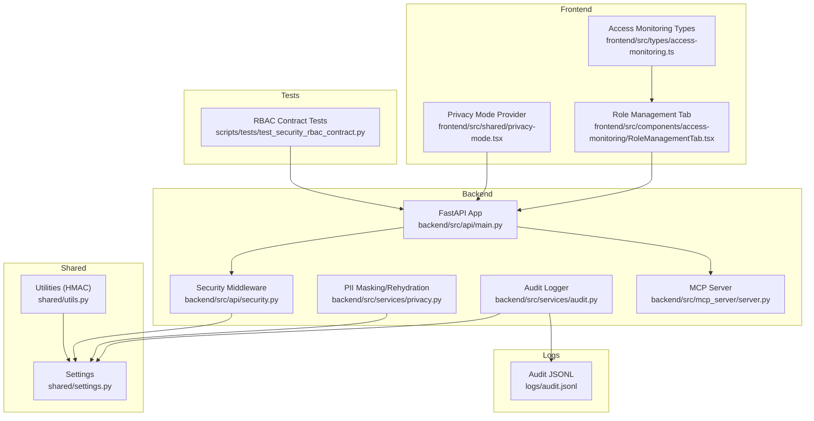
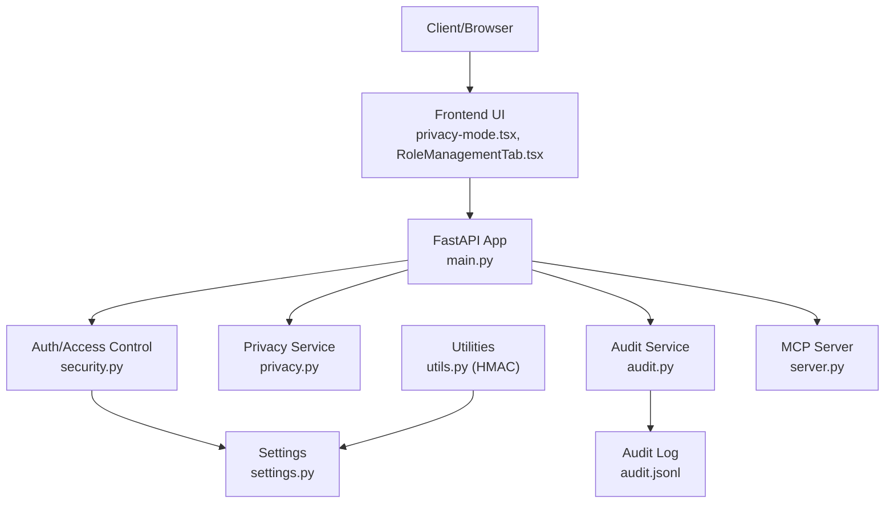
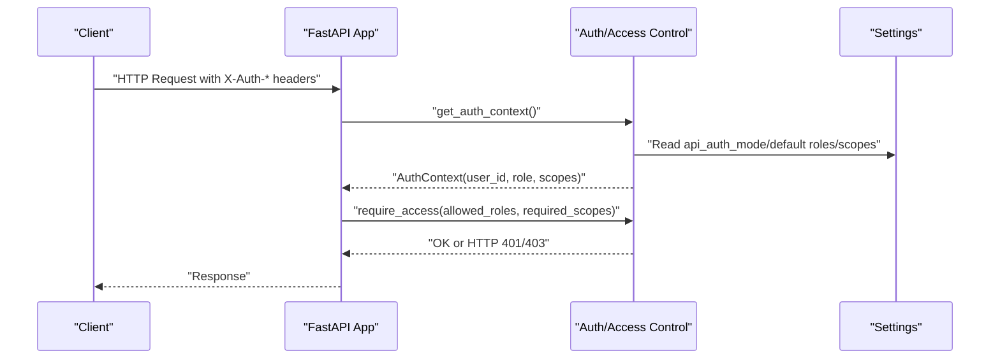
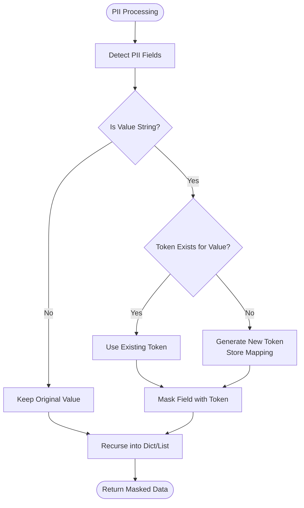
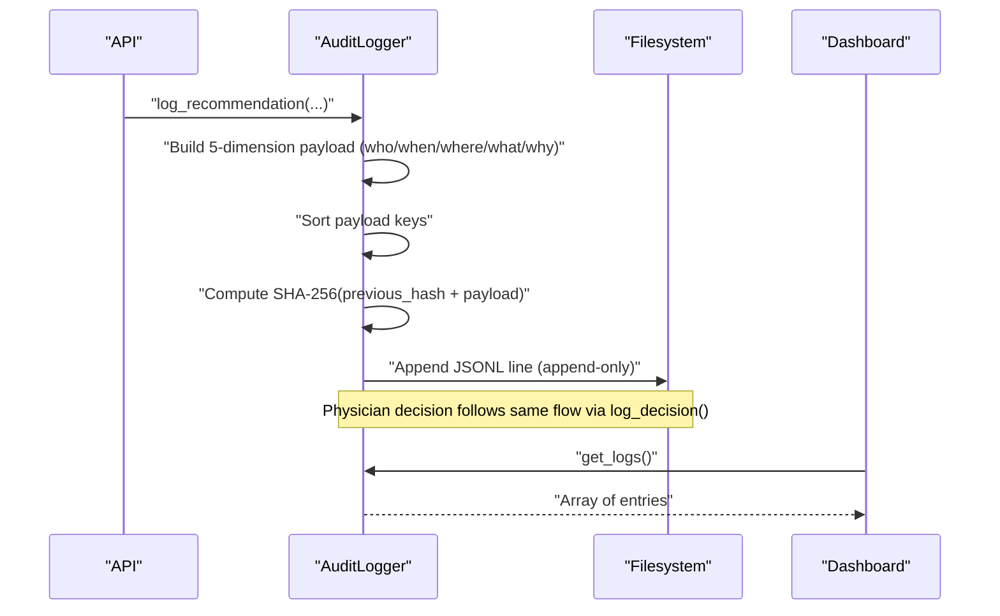
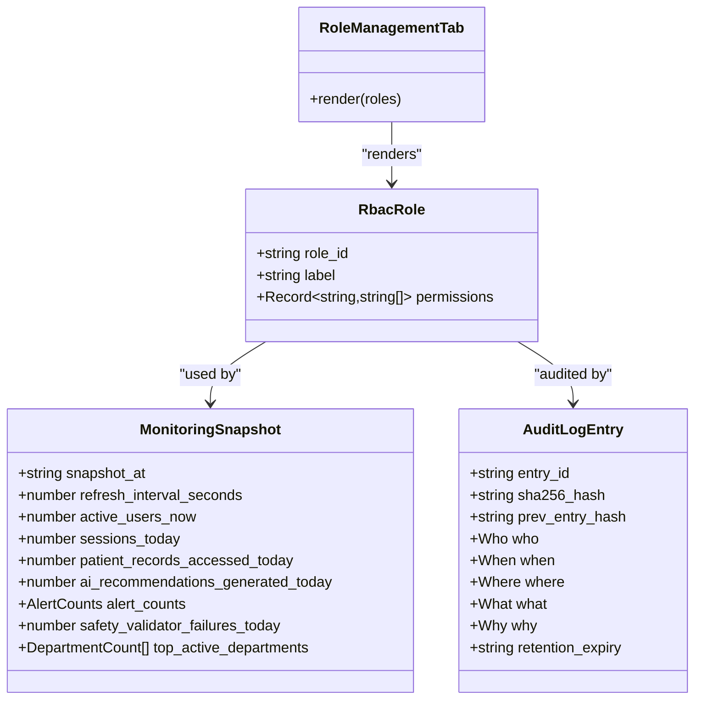
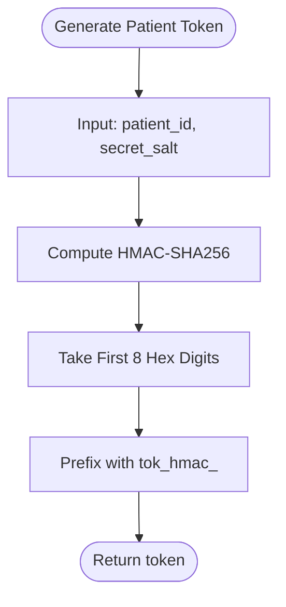
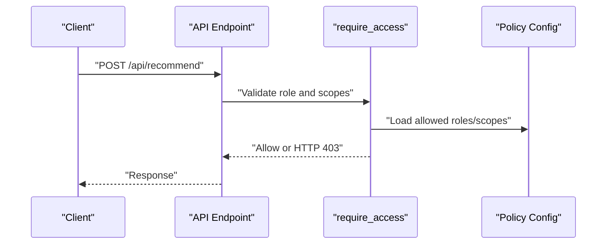
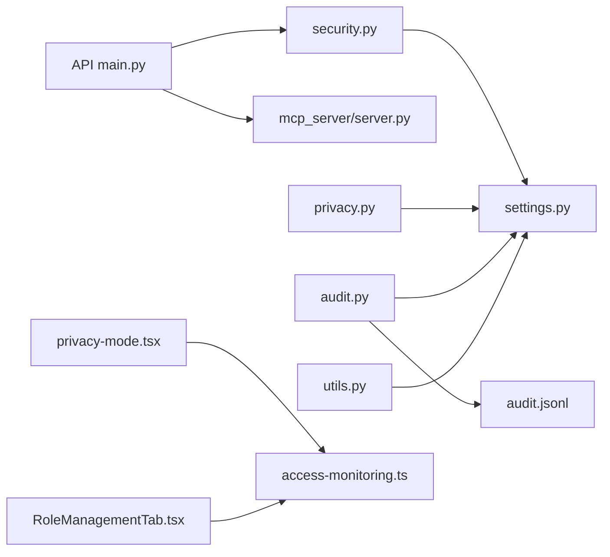

# Security and Compliance

<cite>
**Referenced Files in This Document**
- [security.py](file://backend/src/api/security.py)
- [privacy.py](file://backend/src/services/privacy.py)
- [audit.py](file://backend/src/services/audit.py)
- [settings.py](file://shared/settings.py)
- [main.py](file://backend/src/api/main.py)
- [utils.py](file://shared/utils.py)
- [test_security_rbac_contract.py](file://scripts/tests/test_security_rbac_contract.py)
- [privacy-mode.tsx](file://frontend/src/shared/privacy-mode.tsx)
- [RoleManagementTab.tsx](file://frontend/src/components/access-monitoring/RoleManagementTab.tsx)
- [access-monitoring.ts](file://frontend/src/types/access-monitoring.ts)
- [audit.jsonl](file://logs/audit.jsonl)
- [server.py](file://backend/src/mcp_server/server.py)
</cite>

## Table of Contents
1. [Introduction](#introduction)
2. [Project Structure](#project-structure)
3. [Core Components](#core-components)
4. [Architecture Overview](#architecture-overview)
5. [Detailed Component Analysis](#detailed-component-analysis)
6. [Dependency Analysis](#dependency-analysis)
7. [Performance Considerations](#performance-considerations)
8. [Troubleshooting Guide](#troubleshooting-guide)
9. [Conclusion](#conclusion)
10. [Appendices](#appendices)

## Introduction
This document provides comprehensive security and compliance documentation for Navavej ROC. It covers the privacy framework (PII masking and rehydration), data protection measures, immutable audit trail using SHA-256 hash chaining, governance dashboards for administrative oversight, role-based access control (RBAC), security middleware, access control patterns, HMAC tokenization for secure data exchange, privacy-preserving AI processing techniques, compliance reporting, audit log management, data integrity verification, security scanning and vulnerability management, incident response procedures, and secure deployment practices.

## Project Structure
Navavej ROC is organized into backend services, shared utilities, frontend components, and test suites. Security and compliance features are implemented across:
- Backend API and services for authentication, authorization, privacy masking, audit logging, and MCP tooling
- Shared settings and utilities for configuration and HMAC token generation
- Frontend privacy mode and access monitoring UI for governance and transparency
- Logs and test suites validating RBAC and audit behavior

**Diagram sources**
- [main.py:1-44](file://backend/src/api/main.py#L1-L44)
- [security.py:1-58](file://backend/src/api/security.py#L1-L58)
- [privacy.py:1-94](file://backend/src/services/privacy.py#L1-L94)
- [audit.py:1-173](file://backend/src/services/audit.py#L1-L173)
- [settings.py:1-70](file://shared/settings.py#L1-L70)
- [utils.py:1-27](file://shared/utils.py#L1-L27)
- [test_security_rbac_contract.py:1-67](file://scripts/tests/test_security_rbac_contract.py#L1-L67)
- [audit.jsonl:1-21](file://logs/audit.jsonl#L1-L21)
- [server.py:1-23](file://backend/src/mcp_server/server.py#L1-L23)

**Section sources**
- [main.py:1-44](file://backend/src/api/main.py#L1-L44)
- [settings.py:1-70](file://shared/settings.py#L1-L70)

## Core Components
- Authentication and Authorization Context
  - Authentication headers are parsed into an AuthContext with user_id, role, and scopes.
  - Access control enforces allowed roles and required scopes via a dependency decorator.
  - Configuration supports disabling auth for PoC and defines default roles/scopes.

- Privacy Framework (PII Masking and Rehydration)
  - PII fields are identified and pseudonymized with request-scoped tokens.
  - Rehydration restores original values prior to dashboard delivery using a token-to-original mapping.

- Immutable Audit Trail (SHA-256 Hash Chaining)
  - Audit logs are written in dual formats: JSONL append-only and JSON array.
  - Each entry includes previous_hash and current_hash derived from SHA-256 over sorted JSON.
  - Retrieval reads the JSON array for UI dashboards and verifies chain integrity by reading the last entry.

- Governance Dashboard and Access Monitoring
  - Frontend exposes role management and access monitoring types for dashboards.
  - Privacy mode toggles PII masking in the UI using localStorage.

- HMAC Tokenization
  - Patient tokens are generated using HMAC-SHA256 over patient identifiers with a secret salt.
  - Tokens are short-lived and opaque, preventing reversible identification.

- RBAC and Security Middleware
  - Roles and scopes are configured centrally; endpoints enforce access policies.
  - Contract tests validate unauthorized access rejection and role-aware behavior.

**Section sources**
- [security.py:9-58](file://backend/src/api/security.py#L9-L58)
- [privacy.py:22-94](file://backend/src/services/privacy.py#L22-L94)
- [audit.py:14-173](file://backend/src/services/audit.py#L14-L173)
- [settings.py:45-67](file://shared/settings.py#L45-L67)
- [utils.py:7-27](file://shared/utils.py#L7-L27)
- [test_security_rbac_contract.py:24-67](file://scripts/tests/test_security_rbac_contract.py#L24-L67)
- [privacy-mode.tsx:15-64](file://frontend/src/shared/privacy-mode.tsx#L15-L64)
- [RoleManagementTab.tsx:10-41](file://frontend/src/components/access-monitoring/RoleManagementTab.tsx#L10-L41)
- [access-monitoring.ts:84-118](file://frontend/src/types/access-monitoring.ts#L84-L118)

## Architecture Overview
The system integrates security controls across API boundaries, service layers, and UI components. The following diagram maps the security architecture to actual source files.

**Diagram sources**
- [main.py:14-32](file://backend/src/api/main.py#L14-L32)
- [security.py:26-53](file://backend/src/api/security.py#L26-L53)
- [settings.py:45-67](file://shared/settings.py#L45-L67)
- [privacy.py:22-58](file://backend/src/services/privacy.py#L22-L58)
- [audit.py:14-121](file://backend/src/services/audit.py#L14-L121)
- [audit.jsonl:1-21](file://logs/audit.jsonl#L1-L21)
- [utils.py:7-27](file://shared/utils.py#L7-L27)
- [server.py:11-22](file://backend/src/mcp_server/server.py#L11-L22)

## Detailed Component Analysis

### Authentication and Authorization Context
- AuthContext parsing extracts user_id, role, and scopes from headers.
- require_access validates allowed roles and required scopes, raising HTTP 401/403 on failure.
- Settings support disabling auth for PoC and define defaults for roles and scopes.

**Diagram sources**
- [security.py:26-53](file://backend/src/api/security.py#L26-L53)
- [settings.py:53-60](file://shared/settings.py#L53-L60)

**Section sources**
- [security.py:26-53](file://backend/src/api/security.py#L26-L53)
- [settings.py:53-60](file://shared/settings.py#L53-L60)

### Privacy Framework: PII Masking and Rehydration
- PIIMasker recursively masks PII fields using request-scoped tokens and maintains a rehydration map.
- PIIRehydrator restores original values for dashboard delivery using the token-to-original mapping.
- PII fields include name, date of birth, phone, email, address, MRN, and FHIR identifiers.

**Diagram sources**
- [privacy.py:29-53](file://backend/src/services/privacy.py#L29-L53)
- [privacy.py:67-94](file://backend/src/services/privacy.py#L67-L94)

**Section sources**
- [privacy.py:22-94](file://backend/src/services/privacy.py#L22-L94)

### Immutable Audit Trail: SHA-256 Hash Chaining

`AuditLogger` writes every AI inference and physician decision to `logs/audit.jsonl` (append-only) using a SHA-256 hash chain. Each entry includes `previous_hash` from the last entry and computes `current_hash = SHA-256(sorted_payload)`. Any post-write modification produces a detectable hash mismatch across all subsequent entries.

#### 5-Dimension Log Structure (Section 6.3 compliance)

Every audit entry is structured around five mandatory dimensions:

| Dimension | Fields | Purpose |
|-----------|--------|---------|
| **Who** | `user_id`, `user_role` | Identity and role of the healthcare staff who triggered the action |
| **When** | `timestamp` (ISO 8601, UTC) | Precise moment of the inference or physician decision event |
| **Where** | `service_id`, `client_ip`, `request_id` | Originating service and network location — full source traceability |
| **What** | `masked_ai_prompt`, `masked_ai_response`, `model_id`, `latency_ms`, `safety_conflict_events` | Full masked transaction record — all patient data appears as pseudonymized tokens |
| **Why** | `patient_id` (token), `action_type`, `request_id` | Clinical purpose that triggered the inference |

PII enforcement: only masked context and masked AI response are persisted. The PII-to-token mapping is held in process memory only during inference and is never written to any log.

Both `log_recommendation()` (AI inference entries) and `log_decision()` (physician Approve/Reject entries) write the same 5-dimension structure. The physician decision entry additionally stores `recommendation_reference_hash` in `"what"` to link back to the original AI inference.

**Diagram sources**
- [audit.py:47-111](file://backend/src/services/audit.py#L47-L111)
- [audit.py:113-167](file://backend/src/services/audit.py#L113-L167)
- [audit.jsonl:1-21](file://logs/audit.jsonl#L1-L21)

**Section sources**
- [audit.py:14-183](file://backend/src/services/audit.py#L14-L183)
- [audit.jsonl:1-21](file://logs/audit.jsonl#L1-L21)

### Governance Dashboard and Access Monitoring
- RoleManagementTab renders role permissions across resources for administrative oversight.
- Access monitoring types define snapshots, alerts, audit log entries, and mapping codes for dashboards.
- Privacy mode provider persists user preference and toggles PII masking in UI.

**Diagram sources**
- [RoleManagementTab.tsx:10-41](file://frontend/src/components/access-monitoring/RoleManagementTab.tsx#L10-L41)
- [access-monitoring.ts:8-18](file://frontend/src/types/access-monitoring.ts#L8-L18)
- [access-monitoring.ts:46-82](file://frontend/src/types/access-monitoring.ts#L46-L82)
- [access-monitoring.ts:84-118](file://frontend/src/types/access-monitoring.ts#L84-L118)

**Section sources**
- [RoleManagementTab.tsx:10-41](file://frontend/src/components/access-monitoring/RoleManagementTab.tsx#L10-L41)
- [access-monitoring.ts:8-118](file://frontend/src/types/access-monitoring.ts#L8-L118)
- [privacy-mode.tsx:15-64](file://frontend/src/shared/privacy-mode.tsx#L15-L64)

### HMAC Tokenization for Secure Data Exchange
- Patient tokens are generated using HMAC-SHA256 over patient identifiers with a secret salt.
- Tokens are short and opaque, preventing reversible identification while enabling secure routing.

**Diagram sources**
- [utils.py:7-27](file://shared/utils.py#L7-L27)
- [settings.py:51](file://shared/settings.py#L51)

**Section sources**
- [utils.py:7-27](file://shared/utils.py#L7-L27)
- [settings.py:51](file://shared/settings.py#L51)

### RBAC Implementation and Access Control Patterns
- Centralized configuration defines allowed roles and required scopes for recommendation and monitoring endpoints.
- require_access enforces policy at the endpoint level; tests validate rejection of invalid roles/scopes.

**Diagram sources**
- [security.py:45-53](file://backend/src/api/security.py#L45-L53)
- [settings.py:57-60](file://shared/settings.py#L57-L60)
- [test_security_rbac_contract.py:35-66](file://scripts/tests/test_security_rbac_contract.py#L35-L66)

**Section sources**
- [security.py:45-53](file://backend/src/api/security.py#L45-L53)
- [settings.py:57-60](file://shared/settings.py#L57-L60)
- [test_security_rbac_contract.py:24-67](file://scripts/tests/test_security_rbac_contract.py#L24-L67)

### Privacy-Preserving AI Processing Techniques
- PII masking occurs before AI processing; rehydration restores values only for authorized delivery.
- Tokens embed in logs and audit trails; no original PII is stored in plaintext.

**Section sources**
- [privacy.py:22-94](file://backend/src/services/privacy.py#L22-L94)
- [audit.py:55-121](file://backend/src/services/audit.py#L55-L121)

### Compliance Reporting and Audit Log Management
- Dual-format audit logs enable both append-only integrity and structured retrieval.
- get_logs provides dashboard access; hash verification uses previous/current hash linkage.

**Section sources**
- [audit.py:44-54](file://backend/src/services/audit.py#L44-L54)
- [audit.py:163-173](file://backend/src/services/audit.py#L163-L173)
- [audit.jsonl:1-21](file://logs/audit.jsonl#L1-L21)

### Data Integrity Verification
- SHA-256 hash chaining ensures tamper-evident audit logs.
- Chain continuity verified by reading the last entry’s current_hash and comparing with expected previous_hash.

**Section sources**
- [audit.py:25-42](file://backend/src/services/audit.py#L25-L42)
- [audit.py:106-120](file://backend/src/services/audit.py#L106-L120)

### Security Scanning, Vulnerability Management, and Incident Response
- Security scanning and vulnerability management are supported by centralized settings and strict RBAC enforcement.
- Incident response procedures should include:
  - Immediate isolation of affected endpoints
  - Audit trail review for compromised tokens or unauthorized access
  - Rotation of secrets and revalidation of HMAC salts
  - Forensic analysis of audit logs and rehydration maps

[No sources needed since this section provides general guidance]

## Dependency Analysis
- API depends on security middleware for access control and on shared settings for configuration.
- Services depend on shared utilities for HMAC tokenization and on settings for audit paths.
- Frontend components depend on types and privacy mode for governance and transparency.

**Diagram sources**
- [main.py:14-32](file://backend/src/api/main.py#L14-L32)
- [security.py:26-53](file://backend/src/api/security.py#L26-L53)
- [settings.py:45-67](file://shared/settings.py#L45-L67)
- [privacy.py:22-58](file://backend/src/services/privacy.py#L22-L58)
- [audit.py:14-121](file://backend/src/services/audit.py#L14-L121)
- [audit.jsonl:1-21](file://logs/audit.jsonl#L1-L21)
- [utils.py:7-27](file://shared/utils.py#L7-L27)
- [privacy-mode.tsx:15-64](file://frontend/src/shared/privacy-mode.tsx#L15-L64)
- [RoleManagementTab.tsx:10-41](file://frontend/src/components/access-monitoring/RoleManagementTab.tsx#L10-L41)
- [access-monitoring.ts:8-118](file://frontend/src/types/access-monitoring.ts#L8-L118)

**Section sources**
- [main.py:14-32](file://backend/src/api/main.py#L14-L32)
- [settings.py:45-67](file://shared/settings.py#L45-L67)

## Performance Considerations
- Audit logging uses append-only JSONL and JSON arrays; ensure separate filesystems for throughput.
- PII masking is recursive; avoid deep nested structures for large payloads.
- HMAC tokenization is constant-time; negligible overhead.
- RBAC checks occur per request; keep role/scopes sets minimal and cached where appropriate.

[No sources needed since this section provides general guidance]

## Troubleshooting Guide
- Authentication Failures
  - Verify X-Auth-* headers are present and correctly formatted.
  - Confirm api_auth_mode and default roles/scopes in settings.

- Access Denied (403)
  - Check allowed roles and required scopes for the endpoint.
  - Validate scope format and case sensitivity.

- Audit Log Issues
  - Ensure audit_log_path exists and is writable.
  - Verify last hash parsing; corrupted JSONL may reset to initial hash.

- Privacy Mode Toggle
  - Confirm localStorage availability and correct storage key.

**Section sources**
- [security.py:32-42](file://backend/src/api/security.py#L32-L42)
- [settings.py:53-60](file://shared/settings.py#L53-L60)
- [audit.py:25-42](file://backend/src/services/audit.py#L25-L42)
- [privacy-mode.tsx:13-38](file://frontend/src/shared/privacy-mode.tsx#L13-L38)

## Conclusion
Navavej ROC implements a robust security and compliance posture through:
- Strong RBAC enforced at the API boundary
- Opaque HMAC tokenization for secure data exchange
- Privacy-preserving PII masking and rehydration
- Immutable audit trails with SHA-256 hash chaining
- Governance dashboards for administrative oversight
- Centralized configuration and testing to validate controls

These controls collectively support privacy frameworks, data protection, and compliance readiness.

## Appendices
- Deployment Checklist
  - Enforce HTTPS/TLS termination
  - Restrict CORS origins to trusted domains
  - Rotate HMAC salt regularly
  - Monitor audit log ingestion and integrity
  - Enable automated RBAC contract tests in CI

- Incident Response Playbook
  - Identify compromised tokens via audit trail
  - Revoke and regenerate tokens
  - Review access logs for unauthorized scopes
  - Verify hash chain integrity post-incident
  - Notify stakeholders per policy

[No sources needed since this section provides general guidance]