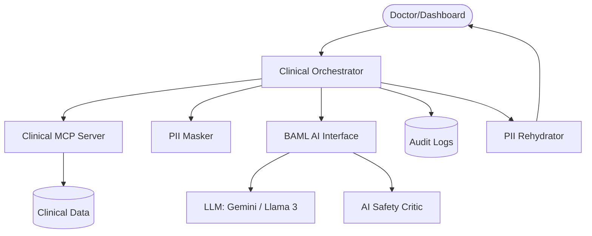

# Navaveij — Intelligent Clinical Recommendation Engine

Navaveij is a medical-grade AI orchestration system designed to provide personalized health checkup recommendations. It leverages the **Model Context Protocol (MCP)** for data retrieval, **BAML** for robust LLM interactions, and multi-layered safety guardrails.

## 🌟 Core Features

- **Standardized Data Access**: Powered by [MCP Server](./src/mcp_server/README.md) to bridge clinical data and AI.
- **Privacy First**: Built-in PII masking and rehydration to ensure patient data never leaves the local environment unencrypted.
- **Robust AI Reasoning**: Uses [BAML](./baml_src/clinical/README.md) for type-safe, high-quality prompt engineering and response parsing.
- **Clinical Safety Guardrails**: Hybrid validation using a Rule-based engine and an LLM-based Safety Critic.
- **5-Dimensional Audit Logging**: Immutable record of every decision (Who, What, Why, How, When).

## 🏗️ Architecture



## 🚀 Getting Started

### Prerequisites

- Python 3.10+
- [uv](https://docs.astral.sh/uv/) for dependency management.
- [BAML CLI](https://docs.boundaryml.com/ref/overview) installed.

### Setup

1. **Clone the repository**:
   ```bash
   git clone <repository-url>
   cd navaveij
   ```

2. **Install dependencies**:
   ```bash
   uv sync
   ```

3. **Configure Environment**:
   Copy `.env.example` to `.env` and fill in your LLM credentials:
   ```bash
   cp .env.example .env
   ```

4. **Generate BAML Clients**:
   ```bash
   baml-cli generate
   ```

### Running Tests

To run the end-to-end clinical recommendation flow:
```bash
PYTHONPATH=. uv run python test_orchestrator.py
```

## 📂 Project Structure

- `src/orchestrator/`: The core reasoning loop, privacy, and safety layers.
- `src/mcp_server/`: Implementation of MCP tools for clinical data retrieval.
- `baml_src/`: BAML definitions for AI prompts and domain models.
- `logs/`: Directory for audit and system logs.

## 🛡️ Reliability & Standards

- **Ruff**: For strict Python code quality and formatting.
- **Loguru**: For centralized, structured logging.
- **Pydantic v2**: For data validation and type safety.
