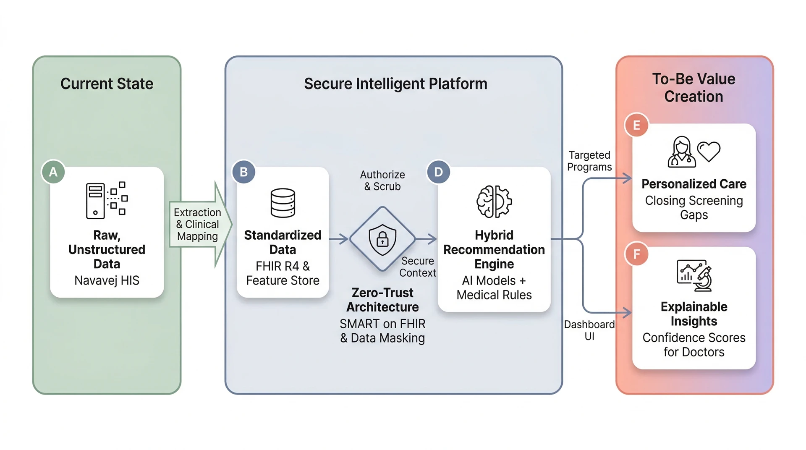
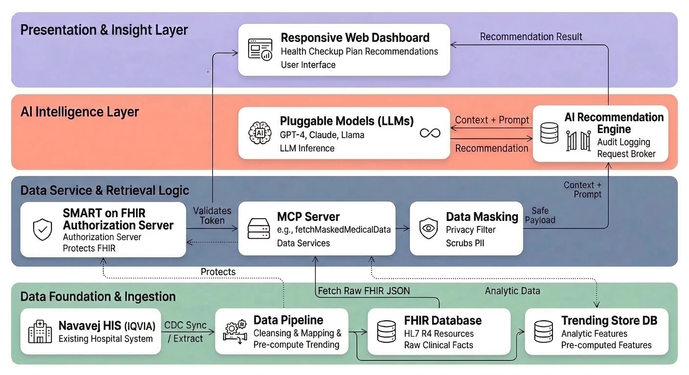
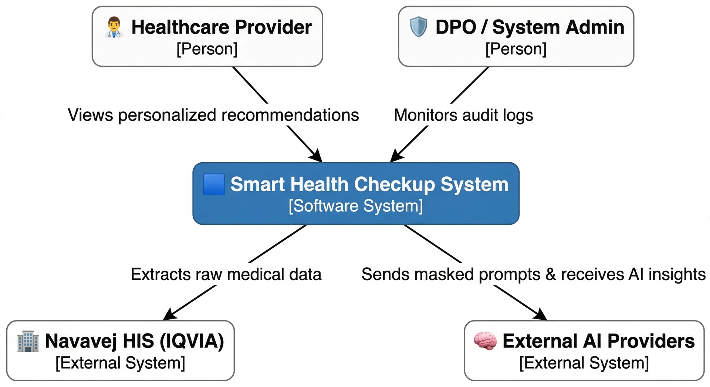
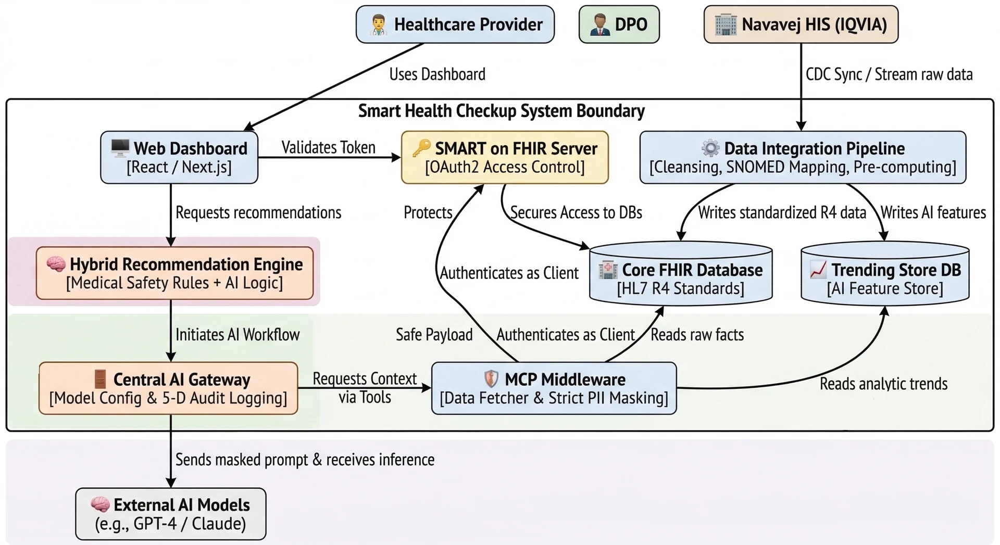

Technical Proposal - Smart Health Checkup Recommendation Dashboard


* 1. Executive Summary
    * 1.1 Introduction
    * 1.2 Background Information
    * 1.3 To-Be Vision & Core Value Proposition
* 2. Project Scope & Assumptions
    * 2.1 Scope of Work (In-Scope Deliverables)
    * 2.2 Out of Scope
    * 2.3 Key Assumptions & Dependencies
* 3. High-Level System Architecture
    * 3.1 Data flow
    * 3.2 Conceptual Architecture 
        * C4 Context Diagram 
        * C4 Container Diagram 
    * 3.3 Core Modules Overview
* 4. Data Platform & Integration Architecture
    * 4.1 Data Ingestion Strategy (Connecting to Navavej HIS)
    * 4.2 Data Pipeline at a Glance
    * 4.3 Data Conversion & Health Trend Pre-Computing
        * 4.3.1 Clinical Code Mapping (LOINC, SNOMED CT, ICD-10)
        * 4.3.2 Health Trend Pre-Computing (Velocity, Gaps, eGFR slope)
    * 4.4 Dual-Storage Strategy
        * 4.4.1 Core FHIR Database (Immutable Clinical Records)
        * 4.4.2 Trending Store Database (AI Analytical Feature Store)
    * 5. Data Platform Tech Stack
* 6. Security, Privacy & Data Governance
    * 6.1 SMART on FHIR Authorization (Access Control Gatekeeper)
    * 6.2 Data Masking & Pseudo-Anonymization Pipelines
    * 6.3 Comprehensive Audit Logging
* 7. AI & Recommendation Engine Architecture
    * 7.1 High-Level AI Workflow
    * 7.2 Model Context Protocol (MCP) Middleware (Secure Context Retrieval)
    * 7.3 Hybrid Recommendation Logic (Rule-based Safety + AI Inference)
    * 7.4 Central AI Gateway
        * 7.4.2 Pluggable LLM Configuration Management
        * 7.4.1 Explainable AI (XAI) & Confidence Scoring Generation
    * 7.5 AI Tech Stack
* 8. Frontend & Dashboards (User Experience)
    * 8.1 Responsive Web Application Architecture (Tech Stack)
    * 8.2 Healthcare Provider Dashboard (Summaries, Timelines, Action Items)
    * 8.3 DPO / System Admin Access Monitoring Dashboard (Anomaly Detection)
* 9. Deployment & Operational Architecture
    * 9.1 Target Environment Strategy (SaaS / Private Cloud)
    * 9.2 CI/CD Pipeline & Automation
    * 9.3 Observability & Monitoring (Grafana, CloudWatch, OpenTelemetry)
    * 9.4 Disaster Recovery (DR) & Backup Plan
* 10. Quality Assurance & Non-Functional Requirements (NFRs)
    * 10.1 Performance Metrics & SLAs
    * 10.2 Scalability & High Availability Matrix
    * 10.3 Medical Validation Strategy (Medical Acceptance Test / Expert Consensus)
    * 10.4 Safety "Fallback" Rules
* 11. Cost & Investment Plan
    * 11.1 Infrastructure Licensing & Cloud Costs
    * 11.2 Implementation & Professional Services
1. Executive Summary

1.1 Introduction

This technical proposal outlines the design, architecture, and implementation strategy for the Smart Health Checkup Recommendation Dashboard at Navavej Hospital. The primary objective is to develop an intelligent, AI-driven platform that systematically analyzes a patient’s historical medical data to recommend highly accurate, safe, and personalized health checkup programs. By combining international healthcare data standards (HL7 FHIR R4) with an advanced, pluggable Artificial Intelligence architecture (Model-Switching Architecture), the proposed system will elevate Navavej Hospital's services to a true "Personalized Medicine" approach. The solution inherently prioritizes security and privacy, utilizing strict Data Masking, SMART on FHIR authorization, and the Model Context Protocol (MCP) to ensure full compliance with PDPA and HIPAA regulations.
1.2 Background Information

Traditionally, health checkup programs are selected based on generic criteria such as age and gender. However, this generalized approach frequently leads to "Screening Gaps"—missed opportunities to identify hidden health risks or prioritize critical preventative care. Service recipients possess rich, longitudinal medical histories stored within the Navavej Hospital Information System (HIS / IQVIA SaaS), encompassing diagnoses, lab value velocities, biomarker trends (e.g., eGFR slope or BMI), and historical screening data.
To bridge the gap between this wealth of raw data and actionable clinical insights, Navavej requires a system capable of interpreting complex medical histories efficiently and securely. This entails moving away from manual, ad-hoc program selection toward a Hybrid Recommendation Engine (Rule-based combined with AI). The core challenge to realizing this vision is not only generating medically accurate recommendations but also standardizing the legacy data using international clinical code mapping (LOINC, SNOMED CT, ICD-10) and strictly safeguarding patient privacy before any data interacts with external AI models. This proposal presents a modular, highly secure technical blueprint designed specifically to leapfrog these challenges, while supporting seamless future AI upgrades without core system disruptions.
1.3 To-Be Vision & Core Value Proposition


The "To-Be" vision is a fully automated, transparent, and standardized workflow where raw clinical data transforms into highly personalized patient care without compromising a single data privacy boundary. The core value propositions of this platform are:
1. Precision and Personalization: The system will evaluate dozens of hard clinical markers (e.g., BMI velocity, JNC 8 blood pressure categories, genetic histories) to generate customized primary and "Add-On" examination recommendations that successfully close vital Screening Gaps.
2. Explainable AI (XAI) for Trust: Both healthcare providers and service recipients will receive clear, logical reasoning behind every AI recommendation alongside a Confidence Score, completely eliminating "black-box" medical uncertainty.
3. Zero-Trust Security by Design: Applying the SMART on FHIR authorization standard and the strict Least Privilege Model Context Protocol (MCP) ensures that PII is masked before any inference occurs, and every AI prompt is immutably logged for comprehensive auditing.
4. Future-Proof Pluggable Architecture: Exploring a Model-Switching AI Gateway guarantees Navavej Hospital flexibility. Administrators can effortlessly transition between frontier AI models (e.g., from GPT-4 to Claude 3.5 or an on-premise Local Llama model) via configuration screens, entirely avoiding vendor lock-in as technology advances.
2. Project Scope & Assumptions

2.1 Scope of Work (In-Scope Deliverables)

The implementation of the Smart Health Checkup Recommendation Dashboard encompasses the complete end-to-end delivery of the data, security, AI, and presentation layers.


Implementation Layer	Deliverables & Included Scope
Data Integration & Storage	•	Secure data extraction from Navavej HIS (IQVIA SaaS) via CDC sync.
	•	Automated processing and terminology mapping into international clinical codes (LOINC, SNOMED CT, ICD-10).
	•	Setup of the dual-storage architecture: Core FHIR Database & analytical Trending Store DB.
AI Recommendation Engine	•	Development of the Hybrid Recommendation Engine combining hard medical rules with AI logic.
	•	Delivery of the AI Gateway supporting pluggable, model-switching architecture.
	•	Implementation of the Model Context Protocol (MCP) Server for secure context retrieval.
Security & Compliance	•	SMART on FHIR authorization server acting as the gateway for all FHIR data.
	•	Strict Data Masking protocol within the MCP layer to eliminate PII leakage to the AI.
	•	Implementation of the immutable 5-Dimension Audit Log (Who, When, Where, What, Why).
User Interfaces (Web)	•	Healthcare Provider Dashboard: Screens displaying Individual Summaries, historical Trend Timelines (3-5 years), Screening Gaps, and Explainable AI reasoning.
	•	Admin/DPO Dashboard: Screens for Real-Time Access Monitoring and Behavior Anomaly Detection.
Testing & Deployment	•	Complete system containerization (Docker/Microservices).
	•	Medical Acceptance Testing (MAT) to ensure the AI hits the > 95% threshold of expert consensus.
	•	Performance testing to ensure strict SLA compliance (< 10-second latency).


2.2 Out of Scope

To ensure strict project boundaries and focus, the following items are excluded from this implementation phase:


Out-of-Scope Area	Description
Legacy HIS Replacement	The proposed solution acts as an intelligent add-on. It does not replace, refactor, or migrate the core functionality of the existing Navavej Hospital Information System (IQVIA).
Bi-Directional EMR Writes	The AI operates purely in a read-only state via the MCP server to deduce recommendations. It will not autonomously write back to or alter the core medical records in the HIS.
Financial / Billing AI	The AI scope is strictly limited to medical health checkup recommendations. Predictive models for hospital financial forecasting or billing are excluded.
Physical Hardware	Procurement, delivery, or maintenance of physical on-premise hardware servers is excluded (presuming standard cloud infrastructure usage).


2.3 Key Assumptions & Dependencies

The successful delivery of this architecture relies on the following baseline assumptions:


Dependency Domain	Assumption Statement
Data Availability	The existing Navavej HIS (IQVIA SaaS) supports and permits reliable, near-real-time data synchronization (e.g., CDC or robust APIs) necessary to populate the pipeline.
Medical Ruleset Support	Clinical experts at Navavej will provide the definitive "Safety Rules" (e.g., age limits, gender-specific checks) required to train and constrain the rule-based safety engine.
LLM Infrastructure	Commercial LLM API accounts (such as OpenAI/Anthropic) or provisioned local GPU hardware (if utilizing a localized LLM) will be funded or provided by the hospital.


3. High-Level System Architecture

3.1 Data flow


3.2 Conceptual Architecture 

C4 Context Diagram 

This diagram maps out the high-level interactions between the users, the proposed system, and the external legacy systems.


```flowchart TD
    %% Actors and External Systems
    Provider(["🧑‍⚕️ Healthcare Provider"])
    HIS["🏢 Navavej HIS (IQVIA)"]
    LLM["🧠 External AI Models (e.g., GPT-4 / Claude)"]

    %% System Boundary
    subgraph SystemBoundary [Smart Health Checkup System Boundary]
        direction TB
        
        WebApp["🖥️ Web Dashboard<br>[React / Next.js]"]
        Auth["🔑 SMART on FHIR Server<br>[OAuth2 Access Control]"]
        
        Pipeline["⚙️ Data Integration Pipeline<br>[Cleansing, SNOMED Mapping, Pre-computing]"]
        
        FHIR[("🏥 Core FHIR Database<br>[HL7 R4 Standards]")]
        Trend[("📈 Trending Store DB<br>[AI Feature Store]")]
        
        RecEngine["🧠 Hybrid Recommendation Engine<br>[Medical Safety Rules + AI Logic]"]
        AIGateway["🚪 Central AI Gateway<br>[Model Config & 5-D Audit Logging]"]
        MCP["🛡️ MCP Middleware<br>[Data Fetcher & Strict PII Masking]"]
    end

    %% Relationships
    Provider -->|Uses Dashboard| WebApp
    WebApp -->|Authenticates via| Auth
    WebApp -->|Requests recommendations| RecEngine
    
    HIS -->|CDC Sync / Stream raw data| Pipeline
    Pipeline -->|Writes standardized R4 data| FHIR
    Pipeline -->|Writes AI features| Trend
    
    Auth -.->|Secures Access to DBs| FHIR
    
    RecEngine -->|Initiates AI Workflow| AIGateway
    AIGateway -->|Requests Context via Tools| MCP
    
    MCP -->|Authenticates as Client| Auth
    MCP -->|Reads raw facts| FHIR
    MCP -->|Reads analytic trends| Trend
    
    AIGateway -->|Sends masked prompt & receives inference| LLM
```

C4 Container Diagram 

This diagram zooms inside the system boundary to show the high-level technical architecture, demonstrating how the Pluggable AI, dual-databases, and MCP Middleware interact safely.


mermaid

3.3 Core Modules Overview

To realize the "To-Be" architecture, the system is logically divided into 7 specialized, decoupled microservice modules:
1. Web Dashboard (Frontend UI): A responsive application (e.g., React/Next.js) serving 2 primary user groups. It provides:
    * Sales/Doctors: with the Individual Summary and Trend Timelines
    * DPO: with an Access Monitoring page for anomaly detection.
2. Data Integration Pipeline: A robust ETL engine that captures updates from the Navavej HIS via CDC sync. It handles data cleansing, strict clinical code mapping (LOINC, SNOMED CT, ICD-10), and the pre-computation of complex health trends (e.g., eGFR slope or BMI velocity).
3. Dual-Storage Databases: The data storage layer is deliberately split. The Core FHIR DB maintains immutable, standardized clinical records, while the Trending Store DB acts as a flexible AI Feature Store for pre-computed longitudinal data.
4. SMART on FHIR Authorization Server: The centralized OAuth 2.0 gatekeeper. It ensures that every request pulling from the databases—whether requested by a doctor's dashboard or the MCP context fetcher—operates under strict, resource-level scopes.
5. Hybrid Recommendation Engine: The orchestrator of the system's clinical logic. It applies deterministic "Safety Rules" (e.g., specific age/gender limits) before and after invoking the AI, ensuring medical safety acts as a fail-safe parachute alongside the statistical AI model.
6. Model Context Protocol (MCP) Middleware: A specialized, Read-Only data fetcher. It serves as the ultimate privacy filter, pulling records from the FHIR and Trending databases and strictly scrubbing all Personally Identifiable Information (PII) before the context is ever shared with the AI.
7. AI Gateway & Pluggable Models: A model-agnostic API router that bridges the masked context to frontier LLMs (e.g., GPT-4, Claude 3.5, Local Llama). Crucially, this module is also responsible for executing the immutable 5-Dimension Audit Logging (Who, When, Where, What, Why) for every single AI inference execution.
4. Data Platform & Integration Architecture

4.1 Data Ingestion Strategy (Connecting to Navavej HIS)

TBD
 Data team provide the tech explain
4.2 Data Pipeline at a Glance

<<diagram - tbd>> 
TBD
 Data team provide the tech explain
4.3 Data Conversion & Health Trend Pre-Computing

4.3.1 Clinical Code Mapping (LOINC, SNOMED CT, ICD-10)

A dedicated service converts "Local Codes" from Navavej's HIS into international standard codes:
* LOINC: For laboratory test result codes (Observations).
* SNOMED CT: For symptoms, diagnoses, and procedures (Conditions/Procedures).
* ICD-10: For disease classification.
TBD
 Data team provide the tech explain
4.3.2 Health Trend Pre-Computing (Velocity, Gaps, eGFR slope)

To optimize AI performance and ensure reliable medical accuracy, longitudinal calculations (e.g., BMI velocity over 12 months, eGFR slope decline) are explicitly pre-computed during this pipeline phase. Rather than relying on the AI to deduce complex math on the fly, these generated features are stored in a secondary, specialized Trending Store DB (an AI Feature Store). This enterprise pattern keeps the primary FHIR Database beautifully pristine for immutable clinical records while the Trending Store securely holds analytical AI features ready for instant AI context mapping.
TBD
 Data team provide the tech explain
4.4 Dual-Storage Strategy

4.4.1 Core FHIR Database (Immutable Clinical Records)

TBD
 Data team provide the tech explain
4.4.2 Trending Store Database (AI Analytical Feature Store)

TBD
 Data team provide the tech explain
5. Data Platform Tech Stack

TBD
 Data team provide the tech explain
6. Security, Privacy & Data Governance

6.1 SMART on FHIR Authorization (Access Control Gatekeeper)

TBD
 Diep
6.2 Data Masking & Pseudo-Anonymization Pipelines

TBD
 Diep + Data
6.3 Comprehensive Audit Logging

TBD
 Diep + Nguyen
7. AI & Recommendation Engine Architecture

7.1 High-Level AI Workflow

TBD
 Nguyen
7.2 Model Context Protocol (MCP) Middleware (Secure Context Retrieval)

TBD
 Nguyen
7.3 Hybrid Recommendation Logic (Rule-based Safety + AI Inference)

TBD
 Nguyen
7.4 Central AI Gateway

TBD
 Nguyen
7.4.2 Pluggable LLM Configuration Management

TBD
 Nguyen
7.4.1 Explainable AI (XAI) & Confidence Scoring Generation

TBD
 Nguyen
7.5 AI Tech Stack

TBD
 Nguyen
8. Frontend & Dashboards (User Experience)

8.1 Responsive Web Application Architecture (Tech Stack)

TBD
 Diep
8.2 Healthcare Provider Dashboard (Summaries, Timelines, Action Items)

TBD
 Diep
8.3 DPO / System Admin Access Monitoring Dashboard (Anomaly Detection)

TBD
 Diep
9. Deployment & Operational Architecture

TBD
 Diep
9.1 Target Environment Strategy (SaaS / Private Cloud)

9.2 CI/CD Pipeline & Automation

9.3 Observability & Monitoring (Grafana, CloudWatch, OpenTelemetry)

9.4 Disaster Recovery (DR) & Backup Plan

10. Quality Assurance & Non-Functional Requirements (NFRs)

TBD
 Diep
10.1 Performance Metrics & SLAs

10.2 Scalability & High Availability Matrix

10.3 Medical Validation Strategy (Medical Acceptance Test / Expert Consensus)

10.4 Safety "Fallback" Rules

11. Cost & Investment Plan

TBD
 Diep
11.1 Infrastructure Licensing & Cloud Costs

11.2 Implementation & Professional Services
