```mermaid
---
config:
  layout: dagre
---
flowchart LR
 subgraph SOURCES["Hospital Networks"]
        H1["Hospital A · HIS"]
        H2["Hospital B · HIS"]
        H3["Hospital C · HIS"]
  end
 subgraph PIPELINE["Data Pipeline  —  offline / batch"]
        FHIR_T["FHIR R4 Transform<br>Terminology Mapping<br>LOINC · SNOMED CT · ICD-10"]
        FE["Feature Engineering<br>Unit Conversion · Outlier Exclusion<br>BMI Trend · Lab Velocity · eGFR Slope<br>BP Category · Screening Gap · Symptom Mapper"]
        CSE["Clinical Signal Engine<br>Applies clinical guidelines<br>Risk Flags · Gap Detection · Abnormal Triggers<br>Hard Safety Constraints"]
  end
subgraph DATA_STORES["Data Stores"]
        SIGNAL_DB[("Signal Store<br>(pre-computed clinical signals)")]
        RULESET_DB[("Ruleset Store<br>(program selection rules)")]
        MODEL_CFG_DB[("Model Config Store<br>(model · API keys · routing)")]
        TPL_VAULT[("Prompt Template Vault<br>(per-model templates)")]
  end
 subgraph MCP_ZONE["MCP Server — Read-Only · Least Privilege"]
        MCP1["MCP Tool: get_clinical_signals"]
        MCP2["MCP Tool: get_biomarker_trends"]
        MCP3["MCP Tool: get_hard_constraints"]
        MCP4["MCP Tool: get_program_ruleset"]
  end
 subgraph AI_ENGINE["Pluggable AI Engine"]
        GW["AI Gateway<br>Pluggable — config-based model swap<br>GPT-4 ↔ Claude ↔ Local Llama"]
        TPL["Prompt Template Selector<br>Per-model · config-driven"]
        ORCH["Inference Orchestrator<br>Tool-Call Loop Manager<br>Context Assembler"]
        AI["Recommendation AI Model<br>Reasoning · Generation<br>Confidence Scores · Explanations"]
        OSV["Output Schema Validator<br>(BAML structured output)"]
        LOG["Audit Logger<br>prompt · context · response · model ID · latency<br>(immutable · PDPA)"]
  end
 subgraph PLATFORM["AI Inference Platform  —  query time"]
        MCP_ZONE
        PIIM["PII Masking<br>(de-identify)"]
        AI_ENGINE
        SRV["Safety Rule Validator<br>Post-AI hard constraint check"]
        FALLBACK["Fallback<br>Revoke item · log conflict<br>Return rule-only output"]
        DEG["Graceful Degradation<br>Rule-only output + review flag"]
        PIIR["PII Rehydration<br>(re-identify for display)"]
  end
 subgraph OUTPUT["Output Layer"]
        DASH["ROC Dashboard<br>Explainable AI · Confidence Score"]
        PLAN["Personalized Checkup Plan<br>+ Communication Script"]
        ADMIN["SalesAdmin<br>Human-in-the-loop Review"]
        APP{"Approved?"}
  end
 subgraph FB["Feedback"]
        FBS["Feedback Store<br>Rejection Reasons<br>Model Improvement Input"]
  end
    H1 --> FHIR_T
    H2 --> FHIR_T
    H3 --> FHIR_T
    FHIR_T --> FE
    FE --> CSE
    CSE --> SIGNAL_DB[("Signal Store<br>(pre-computed clinical signals)")]
    ADMIN_PANEL[["Admin Panel<br>(configures ruleset + AI)"]] -- configure rules --> RULESET_DB[("Ruleset Store<br>(program selection rules)")]
    ADMIN_PANEL -- configure AI --> MODEL_CFG_DB[("Model Config Store<br>(model · API keys · routing)")] & TPL_VAULT[("Prompt Template Vault<br>(per-model templates)")]
    SIGNAL_DB -- "read-only" --> MCP1 & MCP2 & MCP3
    RULESET_DB -- "read-only" --> MCP4
    MODEL_CFG_DB L_MODEL_CFG_DB_AI_ENGINE_0@-. read .-> AI_ENGINE
    TPL_VAULT -. load .-> AI_ENGINE
    MCP_ZONE --> PIIM
    PIIM --> AI_ENGINE
    GW --> TPL
    TPL --> ORCH
    ORCH --> AI
    AI --> OSV
    OSV --> LOG
    LOG --> SRV
    AI_ENGINE -. tool calls .-> MCP_ZONE
    SRV -- All pass --> PIIR
    SRV -- Violation detected --> FALLBACK
    FALLBACK -. "rule-only output" .-> PIIR
    FALLBACK -. AI unavailable .-> DEG
    DEG -. "rule-only output" .-> PIIR
    PIIR --> DASH & PLAN
    DASH --> ADMIN
    PLAN --> ADMIN
    ADMIN --> APP
    APP -- Yes --> EXT["External System<br>(Order / Booking)"]
    APP -- No --> FBS
    EXT --> FBS

    style FHIR_T      fill:#E8F5E9,stroke:#2E7D32,color:#000
    style FE          fill:#F3E5F5,stroke:#7B1FA2,color:#000
    style CSE         fill:#FFF3E0,stroke:#E65100,color:#000
    style MCP1        fill:#E0F2F1,stroke:#00695C,color:#000
    style MCP2        fill:#E0F2F1,stroke:#00695C,color:#000
    style MCP3        fill:#E0F2F1,stroke:#00695C,color:#000
    style MCP4        fill:#E0F2F1,stroke:#00695C,color:#000
    style GW          fill:#E8F5E9,stroke:#2E7D32,color:#000
    style TPL         fill:#FFF8E1,stroke:#F9A825,color:#000
    style ORCH        fill:#D1C4E9,stroke:#4527A0,color:#000
    style AI          fill:#E3F2FD,stroke:#1565C0,color:#000
    style OSV         fill:#FFF8E1,stroke:#F9A825,color:#000
    style LOG         fill:#E8EAF6,stroke:#283593,color:#000
    style PIIM        fill:#FFEBEE,stroke:#C62828,color:#000
    style SRV         fill:#FFEBEE,stroke:#C62828,color:#000
    style FALLBACK    fill:#FFEBEE,stroke:#C62828,color:#000
    style DEG         fill:#FFF9C4,stroke:#F57F17,color:#000
    style PIIR        fill:#FFEBEE,stroke:#C62828,color:#000
    style SIGNAL_DB    fill:#F5F5F5,stroke:#424242,color:#000
    style ADMIN_PANEL  fill:#FCE4EC,stroke:#880E4F,color:#000
    style RULESET_DB   fill:#FFF3E0,stroke:#E65100,color:#000
    style MODEL_CFG_DB fill:#FCE4EC,stroke:#880E4F,color:#000
    style TPL_VAULT    fill:#FFF8E1,stroke:#F9A825,color:#000
```

# High-Level Architecture — AI Recommendation Platform (v3)

**Key architectural principles:**
- All data transformation, feature engineering, and rule-based processing happen **offline in the data pipeline** and are stored pre-computed in a database. The AI never has direct access to source systems.
- The **MCP Server** sits close to the AI model and provides a controlled, read-only interface for retrieving pre-computed signals. The AI Engine can call MCP tools on demand during reasoning (bidirectional tool-calling loop).
- **SMART on FHIR Auth** enforces scope-based access control at the platform entry before any data is retrieved.
- **PII Masking** transforms raw MCP output (removes known PII fields) before context reaches the AI Engine.
- **Pluggable AI Engine** encapsulates the gateway (model config), prompt template selector, AI model, output schema validator, and a single post-inference audit logger that captures the full round-trip. Swapping models requires only a config change.
- **Model Config Store** and **Prompt Template Vault** are admin-configurable and read by the AI Gateway at inference time — no code changes required to swap models.
- **Clinical Signal Engine** applies clinical guidelines (e.g. JNC 8, ACS) to produce structured signals. **Program Selection Ruleset** is a separate, admin-configurable layer that maps those signals to program recommendations — decoupling medical logic from business configuration.

---

---

## Color Legend

| Color | Zone / Meaning |
|-------|---------------|
| 🟢 Green (light) | FHIR Transform / Data Standards |
| 🟣 Purple | Feature Engineering |
| 🟠 Orange | Rule-Based Processing (Clinical Signal Engine + Program Selection) |
| 🩷 Pink | Admin-configurable inputs (Ruleset + Model Config) |
| ⬜ Grey | Pre-processed Signal Store (DB) |
| 🟩 Teal | MCP Tools (controlled read-only query interface) |
| 🔴 Red | PII Protection + Safety Enforcement + SMART on FHIR Auth |
| 🟡 Yellow | Prompt Template Management + Output Schema Validation |
| 🔵 Indigo | Audit Logging (PDPA) |
| 🟢 Green (dark) | AI Gateway (Pluggable) |
| 🔵 Blue | AI Reasoning Model |
| 🌕 Amber | Graceful Degradation / Fallback |

---

## Architectural Separation of Concerns

| What | Where | When |
|------|-------|------|
| FHIR Transform + Terminology Mapping | Data Pipeline | Offline / batch |
| Feature Engineering (trends, velocities, gaps) | Data Pipeline | Offline / batch |
| Clinical Signal Engine (guideline-driven flags & triggers) | Data Pipeline | Offline / batch |
| Program Selection Ruleset (admin-configured via Admin Panel) | Ruleset Store | On demand (admin update) |
| Model config + Prompt templates (admin-configured via Admin Panel) | Model Config Store · Prompt Template Vault | On demand (admin update) |
| Scope-based access control | SMART on FHIR Auth | Query time |
| Controlled data retrieval interface for AI (bidirectional tool calls) | MCP Server | Query time |
| PII Masking (transform raw MCP output) | AI Inference Platform | Query time |
| Model config → prompt template selection → inference | Pluggable AI Engine | Query time |
| Output schema enforcement (BAML structured output) | Pluggable AI Engine | Query time |
| Audit logging — full round-trip (Prompt/Context/Response) | Pluggable AI Engine | Query time |
| Post-AI safety validation | AI Inference Platform | Query time |

---

## How the Two Rule Layers Differ

| Layer | Driven by | Configurable by | Output |
|-------|-----------|-----------------|--------|
| **Clinical Signal Engine** | Clinical guidelines (JNC 8, ACS, etc.) | Clinical / dev team (versioned) | Risk flags, screening gaps, biomarker triggers, hard constraints → **Signal Store** |
| **Program Selection Ruleset** | Business & hospital policy | Admin panel (no code change) | Mapping rules: signals → program tier + add-ons → **Ruleset Store** |

---

## How the MCP Tools Map to Requirements

| MCP Tool | Returns (pre-computed) | Committee Criterion |
|----------|----------------------|---------------------|
| `get_clinical_signals` | Risk flags, gaps, abnormal triggers ← Signal Store | 35% Hybrid mechanism |
| `get_biomarker_trends` | BMI trend, lab velocity, eGFR slope ← Signal Store | 35% Hybrid mechanism |
| `get_hard_constraints` | Gender/age eligibility, safety rules ← Signal Store | 35% Hybrid mechanism + 20% Safety |
| `get_program_ruleset` | Admin-configured mapping rules ← Ruleset Store | 25% Pluggable architecture |
