```mermaid
---
config:
  layout: dagre
---
flowchart LR
  subgraph SOURCES["Hospital Networks"]
    H["HIS Systems<br>Hospital A · B · C"]
  end

  subgraph PIPELINE["Data Pipeline — offline / batch"]
    P["FHIR R4 Transform<br>Feature Engineering<br>Clinical Signal Engine"]
  end

  subgraph STORES["Data Stores"]
    DS["Signal Store · Ruleset Store<br>Model Config · Prompt Templates"]
  end

  ADMIN[["Admin Panel<br>(configures ruleset + AI)"]]
  REQ(["Recommendation Request<br>(ROC Staff)"])

  subgraph REC_PLATFORM["Recommendation Platform"]
    subgraph MCP["MCP Server — Read-Only · Least Privilege"]
      MCPT["get_clinical_signals · get_biomarker_trends<br>get_hard_constraints · get_program_ruleset"]
    end

    subgraph PII_SAFETY["PII & Safety"]
      PS["SMART on FHIR Auth<br>PII Masking · Safety Rule Validator<br>Fallback · Graceful Degradation<br>PII Rehydration"]
    end

    subgraph AI_ENGINE["Pluggable AI Engine"]
      AIE["AI Gateway · Prompt Templates<br>Inference Orchestrator · AI Model<br>Schema Validator · Audit Logger"]
    end
  end

  subgraph OUTPUT["Output Layer"]
    OUT["ROC Dashboard · Personalized Plan<br>SalesAdmin Review · Approval"]
  end

  FBS[("Feedback Store<br>Rejection Reasons<br>Model Improvement Input")]

  SOURCES --> PIPELINE
  PIPELINE --> STORES
  ADMIN -- "configure rules + AI" --> STORES
  REQ -- "recommendation request" --> REC_PLATFORM
  STORES -- "signals / rules (read-only)" --> MCP
  STORES -. "model config & templates" .-> AI_ENGINE
  MCP --> PII_SAFETY
  PII_SAFETY --> AI_ENGINE
  AI_ENGINE -. "tool calls" .-> MCP
  AI_ENGINE --> PII_SAFETY
  PII_SAFETY --> OUTPUT
  OUTPUT --> FBS

  style PIPELINE      fill:#E8F5E9,stroke:#2E7D32,color:#000
  style STORES        fill:#F5F5F5,stroke:#424242,color:#000
  style ADMIN         fill:#FCE4EC,stroke:#880E4F,color:#000
  style MCP           fill:#E0F2F1,stroke:#00695C,color:#000
  style PII_SAFETY    fill:#FFEBEE,stroke:#C62828,color:#000
  style AI_ENGINE     fill:#E3F2FD,stroke:#1565C0,color:#000
  style REC_PLATFORM  fill:#F3F8FF,stroke:#1A237E,color:#000,stroke-width:2px
```

# Very-High-Level Architecture — AI Recommendation Platform (v3)

Each block below represents a major zone from the detailed high-level diagram. All PII protection, access control, safety validation, and data re-identification are consolidated into the **PII & Safety** block.

---

---

## Block Contents

| Block | Contains |
|-------|----------|
| **Hospital Networks** | Hospital A · B · C HIS systems |
| **Data Pipeline** | FHIR R4 Transform · Feature Engineering · Clinical Signal Engine |
| **Data Stores** | Signal Store · Ruleset Store · Model Config Store · Prompt Template Vault |
| **Admin Panel** | Admin-configurable ruleset + AI model settings (no code change) |
| **Recommendation Platform** | MCP Server · PII & Safety · Pluggable AI Engine |
| ↳ **MCP Server** | `get_clinical_signals` · `get_biomarker_trends` · `get_hard_constraints` · `get_program_ruleset` |
| ↳ **PII & Safety** | SMART on FHIR Auth · PII Masking · Safety Rule Validator · Fallback · Graceful Degradation · PII Rehydration |
| ↳ **Pluggable AI Engine** | AI Gateway · Prompt Template Selector · Inference Orchestrator · AI Model · Output Schema Validator · Audit Logger |
| **Output Layer** | ROC Dashboard · Personalized Checkup Plan · SalesAdmin Review · Approval decision |
| **Feedback Store** | Rejection reasons · Model improvement input |
