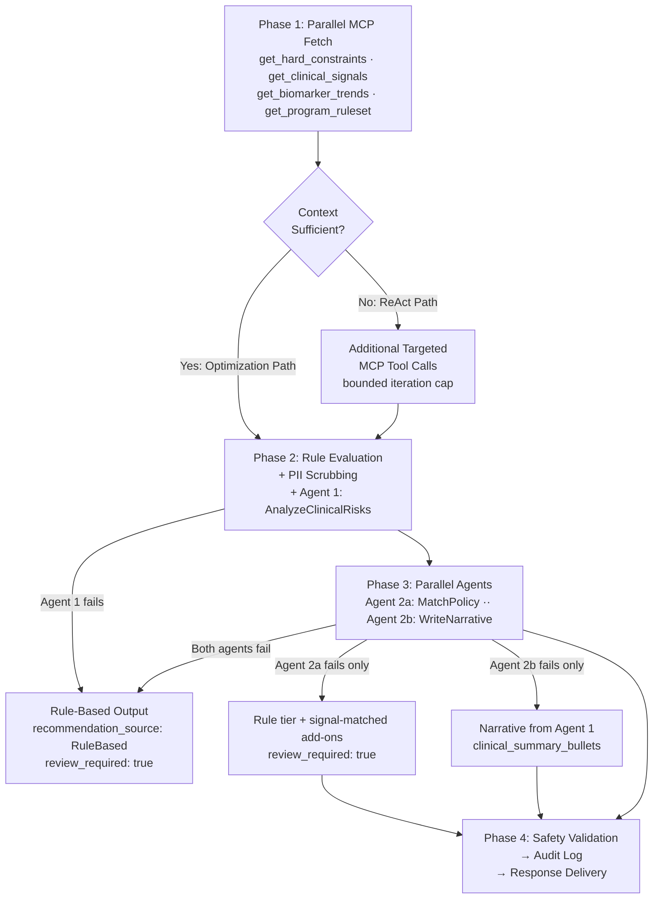

# 7.1 High-Level AI Workflow

The AI recommendation pipeline is orchestrated as a four-phase asynchronous loop. To balance inference quality against latency and cost, the pipeline supports two complementary execution paths that converge on the same three-agent chain.

### Two-Path Design

**Optimization Path (default)** — For cases where the standard clinical data set is sufficient, four MCP context tools are fetched in parallel upfront. If the assembled context is deemed complete, the pipeline proceeds directly to the agent chain with no additional tool calls.

**ReAct Path (data-gap cases)** — When the AI determines that the prefetched context is insufficient for a high-quality recommendation, it issues additional targeted MCP tool calls before proceeding. The number of additional calls is bounded by a configured iteration cap to prevent unbounded latency.

Both paths converge at Agent 1 and follow the same agent chain and post-processing steps from that point forward.

\###Four-Phase Pipeline

| Phase                                                   | Steps                                                                                                                                                                | Notes                                                                         |
| ------------------------------------------------------- | -------------------------------------------------------------------------------------------------------------------------------------------------------------------- | ----------------------------------------------------------------------------- |
| **Phase 1 — Context Fetch**                             | 4 MCP tools called in parallel (`get_hard_constraints`, `get_clinical_signals`, `get_biomarker_trends`, `get_program_ruleset`)                                       | No ordering dependency between tools; all results assembled before proceeding |
| **Phase 2 — Rule Evaluation + PII Scrubbing + Agent 1** | Deterministic rule tier computed from active signals; PII fields scrubbed from context; Agent 1 (`AnalyzeClinicalRisks`) produces a structured clinical risk profile | Agent 1 failure triggers immediate full rule-based fallback                   |
| **Phase 3 — Agent 2a + Agent 2b (parallel)**            | Agent 2a (`MatchPolicy`) selects programme tier and add-ons; Agent 2b (`WriteNarrative`) produces patient-facing communication script; both run concurrently         | Either agent can fail independently; per-field fallback applied               |
| **Phase 4 — Safety Validation + Audit + Response**      | `SafetyRuleValidator` filters gender/age/contraindication-ineligible add-ons; audit log written synchronously; response delivered to caller                          | Frontend resolves patient identity from `patient_id` at display time          |

\###Workflow Diagram

### Graceful Degradation

The pipeline is designed to always produce a recommendation. Failures are handled at the coarsest applicable boundary:

- **Agent 1 failure** → full rule-based output; AI chain bypassed entirely
- **Agent 2a (`MatchPolicy`) failure only** → rule-based tier applied; signal-matched add-ons substituted; `review_required: true`
- **Agent 2b (`WriteNarrative`) failure only** → narrative constructed from Agent 1 clinical summary bullets
- **Both Agent 2a and 2b failure** → full rule-based output

In degraded states where the AI tier is unavailable (Agent 1 failure, Agent 2a failure, or both Agent 2a and 2b failure), `recommendation_source` is set to `"RuleBased"` and `review_required` is set to `true`, signalling to the clinical UI that human review is required before acting on the recommendation. When only Agent 2b fails, the AI-selected tier and add-ons are retained and `recommendation_source` remains `"AI"` — only the patient-facing narrative is degraded.
